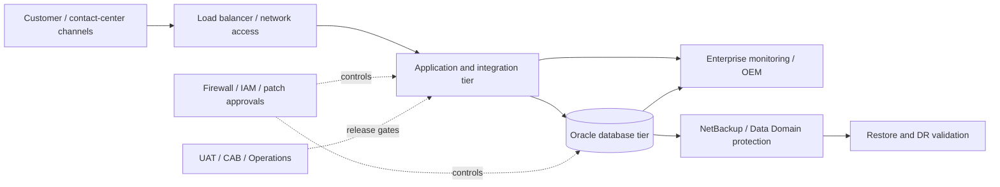

# SAFe 6.01 in Action: Enterprise Banking Infrastructure, Reliability & Release Delivery

**Technical + business case study | Meghna Shah | SAFe 6.01 certified**

> **Experience and case-study scope:** My ICICI Bank background includes enterprise backup and recovery, EMC Data Domain, Veritas NetBackup, Oracle Enterprise Manager monitoring, vendor coordination, infrastructure readiness, QA/UAT and production releases. This case study applies **SAFe 6.01 methods to a reconstructed infrastructure modernization scenario** to demonstrate my technical decision-making and program leadership. The example ART, server configurations, PI dates, dependency tickets and acceptance test data are **illustrative**, not a claim that ICICI Bank operated this exact SAFe structure. Documented career outcomes are identified separately.

## 1. Executive scenario — the business problem

**The challenge:** A large banking service environment has customer-facing applications, IVR/workforce management integrations, Oracle databases, server clusters, shared storage, backup appliances, monitoring agents, network zones, firewalls and external vendors. Business teams need uninterrupted customer access while technical teams must modernize monitoring, improve backup success, patch vulnerable systems and release application changes.

A traditional project schedule can say **“server ready”** while the deployment still fails because the SAN LUN is not presented, the Oracle agent is incompatible with the OS, the firewall blocks a monitoring port, a restore has never been tested, or UAT is waiting for the vendor's fix. The program problem is **end-to-end service readiness**, not individual task completion.

**Business goals:** protect customer-service continuity; shorten issue resolution; make recovery demonstrable; reduce failed releases; provide transparent ownership of infrastructure/vendor dependencies; meet security and audit requirements. Banking platforms require reliable availability, recovery and controlled change management.

### My professional foundation (documented career results)

| Enterprise evidence from my experience | Why it matters to the business |
|---|---|
| Enterprise backup success improved from approximately **65% to 99%** | More recoverable jobs and lower exposure to failed data protection |
| Oracle Enterprise Manager monitoring across **300+ production databases** | Proactive visibility across critical application tiers |
| Customer-facing banking technology | Reliability and change management at significant service scale |
| Reported **99.95% platform availability**, **45% MTTR reduction**, **99% SLA compliance**, **18% lower customer wait time**, and **10% higher CSAT** | Business-level indicators from my broader enterprise operations background, **not outcomes attributable to the illustrative SAFe program** |

## 2. SAFe 6.01 structure — how I would organize the program

**Value stream:** customer service availability and dependable technology change. **Illustrative Agile Release Train (ART):** application/integration, DBA/data, compute/OS, storage/backup, network/security, and QA/operations teams. This is a proposed coordination structure, not a historical organization chart.

| SAFe component | Technical execution | Business decision/value |
|---|---|---|
| **Lean Portfolio Management (LPM)** | Align modernization epics to reliability, compliance and service objectives; capture lean business cases | Fund highest-risk/highest-value work, not the loudest request |
| **ART / shared Program Increment (PI)** | Align teams around integrated features, technical enablers, capacity and dependencies | One cross-team delivery commitment |
| **Business Owners + Product Management** | Define customer-impact priorities and measurable outcomes | Connect technology spend to customer availability |
| **System Architect/Engineering** | Review CPU/RAM, storage IOPS, DB compatibility, network zones, HA, security and recovery | Reduce architecture and integration risk |
| **RTE / Scrum Masters / Product Owners** | Facilitate PI Planning, ART Sync, impediment removal, iteration objectives and backlog clarity | Increase delivery predictability; I partner with these roles rather than claim to have held every role |
| **Technical Program Manager / IT Project Coordinator** | Maintain dependency board, vendor SOW/SLAs, RAID, milestone tracker, CAB/UAT evidence and executive decisions | Turn cross-team uncertainty into owned, testable deliverables |
| **System Demo + Inspect & Adapt** | Demonstrate monitored services, restore tests and UAT-ready releases; analyze defects and flow | Detect gaps before production and improve future increments |

**SAFe 6.01 practices applied:** PI Planning, ART Sync, Scrum of Scrums, PO Sync, ROAM risk handling, WSJF prioritization where useful, built-in quality, continuous integration/delivery concepts, System Demo, Inspect & Adapt, and flow metrics. Certification gives me the framework; the case study shows how I would apply it to real infrastructure dependencies.

## 3. Technical architecture and readiness criteria

*Architecture is a conceptual representation of interdependent banking services; it is not a diagram of an actual ICICI network.*

| Layer | Engineering decision / example acceptance criterion | What I coordinate or verify |
|---|---|---|
| **Compute** | Server/VM type, vCPU/cores, RAM, OS/kernel, hypervisor compatibility, N+1 headroom; e.g., illustrative **8-vCPU/32-GB** application VM | Capacity baseline, vendor sizing proposal, utilization evidence, OS support matrix, procurement dates |
| **Storage** | SAN FC/iSCSI block vs NAS file vs backup appliance; usable TB, RAID, IOPS, latency, growth, retention, replication | Workload-to-storage fit, capacity calculations, recovery targets, vendor compatibility and restore proof |
| **Network** | Copper/fiber NIC and uplink speeds, VLAN/subnet, DNS, routing, load balancer, firewall source/destination/port matrix | Network readiness tickets, firewall approval, connectivity/latency tests, rollback ownership |
| **Database** | Oracle version/patch set, OEM agent certification, memory/connection limits, backup consistency | DBA sign-off, performance baseline, agent compatibility, recovery test |
| **Security** | Least privilege, patch/CVE remediation, TLS certificates, service accounts, access logging | Security acceptance, approved exception register, audit evidence and maintenance window |
| **Resilience** | Availability target, RTO/RPO, backup window, alerting, DR restore and failover tests | SLA and recovery acceptance criteria; business sign-off |

**Example capacity decision (not historical):** For a 5-TB logical database estate growing 20% annually, raw backup capacity is not simply 5 TB × retention days. Assess full/incremental change rate, deduplication ratio, replication copies, restore bandwidth, target retention and peak backup window. Compare vendor options using a documented technical scorecard before purchase.

## 4. Case-study incident: OEM monitoring upgrade blocked by network and compatibility dependencies

**Situation (reconstructed):** A monitoring agent rollout appears complete in the deployment tracker, but alerts from a subset of Oracle instances do not reach the central console. A release date is approaching and the DBA, OS, network/security and vendor teams have different views of readiness.

**Problem analysis — what I would drive:**

1. **Triage symptoms:** collect agent status, OEM target status, timestamps, listener/network connectivity results, OS logs and patch versions; distinguish an agent failure from firewall/DNS/credential problems.
2. **Build a compatibility matrix:** Oracle DB version × OEM agent version × Linux/Unix version × vendor-certified patch level; identify unsupported combinations before production.
3. **Verify connectivity:** check source/destination IP, VLAN, DNS, routing, firewall ports, TLS certificate chain and network change ticket; use approved connectivity tests with network/security owners.
4. **Isolate the blocker:** compare a healthy target with a failing target; link the failure to a version mismatch, access restriction or configuration drift only after log evidence confirms it.
5. **Coordinate remediation:** assign DBA, network/security, monitoring vendor and QA owners; request a supported agent build or firewall change; document decision, due date and fallback.
6. **Prove the fix:** generate a controlled test alert; confirm alert ingestion, routing, acknowledgement, incident assignment and dashboard visibility; retest after restart/failover.
7. **Release gate:** require security approval, DBA acceptance, UAT evidence, rollback, CAB and operations handover before a phased production rollout.

**Example acceptance tests:** `AT-01` agent reports healthy status; `AT-02` a controlled threshold breach generates an alert within the agreed SLA; `AT-03` alert routes to the correct on-call queue; `AT-04` no regression in database response time; `AT-05` rollback restores previous monitoring state. These IDs and test cases are sample portfolio artifacts.

**Business impact mechanism:** fewer blind spots → earlier detection → faster incident triage → less avoidable service disruption. The historical monitoring coverage of **300+ databases** demonstrates relevant scale; this particular example is not a documented incident ticket.

## 5. PI Planning — from technical problems to an executable delivery plan

**Illustrative 10-week PI:** four two-week development iterations plus an innovation/planning interval. Actual SAFe PI cadence depends on the organization.

| PI objective / feature | Dependencies and technical deliverable | Exit evidence | Business priority |
|---|---|---|---|
| **F1 Monitoring coverage** | DBA inventory → vendor agent compatibility → firewall rule → staged rollout | Alert routing and coverage dashboard | Reduce detection gaps |
| **F2 Recoverable backup** | Storage capacity → NetBackup policy → Data Domain target → restore drill | Backup success report and timed restore | Protect critical data |
| **F3 Secure infrastructure** | OS patch → app/DB compatibility → vulnerability scan → security approval | Approved patch and regression results | Lower security exposure |
| **F4 Customer-service release** | App/API integration → IVR/WFM tests → QA/UAT → CAB | Signed UAT, smoke tests and rollback | Preserve customer experience |
| **F5 Operational handover** | Monitoring/runbooks → on-call ownership → hypercare exit | Service acceptance checklist | Sustain availability |

**PI Planning steps:** (1) share business outcomes and architecture vision; (2) size team capacity, vendor lead times and freeze windows; (3) decompose features into testable stories/enablers; (4) map cross-team dependencies on the program board; (5) identify and ROAM risks; (6) set committed and uncommitted objectives; (7) agree on confidence, owners and escalation thresholds.

**Prioritization example:** WSJF can compare relative Cost of Delay (user/business value + time criticality + risk reduction/opportunity enablement) against job size. For a bank, an expiring security patch or untested recovery path may take priority over a low-risk dashboard enhancement. Numerical scores require stakeholder agreement, not invented precision.

## 6. A real TPM / IT project coordinator's operating controls

| Artifact I manage | Technical content | Decision or business value |
|---|---|---|
| **Dependency / program board** | Team, deliverable, prerequisite, committed date, evidence, blocked age | Exposes release-critical cross-team gaps |
| **RAID log** | Risks, assumptions, issues, dependencies; probability, impact, owner, mitigation | Prevents hidden delivery surprises |
| **Vendor SOW & SLA tracker** | Supported firmware/agent, delivery milestones, response/restore SLAs, acceptance criteria | Makes supplier accountability measurable |
| **Technical readiness checklist** | Server CPU/RAM, storage IOPS/TB, VLAN/ports, firewall, OS/DB compatibility, monitoring | Prevents “installed but unusable” releases |
| **UAT traceability matrix** | Business requirement → test ID → environment → defect → retest → sign-off | Connects user needs to tested evidence |
| **Cutover / rollback runbook** | T− checkpoints, change window, command owners, go/no-go, smoke tests, fallback | Protects production availability |
| **Executive dashboard** | PI objective status, critical dependency aging, defects, vendor adherence, service KPIs | Supports timely leadership decisions |

### Vendor escalation — reconstructed example

**Problem:** The storage/monitoring supplier cannot confirm that a proposed firmware or agent version is certified for the existing Oracle/OS combination, jeopardizing the cutover.

**My coordination approach:** record the exact version matrix and failed validation; open a severity-rated vendor support case; reference SOW acceptance criteria and agreed response SLA; set a joint DBA/vendor/security triage; ask for a supported version or documented workaround; quantify the release risk; escalate at the contractual milestone; retain a rollback/deferral option. **Acceptance:** written vendor support confirmation plus successful staging regression and restore/monitoring tests. This demonstrates vendor management as technical delivery, not purchase-order administration.

## 7. UAT, compatibility, change approval and production timeline

| Gate | Required technical proof | Owner / outcome |
|---|---|---|
| **T−20 to T−15 business days** | Requirements, criticality, server/storage/network sizing, architecture review | TPM coordinates baseline and owners |
| **T−14 to T−10** | Vendor compatibility matrix, OS/DB/agent certification, firewall approvals | Vendor + infrastructure + security |
| **T−9 to T−6** | Integration tests, negative tests, backup/restore, failover where applicable | DBA/QA/operations evidence |
| **T−5 to T−3** | UAT scenarios for login, transaction/service flow, IVR routing, WFM integration, alerting | Business owner and QA sign-off |
| **T−2 to T−1** | Defect disposition, CAB/change ticket, security approvals, rollback rehearsal, go/no-go | Change authority and service owner |
| **T0 deployment** | Prechecks, controlled cutover, DB/app health, smoke tests, monitoring, business acceptance | Release bridge with named decision owners |
| **T+1 to T+5** | Hypercare, incident triage, KPI comparison, knowledge transfer, vendor closure | Operations service acceptance |

**Example defect management:** A UAT IVR transfer succeeds in staging but fails under production-like firewall segmentation. Raise defect with timestamp, source/destination, trace ID and expected/actual result; link it to the network rule dependency; retest end-to-end after approval; block go-live if customer-impacting. This is a **sample problem-solving scenario**, not a claim about a particular historical defect.

## 8. Inspect & Adapt — engineering and business measurement

| Leading indicator | Technical definition | Business interpretation |
|---|---|---|
| PI objective achievement | Objectives met vs planned, with business-owner scoring | Delivery predictability |
| Dependency aging | Days a release-critical item remains blocked | Early warning of schedule risk |
| Change failure rate | Changes requiring rollback/hotfix ÷ total changes | Production release quality |
| Backup success | Successful scheduled jobs ÷ total scheduled jobs | Data protection coverage |
| Recovery test pass rate | Successful validated restores ÷ restore attempts | Demonstrated recoverability |
| Monitoring coverage | Healthy monitored critical targets ÷ in-scope targets | Operational visibility |
| MTTR | Average time to restore service after incident | Customer disruption duration |
| SLA / availability | Service availability and contractual compliance | Trust and continuity |
| UAT defect escape | Defects found after UAT relative to total relevant defects | Readiness effectiveness |

**Financial value — calculate, don't invent:** Estimate annual avoided outage exposure as `verified outage hours avoided × finance-approved cost per outage hour`, then add validated support effort savings and vendor cost reductions, avoiding double counting. Customer base size alone does **not** establish dollar savings. 

**How SAFe creates growth capacity:** shorter dependency queues, fewer avoidable production failures, clearer vendor commitments and more reliable services can free engineering capacity for product enhancements, support better customer experiences and reduce operational waste. These are value pathways, not a fabricated revenue attribution.

## 9. Learning-to-execution map — what my SAFe 6.01 certification adds

| SAFe 6.01 learning | Application to infrastructure / customer technology | Evidence a hiring manager can review |
|---|---|---|
| Business agility and value streams | Define end-to-end customer-service reliability outcome | Value-stream map and PI objectives |
| ART and PI Planning | Coordinate application, DBA, storage, network, QA and vendors | [Sample PI dependency board](../templates/safe-6-01-pi-dependency-board.csv) |
| Built-in quality | Define compatibility, security, restore and UAT gates | [Sample UAT traceability matrix](../templates/safe-6-01-uat-traceability.csv) |
| DevOps and continuous delivery | Automate and validate deployments with controlled approvals | [AWS/DevOps project portfolio](../README.md#20-aws--devops-projects) |
| ROAM and risk management | Resolve or escalate security, capacity and vendor blockers | [RAID template](../templates/RAID-log.csv) |
| System Demo and Inspect & Adapt | Show working integration, analyze defects and service KPIs | Acceptance criteria and KPI framework above |
| Lean Portfolio / WSJF | Prioritize resilience, compliance and customer impact | Relative-priority example in Section 5 |

## 10. Why this case study matters for the roles I target

**Technical Program Manager:** I can connect architecture constraints, cross-team execution, release readiness and executive business outcomes. **IT Project Manager / Coordinator:** I can own dependency and vendor tracking, acceptance evidence, milestone risk, UAT and cutover coordination. **Cloud / DevOps Program Coordinator:** I can apply the same controls to cloud infrastructure, IaC, CI/CD and observability workstreams. **Enterprise Infrastructure Operations:** I understand the consequences of storage, backup, database, network and monitoring readiness for real customer services.

**Bottom line:** SAFe 6.01 is valuable here because it provides a repeatable system for delivering complex technical changes across multiple teams. My enterprise infrastructure background supplies the operational judgment; the framework helps turn that judgment into transparent planning, tested outcomes and continuous improvement.
