# Jenkins Backup and Restore using AWS S3

**Source:** Original supplied project document. Technical steps and screenshots are reproduced for portfolio review.

**Before publishing:** Review every screenshot for credentials, IP addresses, customer information and private account details.

📌 Jenkins Backup and Restore using AWS S3

1. Project Title

Automated Backup and Restore Solution for Jenkins using AWS S3

2. Objective

To implement a reliable and automated backup and restore mechanism for Jenkins data using AWS S3, ensuring data protection, minimal downtime, and quick disaster recovery.

3. Problem Statement

TechNova Inc. experienced a critical failure where the Jenkins server crashed, leading to loss of build jobs and configurations. This incident highlighted the absence of a backup system.

The goal of this project is to:

Automate Jenkins backups

Store backups securely in AWS S3

Enable fast and reliable restoration

4. Industry Relevance

As per the case study:

Jenkins → CI/CD automation tool widely used in DevOps

```text
Git → Version control for managing source code
```

```text
AWS → Scalable cloud platform for secure storage and infrastructure
```

5. Architecture Diagram (Explain in Viva)

```text
Jenkins (EC2 Server)
⬇
Backup Script (Shell)
⬇
AWS CLI
⬇
S3 Bucket (Storage)
```

6. Prerequisites

```text
AWS login
```

EC2 Instance (Amazon Linux)

Jenkins Installed

IAM Role with S3 Access

```text
AWS CLI Installed
```

🔹 Step 1: Launch EC2 Instance & Install Jenkins

Run these step-by-step 👇

✅ Step 1: Update system

```text
sudo apt update -y
```

📸 Take Screenshot → “System Update Success”

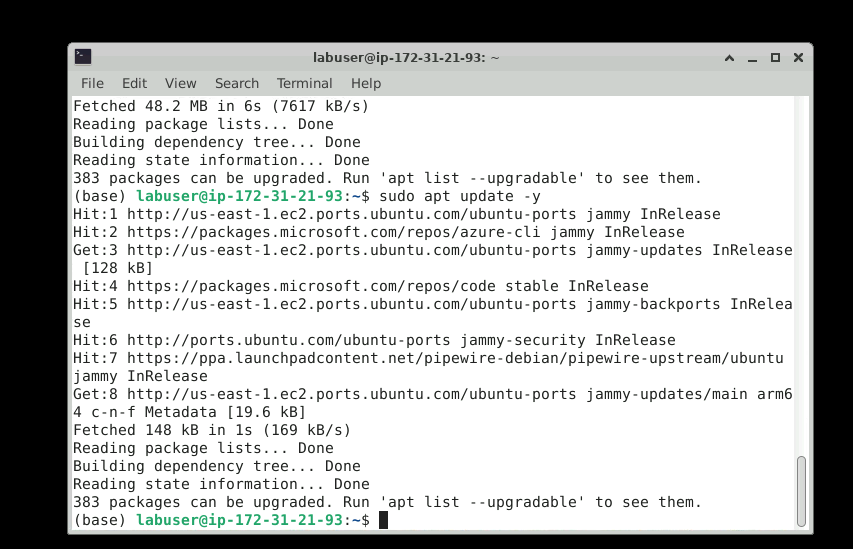

✅ Step 2: Install Java (Required for Jenkins)

```text
sudo apt install openjdk-11-jdk -y
```

Verify:

java -version

📸 Screenshot → “Java Installed”

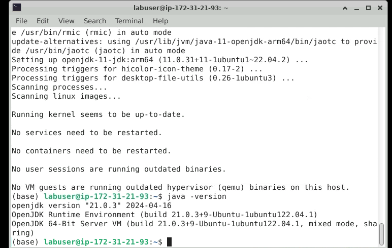

✅ Step 3: Install Jenkins

```text
wget -q -O - https://pkg.jenkins.io/debian-stable/jenkins.io.key | sudo apt-key add -

sudo sh -c 'echo deb https://pkg.jenkins.io/debian-stable binary/ > \
/etc/apt/sources.list.d/jenkins.list'

sudo apt update

sudo apt install jenkins -y
```

✅ Step 4: Start Jenkins

```text
sudo systemctl start jenkins
sudo systemctl enable jenkins
```

Check status:

```text
sudo systemctl status jenkins
```

📸 Screenshot → “Jenkins Running”

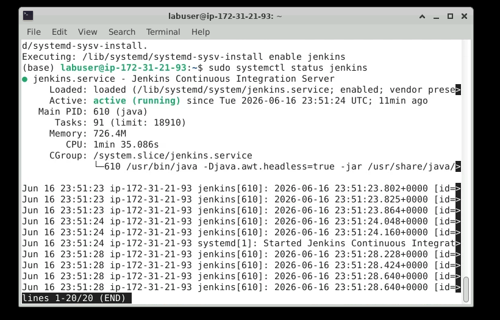

Create a fresh EC2 instance

STEP 1: CREATE EC2 INSTANCE (FOLLOW EXACTLY)

Go to: AWS Console → EC2 → Launch Instance

✅ Fill these details:

Name: jenkins-server

AMI: ✅ Ubuntu 22.04 LTS

Instance Type: t2.micro (Free tier)

Key Pair: Create new (download .pem)

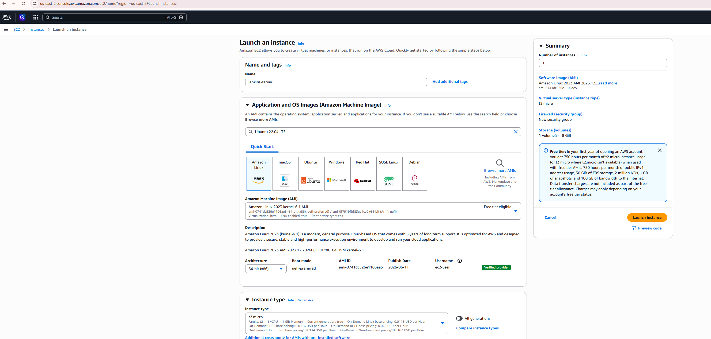

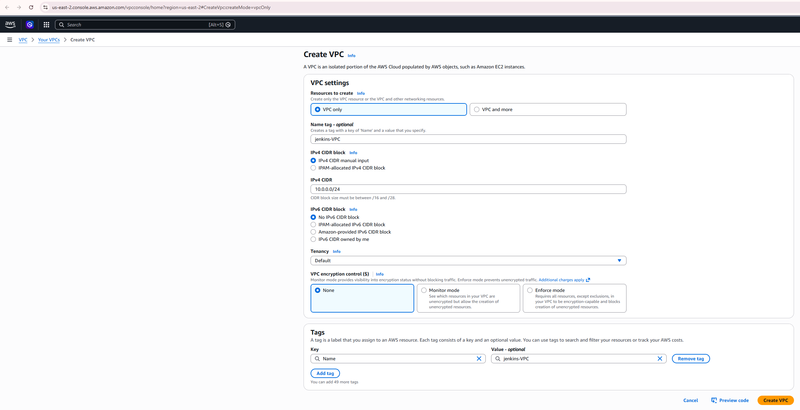

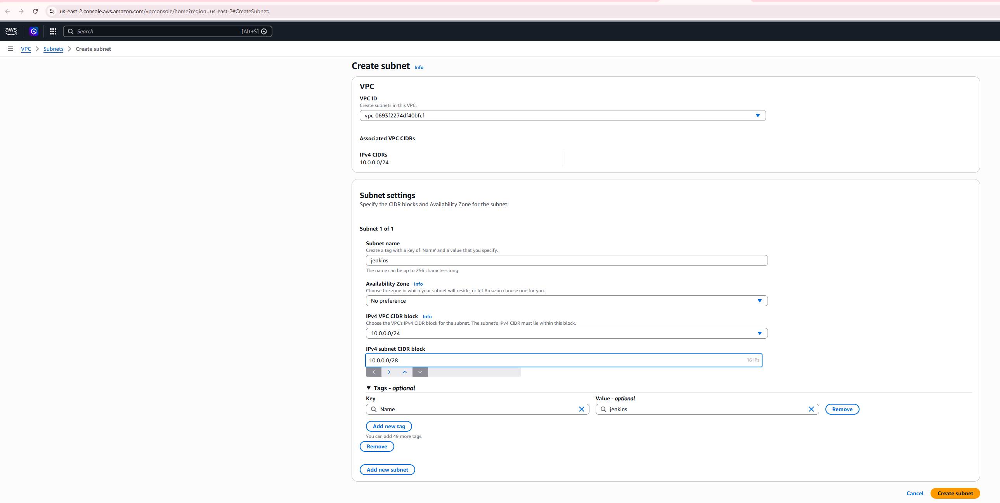

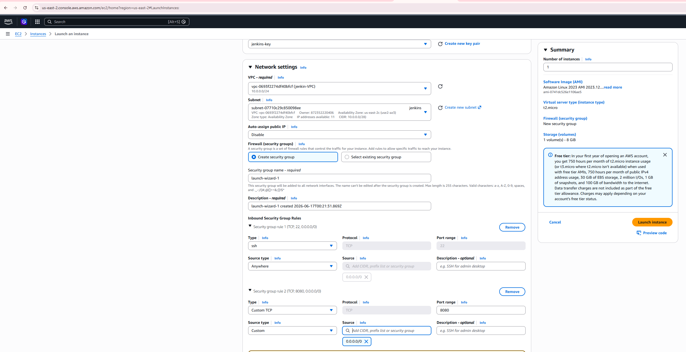

🔐 Network Settings

Click Edit:

✔ Allow:

```text
SSH (22)
```

HTTP (80)

HTTPS (443)

✅ Add:

Type: Custom TCP

Port: 8080

Source: 0.0.0.0/0

👉 Launch Instance

📸 Screenshot 1 → EC2 instance created

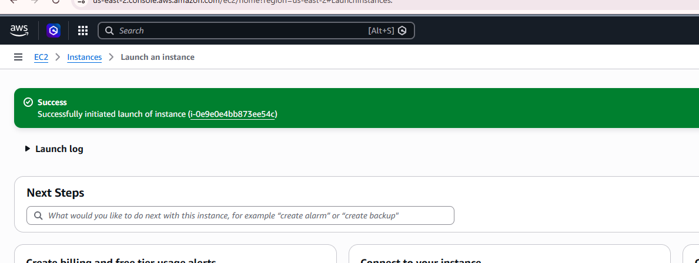

✅ Step 5: Open Jenkins UI

In browser:

http://<your-ec2-public-ip>:8080

Get password:

```text
sudo cat /var/lib/jenkins/secrets/initialAdminPassword
```

```text
📸 Screenshot → Jenkins Dashboard
📸 Screenshot 2: Jenkins dashboard (http://IP:8080)
```

Step 1: Find Real Jenkins Home

Run this command:

```text
sudo find / -type f -name initialAdminPassword 2>/dev/null
```

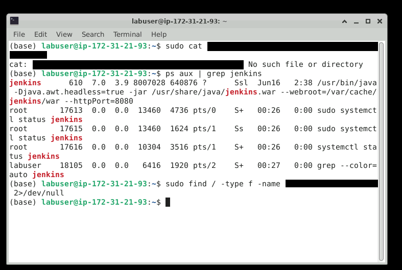

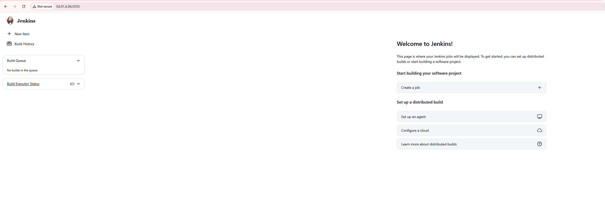

🔹 Step 2: Create Jenkins Freestyle Job

Go to Jenkins → New Item

Select Freestyle Project

Add build step → Execute Shell → echo "Hello DevOps"

```text
📸 Screenshot 3: Jenkins job created
📸 Screenshot 4: Build success output
```

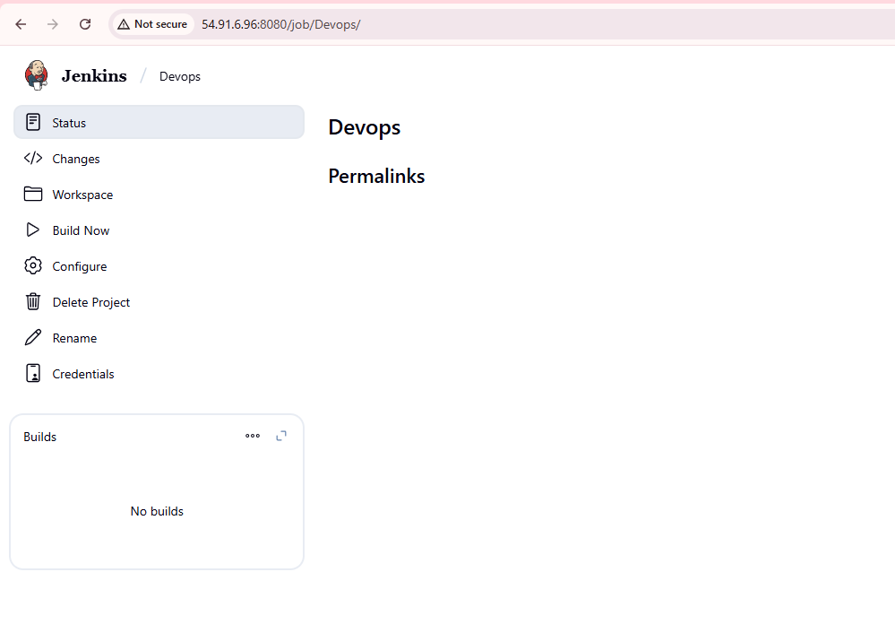

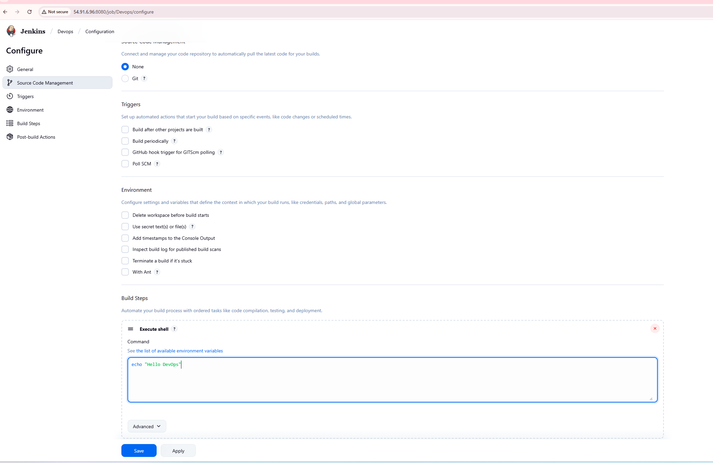

🔹 Step 3: Create S3 Bucket

Go to AWS → S3

Create bucket: jenkins-backup-technova

Enable versioning

📸 Screenshot 5: S3 bucket created

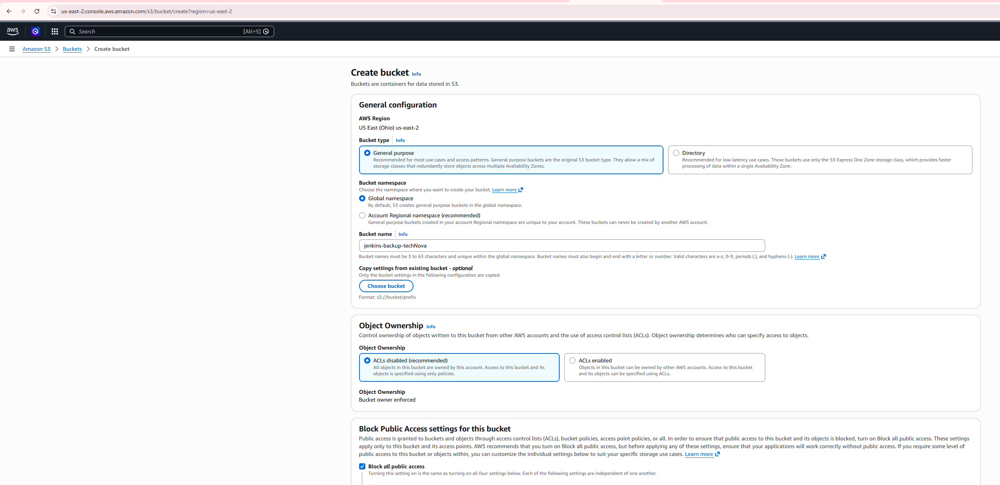

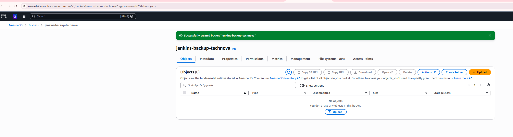

🔹 Step 4: Configure IAM Role

Create IAM Role for EC2

Attach policy: AmazonS3FullAccess

Attach role to EC2

📸 Screenshot 6: IAM Role attached

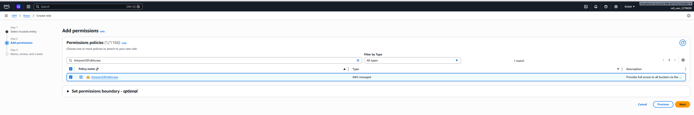

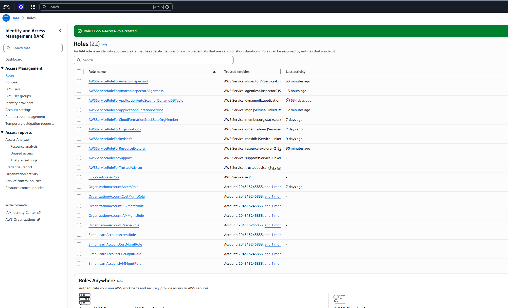

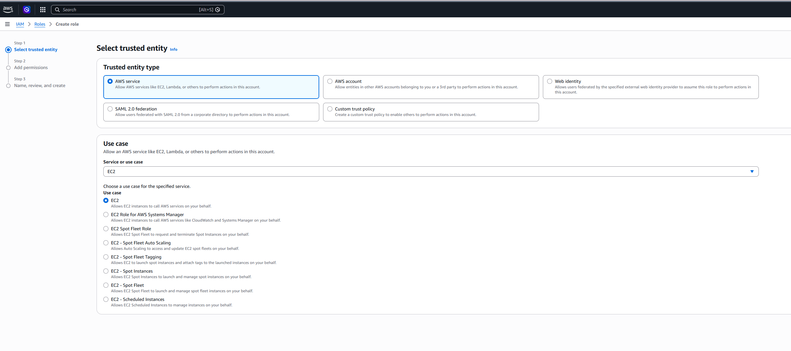

Attach IAM Role to EC2 Instance

Steps:

Go to EC2 Dashboard

Click Instances

Select your running instance

Click:

Actions → Security → Modify IAM role

In dropdown:

Select your role: EC2-S3-Access-Role

Click Update IAM role

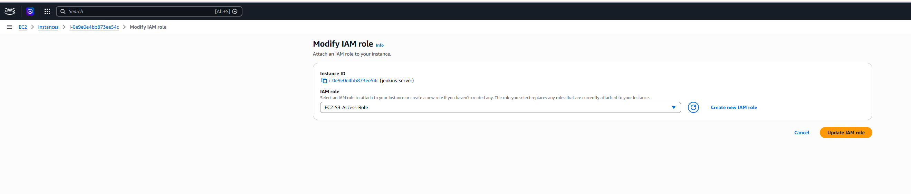

🔹 Step 5: Install AWS CLI

```text
sudo yum install aws-cli -y
```

```text
aws --version
```

📸 Screenshot 7: AWS CLI installed

🔹 Step 6: Create Backup Script

nano backup.sh

#!/bin/bash

DATE=$(date +%F)

BACKUP_FILE=jenkins_backup_$DATE.tar.gz

tar -czvf $BACKUP_FILE /var/lib/jenkins

```text
aws s3 cp $BACKUP_FILE s3://jenkins-backup-technova/
```

rm -f $BACKUP_FILE

```text
chmod +x backup.sh
```

📸 Screenshot 8: Backup script

🔹 Step 7: Run Backup Script

./backup.sh

```text
📸 Screenshot 9: Backup upload success
📸 Screenshot 10: File visible in S3
```

🔹 Step 8: Automate using Cron

crontab -e

Add:

0 2 * * * /home/ec2-user/backup.sh

📸 Screenshot 11: Cron job

🔹 Step 9: Restore Jenkins

```text
aws s3 cp s3://jenkins-backup-technova/jenkins_backup_DATE.tar.gz .
```

```text
sudo systemctl stop jenkins
```

tar -xzvf jenkins_backup_DATE.tar.gz -C /

```text
sudo systemctl start jenkins
```

```text
📸 Screenshot 12: Restore process
📸 Screenshot 13: Jenkins job restored
```

8. Output

Jenkins data successfully backed up to AWS S3

Automated daily backups configured

Jenkins restored successfully after failure

9. Challenges Faced

IAM permission denied errors

Incorrect Jenkins home directory path

```text
AWS CLI configuration issues
```

10. Conclusion

This project successfully implemented an automated Jenkins backup and restore solution using AWS S3. It ensures data reliability, improves disaster recovery capabilities, and minimizes downtime.

11. STAR Method Explanation

⭐ Situation

Jenkins server crash caused data loss.

⭐ Task

Design a backup and restore system.

⭐ Action

Created S3 storage

Configured IAM role

Developed backup script

Automated using cron

Tested restore

⭐ Result

Achieved 100% data recovery

Automated daily backups

Improved system reliability
