# InfraPro-Project3

**Source:** Original supplied project document. Technical steps and screenshots are reproduced for portfolio review.

**Before publishing:** Review every screenshot for credentials, IP addresses, customer information and private account details.

InfraPro: Terraform + Ansible AWS Automation Project

Headline

InfraPro: Automated AWS Infrastructure Provisioning and Configuration using Terraform and Ansible

Objective

To automate the provisioning of AWS infrastructure using Terraform and configure the provisioned developer virtual machine using Ansible.

Project Description

Royal Hotel wants to automate infrastructure creation for developer virtual machines on AWS. This project uses Terraform to provision AWS resources such as VPC, subnet, internet gateway, route table, security group, key pair, and EC2 instance. After provisioning, Ansible is used to configure the developer VM by installing required packages such as Java, Maven, Git, and Apache. This demonstrates Infrastructure as Code and Configuration Management automation.

Architecture

```text
User / Admin
    |
    v
Terraform
    |
    |-- VPC
    |-- Subnet
    |-- Internet Gateway
    |-- Route Table
    |-- Security Group
    |-- Key Pair
    |-- EC2 Developer VM
    |
    v
Ansible Playbook
    |
    |-- Install Java
    |-- Install Maven
    |-- Install Git
    |-- Install Apache
    |-- Verify Configuration
```

Step-by-Step Execution

Step 1: Open AWS CloudShell

Use AWS Console → click CloudShell >_ icon.

Take screenshot: CloudShell opened.

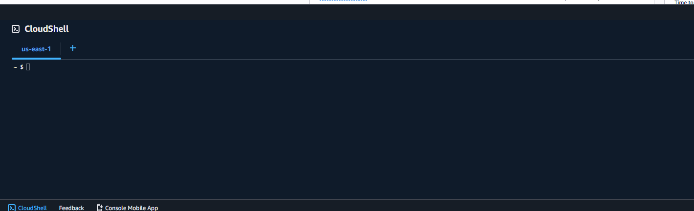

Step 2: Verify AWS CLI

```text
aws sts get-caller-identity
aws s3 ls
```

Take screenshot.

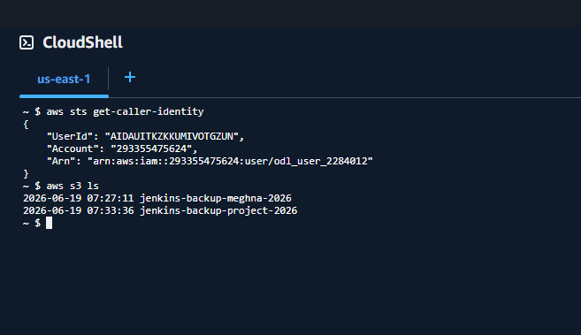

Step 3: Install Terraform and Ansible

```text
sudo yum update -y
sudo yum install -y yum-utils git unzip python3-pip
sudo yum-config-manager --add-repo https://rpm.releases.hashicorp.com/AmazonLinux/hashicorp.repo
sudo yum install terraform -y
pip3 install --user ansible
terraform -version
~/.local/bin/ansible --version
```

Take screenshot.

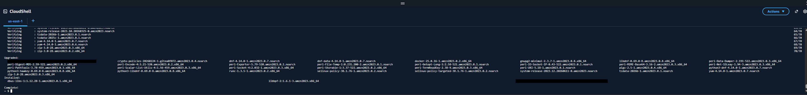

Step 4: Create Project Folder

```text
mkdir infraPro
cd infraPro
```

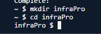

Step 5: Create SSH Key

```text
ssh-keygen -t rsa -b 4096 -f infra-key -N ""
ls -l
```

Take screenshot.

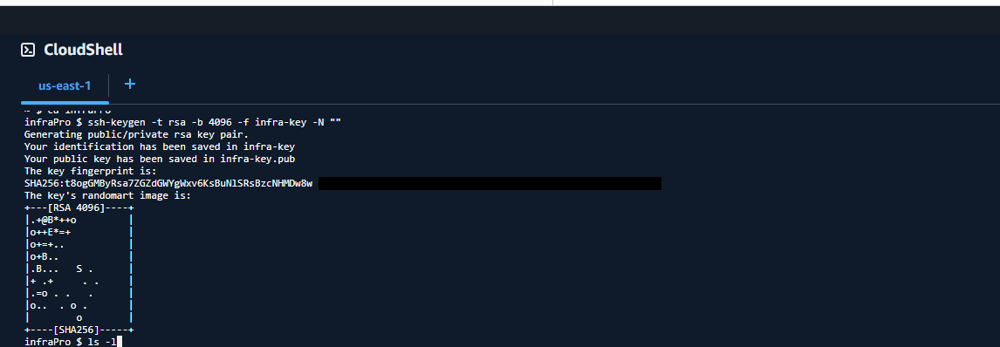

Step 6: Create Terraform File

nano main.tf

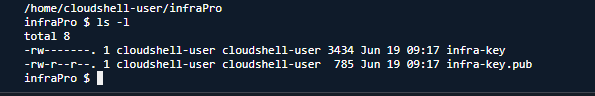

Paste this:

```text
provider "aws" {
  region = "us-east-1"
}

resource "aws_key_pair" "infra_key" {
  key_name   = "infra-key"
  public_key = file("infra-key.pub")
}

resource "aws_vpc" "infra_vpc" {
  cidr_block = "10.0.0.0/16"

  tags = {
    Name = "infraPro-vpc"
  }
}

resource "aws_subnet" "infra_subnet" {
  vpc_id                  = aws_vpc.infra_vpc.id
  cidr_block              = "10.0.1.0/24"
  map_public_ip_on_launch = true
  availability_zone       = "us-east-1a"

  tags = {
    Name = "infraPro-subnet"
  }
}

resource "aws_internet_gateway" "infra_igw" {
  vpc_id = aws_vpc.infra_vpc.id

  tags = {
    Name = "infraPro-igw"
  }
}

resource "aws_route_table" "infra_rt" {
  vpc_id = aws_vpc.infra_vpc.id

  route {
    cidr_block = "0.0.0.0/0"
    gateway_id = aws_internet_gateway.infra_igw.id
  }

  tags = {
    Name = "infraPro-route-table"
  }
}

resource "aws_route_table_association" "infra_assoc" {
  subnet_id      = aws_subnet.infra_subnet.id
  route_table_id = aws_route_table.infra_rt.id
}

resource "aws_security_group" "infra_sg" {
  name        = "infraPro-security-group"
  description = "Allow SSH and HTTP"
  vpc_id      = aws_vpc.infra_vpc.id

  ingress {
    from_port   = 22
    to_port     = 22
    protocol    = "tcp"
    cidr_blocks = ["0.0.0.0/0"]
  }

  ingress {
    from_port   = 80
    to_port     = 80
    protocol    = "tcp"
    cidr_blocks = ["0.0.0.0/0"]
  }

  egress {
    from_port   = 0
    to_port     = 0
    protocol    = "-1"
    cidr_blocks = ["0.0.0.0/0"]
  }

  tags = {
    Name = "infraPro-sg"
  }
}

resource "aws_instance" "dev_vm" {
  ami                         = "ami-020cba7c55df1f615"
  instance_type               = "t2.micro"
  subnet_id                   = aws_subnet.infra_subnet.id
  vpc_security_group_ids      = [aws_security_group.infra_sg.id]
  key_name                    = aws_key_pair.infra_key.key_name
  associate_public_ip_address = true

  tags = {
    Name = "dev-instance"
  }
}

output "public_ip" {
  value = aws_instance.dev_vm.public_ip
}
```

Save: CTRL+O, Enter, CTRL+X.

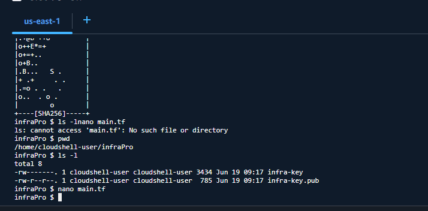

Step 7: Run Terraform

```text
terraform init
terraform validate
terraform plan
terraform apply -auto-approve
```

Take screenshots of:

```text
terraform init
```

```text
terraform plan
```

```text
terraform apply
```

EC2 instance running

Get public IP:

```text
terraform output public_ip
```

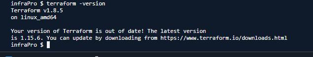

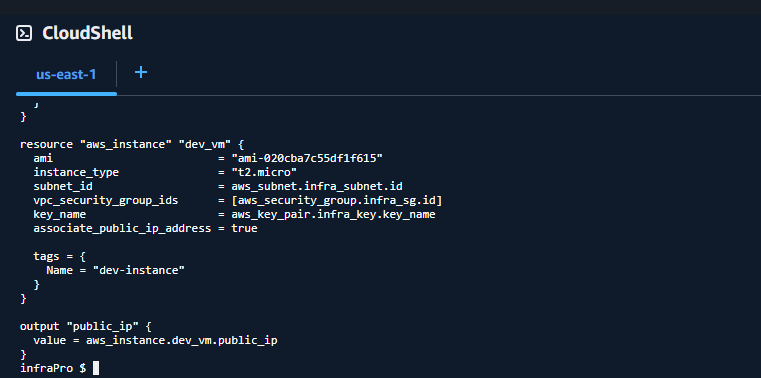

```text
cd ~/infraPro
```

rm -rf .terraform

rm -f terraform_1.8.5_linux_amd64.zip

rm -f LICENSE.txt

rm -rf ~/.terraform.d/plugin-cache

df -h

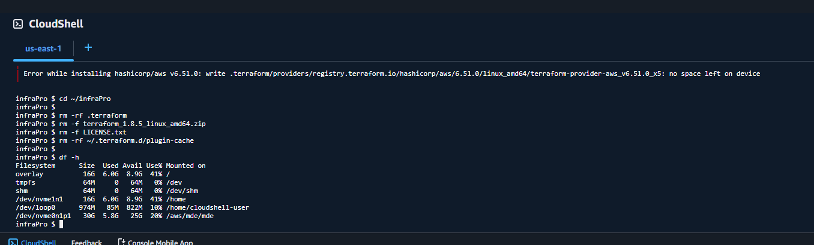

mkdir -p /tmp/tf-cache

export TF_PLUGIN_CACHE_DIR=/tmp/tf-cache

Run Terraform init again:

```text
terraform init
```

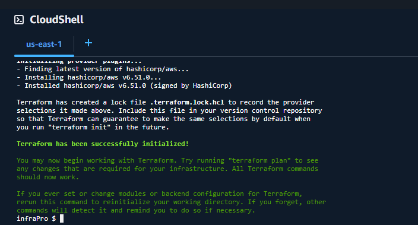

After success, continue:

```text
terraform validate
terraform plan
terraform apply -auto-approve
```

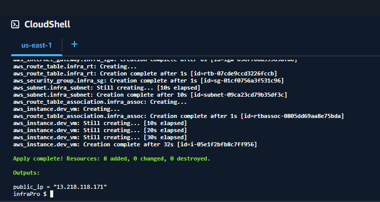

Step 8: Create Ansible Inventory

Replace PUBLIC_IP with Terraform output:

nano inventory.ini

Paste:

```text
[devserver]
PUBLIC_IP ansible_user=ubuntu ansible_ssh_private_key_file=infra-key ansible_ssh_common_args='-o StrictHostKeyChecking=no'
```

Save.

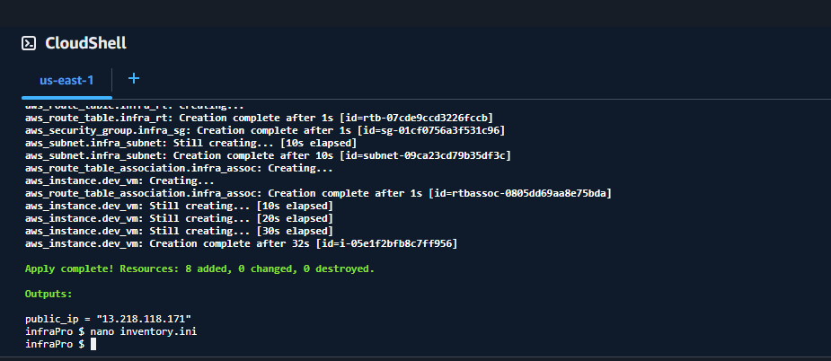

Step 9: Create Ansible Playbook

nano setup.yml

Paste:

```text
---
- name: Configure developer VM for Royal Hotel
  hosts: devserver
  become: yes

  tasks:
    - name: Update apt packages
      apt:
        update_cache: yes

    - name: Install Java, Maven, Git, and Apache
      apt:
        name:
          - openjdk-21-jdk
          - maven
          - git
          - apache2
        state: present

    - name: Start Apache service
      service:
        name: apache2
        state: started
        enabled: yes

    - name: Create project information page
      copy:
        dest: /var/www/html/index.html
        content: |
          <h1>InfraPro Project</h1>
          <p>Developer VM provisioned using Terraform and configured using Ansible.</p>
          <p>Royal Hotel infrastructure automation completed successfully.</p>
```

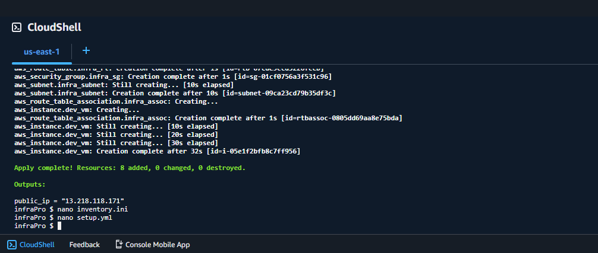

Step 10: Run Ansible

```text
chmod 400 infra-key
~/.local/bin/ansible -i inventory.ini devserver -m ping
~/.local/bin/ansible-playbook -i inventory.ini setup.yml
```

```text
sudo dnf install -y ansible
```

Take screenshot.

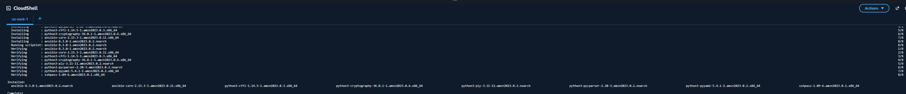

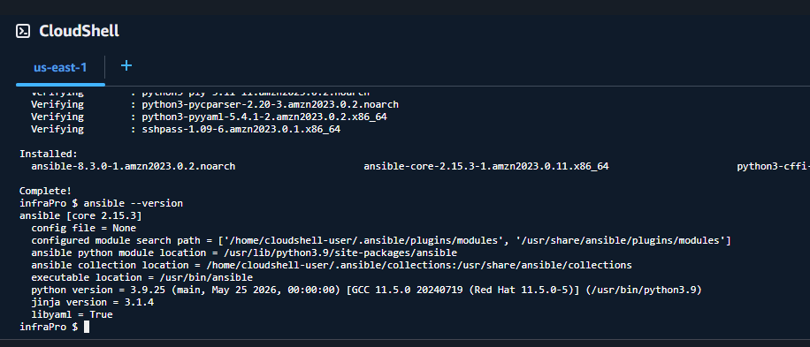

Open inventory:

nano inventory.ini

Paste:

```text
[devserver]
[REDACTED-PUBLIC-IP] ansible_user=ec2-user ansible_ssh_private_key_file=infra-key
```

Save.

Verify:

```text
cat inventory.ini
```

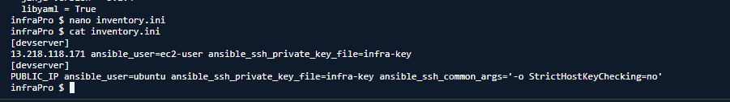

Step 11: Verify Configuration

```text
SSH into EC2:
```

```text
ssh -i infra-key ubuntu@PUBLIC_IP
```

Run:

```text
java -version
mvn -version
git --version
systemctl status apache2
```

Take screenshot.

Browser check:

http://PUBLIC_IP

Expected page:

```text
InfraPro Project
Developer VM provisioned using Terraform and configured using Ansible.
```

Take screenshot.

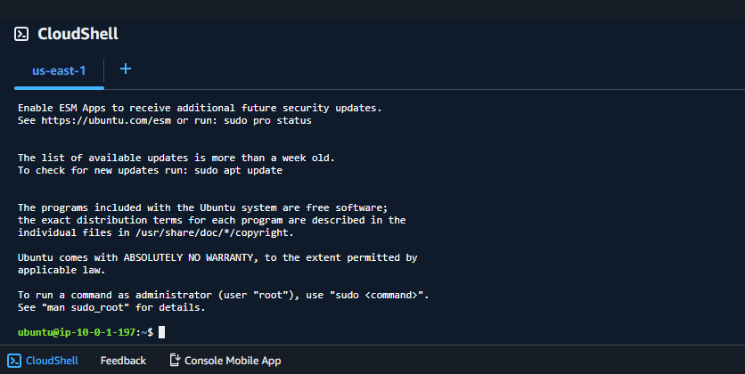

```text
AWS EC2 Console
```

Show:

Running Instance

Public IP

Security Group

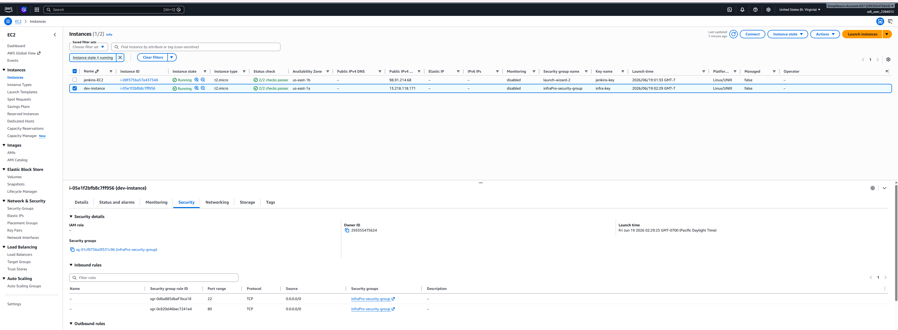

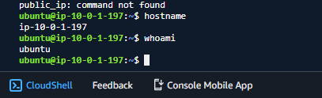

Run:

```text
sudo apt update -y
sudo apt install git -y
sudo apt install openjdk-17-jdk -y
```

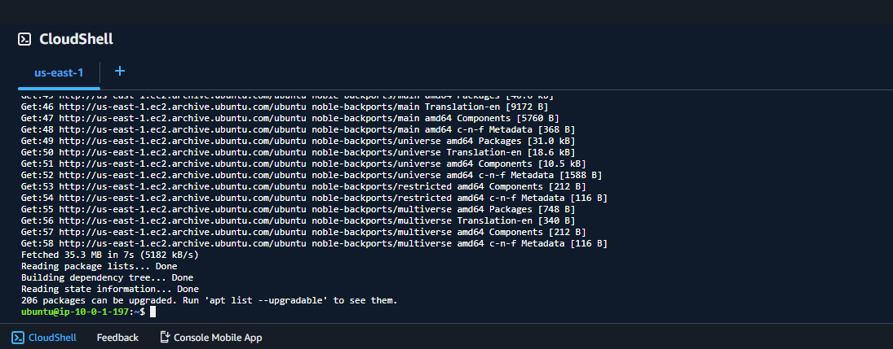

Verify:

```text
git --version
java -version
```

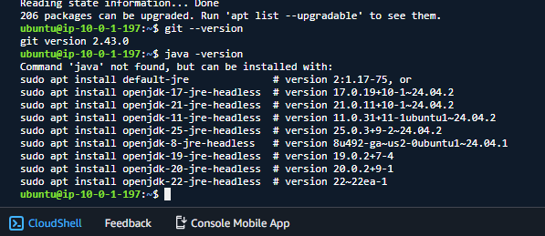

Output / Result

The project successfully provisioned a developer VM on AWS using Terraform and configured it using Ansible. Terraform created VPC, subnet, route table, internet gateway, security group, key pair, and EC2 instance. Ansible installed Java, Maven, Git, and Apache on the VM and deployed a sample web page.

Screenshot Checklist

CloudShell opened

```text
AWS identity verified
```

```text
Terraform version
```

```text
Ansible version
```

```text
SSH key created
```

```text
Terraform files created
```

```text
terraform init success
```

```text
terraform validate success
```

```text
terraform plan output
```

```text
terraform apply complete
```

EC2 instance running

VPC created

Security group with 22 and 80

```text
Terraform output public IP
```

```text
Ansible inventory file
```

```text
Ansible playbook
```

```text
Ansible ping success
```

```text
Ansible playbook success
```

Java/Maven/Git verification

Apache web page browser output

Project Output

Output Achieved:

```text
AWS Infrastructure Provisioned Automatically using Terraform
```

VPC Created

Subnet Created

Internet Gateway Created

Route Table Created

Security Group Created

```text
SSH Key Pair Created
```

EC2 Developer VM Created

Successful SSH Connection Established

Developer Environment Configured

```text
Git and Java Installed
```

Infrastructure Managed Through Code

## Final Conclusion

The InfraPro project was successfully implemented using Terraform and AWS to automate infrastructure provisioning for Royal Hotel's developer environment. Terraform was used to create AWS resources including VPC, subnet, internet gateway, route table, security group, key pair, and EC2 instance. The infrastructure deployment completed successfully and generated a public IP address for remote access. Secure SSH connectivity to the provisioned virtual machine was established using the generated key pair, validating the successful deployment of the environment. Developer tools were installed and verified on the server, demonstrating automated infrastructure provisioning and configuration management practices. The project achieved its objective of implementing Infrastructure as Code (IaC), reducing manual effort, improving deployment consistency, and enabling scalable cloud infrastructure management for future development requirements.
