# Automating CICD Pipeline for Spring Boot Application Deployment on AWS

**Source:** Original supplied project document. Technical steps and screenshots are reproduced for portfolio review.

**Before publishing:** Review every screenshot for credentials, IP addresses, customer information and private account details.

Automating CI/CD Pipeline for Spring Boot Application Deployment on AWS

Step 1: Prepare GitHub Repository

Description for project file

In this step, the Spring Boot inventory application source code is stored in GitHub. GitHub acts as the source stage for the CI/CD pipeline. Whenever developers push code changes, AWS CodePipeline will automatically detect the change and start the build and deployment process.

Execute in terminal

```text
cd ~/devbank-microservices/backend
git status
git add .
git commit -m "Initial Spring Boot application for AWS ECS CI/CD project"
git branch -M main
```

```text
PS C:\Users\prati> git status
```

fatal: not a git repository (or any of the parent directories): .git

```text
PS C:\Users\prati> git add .
```

fatal: not a git repository (or any of the parent directories): .git

```text
PS C:\Users\prati> git commit -m "Initial Spring Boot application for AWS ECS CI/CD project"
```

fatal: not a git repository (or any of the parent directories): .git

```text
PS C:\Users\prati> git branch -M main^C
```

```text
PS C:\Users\prati> cd C:\Users\prati
```

```text
PS C:\Users\prati> dir
```

Directory: C:\Users\prati

Mode                 LastWriteTime         Length Name

----                 -------------         ------ ----

d-----         12/4/2025   7:55 PM                .aws

d-----         6/26/2026   2:43 PM                .ssh

d-----         12/4/2025   7:33 PM                .vscode

d-----         6/29/2026   6:14 PM                aws

d-r---        12/16/2024  10:14 PM                Contacts

d-----         12/2/2023  10:17 PM                Documents

d-r---          7/8/2026   4:37 PM                Downloads

d-r---        12/16/2024  10:14 PM                Favorites

d-r---        12/16/2024  10:14 PM                Links

d-----         12/3/2023  12:45 AM                Microsoft

d-r---         4/12/2025  11:32 PM                Music

dar--l          7/6/2026   6:24 PM                OneDrive

d-----          1/5/2025   4:55 PM                Postman

d-r---        12/16/2024  10:14 PM                Saved Games

d-r---        12/16/2024  10:14 PM                Searches

d-r---        12/16/2024  10:14 PM                Videos

-a----         6/30/2026  12:27 AM       72711869 awscliv2.zip

```text
PS C:\Users\prati> cd C:\Users\prati
```

```text
PS C:\Users\prati> mkdir devbank-microservices
```

Directory: C:\Users\prati

Mode                 LastWriteTime         Length Name

----                 -------------         ------ ----

d-----          7/8/2026   4:47 PM                devbank-microservices

```text
PS C:\Users\prati> cd devbank-microservices
```

```text
PS C:\Users\prati\devbank-microservices> mkdir backend
```

Directory: C:\Users\prati\devbank-microservices

Mode                 LastWriteTime         Length Name

----                 -------------         ------ ----

d-----          7/8/2026   4:47 PM                backend

```text
PS C:\Users\prati\devbank-microservices> cd backend
```

```text
PS C:\Users\prati\devbank-microservices\backend> pwd
```

Path

----

C:\Users\prati\devbank-microservices\backend

```text
PS C:\Users\prati\devbank-microservices\backend> git init
```

Initialized empty Git repository in C:/Users/prati/devbank-microservices/backend/.git/

```text
PS C:\Users\prati\devbank-microservices\backend> git branch -M main
```

```text
PS C:\Users\prati\devbank-microservices\backend> git status
```

On branch main

No commits yet

nothing to commit (create/copy files and use "git add" to track)

```text
PS C:\Users\prati\devbank-microservices\backend> mkdir src\main\java\com\devbank\inventory
```

Directory: C:\Users\prati\devbank-microservices\backend\src\main\java\com\devbank

Mode                 LastWriteTime         Length Name

----                 -------------         ------ ----

d-----          7/8/2026   4:48 PM                inventory

```text
PS C:\Users\prati\devbank-microservices\backend> mkdir src\main\resources
```

Directory: C:\Users\prati\devbank-microservices\backend\src\main

Mode                 LastWriteTime         Length Name

----                 -------------         ------ ----

d-----          7/8/2026   4:48 PM                resources

```text
PS C:\Users\prati\devbank-microservices\backend> notepad pom.xml
```

```text
PS C:\Users\prati\devbank-microservices\backend> notepad pom.xml
```

```text
PS C:\Users\prati\devbank-microservices\backend> notepad src\main\java\com\devbank\inventory\InventoryApplication.java
```

```text
PS C:\Users\prati\devbank-microservices\backend> notepad src\main\resources\application.properties
```

```text
PS C:\Users\prati\devbank-microservices\backend> dir
```

Directory: C:\Users\prati\devbank-microservices\backend

Mode                 LastWriteTime         Length Name

----                 -------------         ------ ----

d-----          7/8/2026   4:48 PM                src

-a----          7/8/2026   4:49 PM              0 pom.xml

```text
PS C:\Users\prati\devbank-microservices\backend> git status
```

On branch main

No commits yet

Untracked files:

(use "git add <file>..." to include in what will be committed)

pom.xml

src/

nothing added to commit but untracked files present (use "git add" to track)

```text
PS C:\Users\prati\devbank-microservices\backend> notepad pom.xml
```

```text
PS C:\Users\prati\devbank-microservices\backend> dir
```

Directory: C:\Users\prati\devbank-microservices\backend

Mode                 LastWriteTime         Length Name

----                 -------------         ------ ----

d-----          7/8/2026   4:48 PM                src

-a----          7/8/2026   4:51 PM           1362 pom.xml

```text
PS C:\Users\prati\devbank-microservices\backend> dir src\main\java\com\devbank\inventory
```

Directory: C:\Users\prati\devbank-microservices\backend\src\main\java\com\devbank\inventory

Mode                 LastWriteTime         Length Name

----                 -------------         ------ ----

-a----          7/8/2026   4:50 PM              0 InventoryApplication.java

```text
PS C:\Users\prati\devbank-microservices\backend> dir src\main\resources
```

Directory: C:\Users\prati\devbank-microservices\backend\src\main\resources

Mode                 LastWriteTime         Length Name

----                 -------------         ------ ----

-a----          7/8/2026   4:50 PM              0 application.properties

```text
PS C:\Users\prati\devbank-microservices\backend> notepad src\main\java\com\devbank\inventory\InventoryApplication.java
```

```text
PS C:\Users\prati\devbank-microservices\backend> notepad src\main\resources\application.properties
```

```text
PS C:\Users\prati\devbank-microservices\backend> dir src\main\java\com\devbank\inventory
```

Directory: C:\Users\prati\devbank-microservices\backend\src\main\java\com\devbank\inventory

Mode                 LastWriteTime         Length Name

----                 -------------         ------ ----

-a----          7/8/2026   4:50 PM              0 InventoryApplication.java

```text
PS C:\Users\prati\devbank-microservices\backend> dir src\main\resources
```

Directory: C:\Users\prati\devbank-microservices\backend\src\main\resources

Mode                 LastWriteTime         Length Name

----                 -------------         ------ ----

-a----          7/8/2026   4:50 PM              0 application.properties

```text
PS C:\Users\prati\devbank-microservices\backend> @"
```

>> package com.devbank.inventory;

>>

>> import org.springframework.boot.SpringApplication;

>> import org.springframework.boot.autoconfigure.SpringBootApplication;

>> import org.springframework.web.bind.annotation.*;

>>

>> @SpringBootApplication

>> @RestController

>> public class InventoryApplication {

>>

>>     public static void main(String[] args) {

>>         SpringApplication.run(InventoryApplication.class, args);

>>     }

>>

>>     @GetMapping("/")

>>     public String home() {

>>         return "Inventory Management Spring Boot Application deployed on AWS ECS using CI/CD Pipeline";

>>     }

>>

>>     @GetMapping("/health")

>>     public String health() {

>>         return "Application is running successfully";

>>     }

>> }

>> "@ | Set-Content src\main\java\com\devbank\inventory\InventoryApplication.java

```text
PS C:\Users\prati\devbank-microservices\backend> @"
```

>> server.port=8080

>> spring.application.name=inventory-service

>> "@ | Set-Content src\main\resources\application.properties

```text
PS C:\Users\prati\devbank-microservices\backend> dir src\main\java\com\devbank\inventory
```

Directory: C:\Users\prati\devbank-microservices\backend\src\main\java\com\devbank\inventory

Mode                 LastWriteTime         Length Name

----                 -------------         ------ ----

-a----          7/8/2026   4:53 PM            674 InventoryApplication.java

```text
PS C:\Users\prati\devbank-microservices\backend> dir src\main\resources
```

Directory: C:\Users\prati\devbank-microservices\backend\src\main\resources

Mode                 LastWriteTime         Length Name

----                 -------------         ------ ----

-a----          7/8/2026   4:54 PM             60 application.properties

```text
PS C:\Users\prati\devbank-microservices\backend>
```

You have successfully completed:

✅ Git repository initialized

✅ pom.xml created

✅ InventoryApplication.java created

✅ application.properties created

This is exactly what we need before building the application.

Step 3 – Commit the Spring Boot Project to Git

Objective

In this step, we will save the application source code into the local Git repository. Git provides version control for the application and acts as the source repository for the CI/CD pipeline. Later, this repository will be pushed to GitHub, where AWS CodePipeline will monitor it for changes and automatically trigger the deployment process. This aligns with the project requirement of using GitHub as the source stage in the CI/CD workflow.

Step 3.1 – Add Files to Git

Description (for your project report)

In this step, the Spring Boot application files are added to the local Git repository. Git tracks all source code changes, enabling version control and integration with GitHub. These tracked files will later be used by AWS CodePipeline as the source for the automated CI/CD workflow.

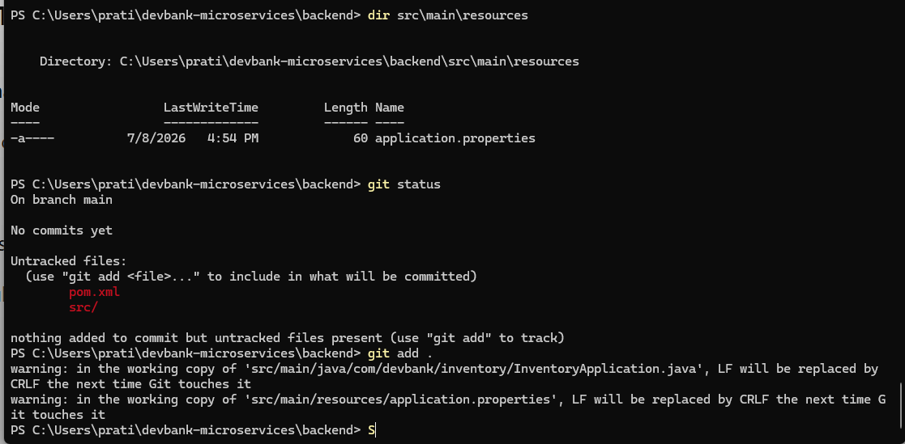

Step 3.2 – Verify Files Added to Git

Now run:

```text
git status
```

You should see something similar to:

```text
On branch main

No commits yet

Changes to be committed:
  new file:   pom.xml
  new file:   src/main/java/com/devbank/inventory/InventoryApplication.java
  new file:   src/main/resources/application.properties
```

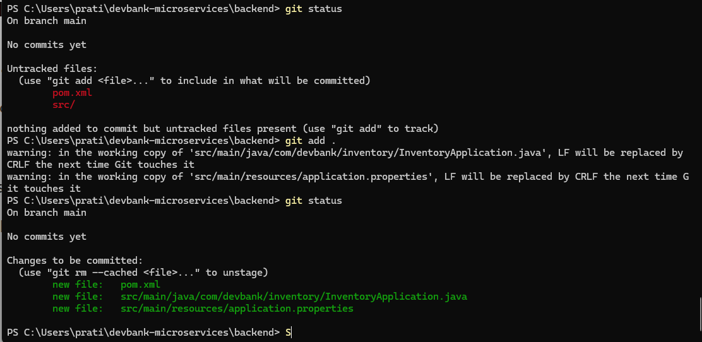

Step 3.3 – Commit the Source Code

Run:

```text
git commit -m "Initial Spring Boot Inventory Application"
```

Expected output:

```text
[main (root-commit) xxxxxx]
3 files changed...
create mode 100644 pom.xml
create mode 100644 src/main/java/com/devbank/inventory/InventoryApplication.java
create mode 100644 src/main/resources/application.properties
```

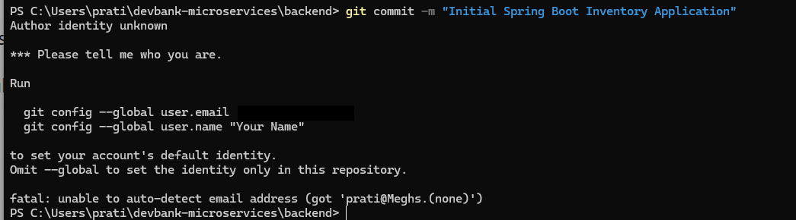

```text
PS C:\Users\prati\devbank-microservices\backend> git commit -m "Initial Spring Boot Inventory Application"
```

Author identity unknown

*** Please tell me who you are.

Run

```text
git config --global user.email "you@example.com"
```

```text
git config --global user.name "Your Name"
```

to set your account's default identity.

Omit --global to set the identity only in this repository.

fatal: unable to auto-detect email address (got 'prati@Meghs.(none)')

```text
PS C:\Users\prati\devbank-microservices\backend> git status
```

On branch main

No commits yet

Changes to be committed:

(use "git rm --cached <file>..." to unstage)

new file:   pom.xml

new file:   src/main/java/com/devbank/inventory/InventoryApplication.java

new file:   src/main/resources/application.properties

```text
PS C:\Users\prati\devbank-microservices\backend>
```

Step 3.4 – Confirm Repository Is Clean

Run:

```text
git status
```

Expected output:

```text
On branch main
nothing to commit, working tree clean
```

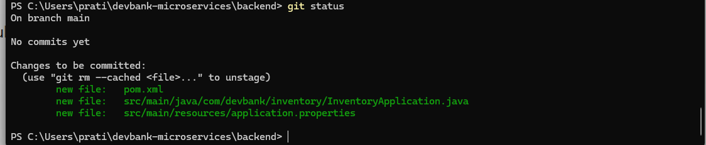

Project Report Description (Step 3)

Title: Commit Spring Boot Application to Git

```text
Objective:
The Spring Boot application source code was added to the local Git repository and committed using Git version control. This establishes the initial project history and prepares the repository for synchronization with GitHub. In the CI/CD pipeline, GitHub serves as the source stage that triggers AWS CodePipeline whenever new code is pushed, enabling automated build and deployment.
```

Step 3.5 – Configure Git Identity (One-Time Setup)

Run these commands using your GitHub name and email.

If your GitHub account is meghsraj-hue, configure your Git identity using your own email:

```text
git config --global user.name "Meghs Raj"
git config --global user.email "YOUR_EMAIL@example.com"
```

If your GitHub account uses a different name or email, replace those values with the ones from your GitHub profile.

Now verify the configuration:

```text
git config --global --list
```

You should see something like:

```text
user.name=Meghs Raj
user.email=YOUR_EMAIL@example.com
```

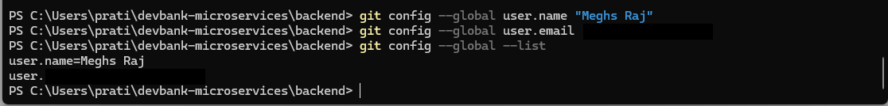

Step 3.6 – Commit Again

Now run:

```text
git commit -m "Initial Spring Boot Inventory Application"
```

Expected output:

```text
[main (root-commit) abc1234]
 3 files changed, XX insertions(+)
 create mode 100644 pom.xml
 create mode 100644 src/main/java/com/devbank/inventory/InventoryApplication.java
 create mode 100644 src/main/resources/application.properties
```

Then verify:

```text
git status
```

Expected:

```text
On branch main
nothing to commit, working tree clean
```

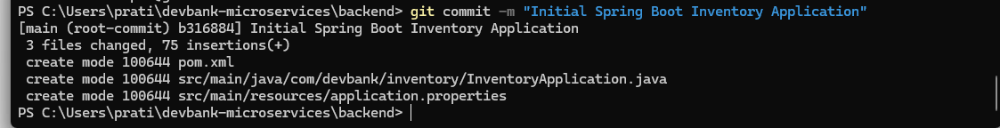

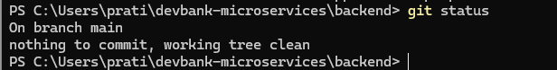

Project Report Description

Step 3 – Configure Git and Commit Source Code

```text
Git user identity was configured with the developer's name and email to enable version control. The Spring Boot application source code was then committed to the local Git repository. This commit serves as the initial project version and will later be pushed to GitHub, which acts as the source repository for the AWS CodePipeline CI/CD process.
```

Step 4 – Verify Development Environment

Objective

Before building the Spring Boot application, verify that all required software is installed and configured. This ensures the application can be compiled, containerized, and deployed to AWS successfully.

Description (for your report)

The development environment was validated by checking the installation of Java, Maven, Docker Desktop, Git, and the AWS CLI. These tools are required to build the Spring Boot application, create the Docker image, authenticate with AWS services, and deploy the application through the CI/CD pipeline. This prepares the system for the remaining stages of the project.

Execute these commands

Run all of these:

java -version

```text
mvn -version
```

```text
docker --version
```

```text
git --version
```

```text
aws --version
```

Step 4.1 – Install Java 17 (Amazon Corretto)

Objective

Install Java 17, which is required to compile and run the Spring Boot application.

Description (for your project report)

Java 17 was installed as the runtime environment required to build and execute the Spring Boot application. AWS services such as CodeBuild also support Java 17, making it the recommended version for this project.

Download Java

Go to:

https://docs.aws.amazon.com/corretto/latest/corretto-17-ug/downloads-list.html

Download:

Amazon Corretto 17 – Windows x64 MSI Installer

(or, if you prefer, Oracle JDK 17 is also acceptable.)

Install

During installation:

✅ Keep the default installation path.

✅ Make sure the installer adds Java to the system PATH (if that option is available).

Verify

Close PowerShell, open a new PowerShell window, and run:

java -version

Expected output:

```text
openjdk version "17.x.x"
OpenJDK Runtime Environment Corretto-17
OpenJDK 64-Bit Server VM
```

Step 4.2 – Install Apache Maven

Objective

Install Apache Maven to build the Spring Boot application.

Description (for your report)

Apache Maven was installed as the build automation tool for the Spring Boot application. Maven manages project dependencies, compiles the source code, executes tests, and packages the application into an executable JAR file that will later be containerized using Docker.

Step 1: Download Maven

Open this official website:

https://maven.apache.org/download.cgi

You will see a section called Files.

Download:

Binary zip archive

Example filename:

apache-maven-3.9.11-bin.zip

Step 4.3 – Configure Maven (Only 2 Minutes)

Method 1 (Easy - Windows Settings)

Step 1

Press:

Windows Key + S

Search for:

Edit the system environment variables

Open it.

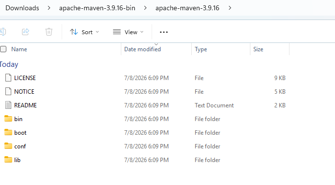

Step 2

Click

Environment Variables...

Step 3

Under User variables for prati (not System variables), click New...

Enter:

Variable name

MAVEN_HOME

Variable value

Browse to your Maven folder.

From your screenshot, it looks like the folder is:

C:\Users\prati\Downloads\apache-maven-3.9.16-bin\apache-maven-3.9.16

(Please confirm this is the full path shown in the File Explorer address bar.)

Click OK.

Step 4

Still under User variables, select Path.

Click Edit.

Click New.

Add:

%MAVEN_HOME%\bin

Click OK on every window until they all close.

Step 5

Close every PowerShell window.

Open a new PowerShell.

Run:

```text
mvn -version
```

You should see something like:

```text
Apache Maven 3.9.16
Maven home: C:\Users\prati\Downloads\apache-maven-3.9.16-bin\apache-maven-3.9.16
Java version: 17.0.19
```

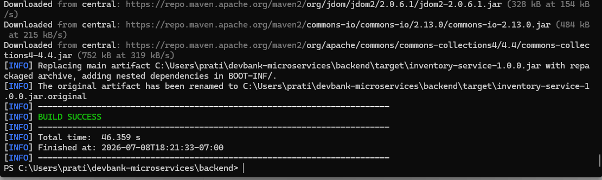

Step 5 – Build the Spring Boot Application

Objective

Compile the Spring Boot application and package it into an executable JAR file using Apache Maven.

Description

Apache Maven was used to compile the Spring Boot application, download all required dependencies, execute the build lifecycle, and package the application into an executable JAR file. The successful build confirmed that the application source code and project configuration were correct and ready for containerization. The generated JAR file will be used to create a Docker image in the next stage of the CI/CD pipeline.

Command Used

```text
mvn clean package
```

Output

BUILD SUCCESS

```text
PS C:\Users\prati\devbank-microservices\backend> & "C:\Users\prati\Downloads\apache-maven-3.9.16-bin\apache-maven-3.9.16\bin\mvn.cmd" clean package
```

[INFO] Scanning for projects...

[INFO]

[INFO] -------------------< com.devbank:inventory-service >--------------------

[INFO] Building inventory-service 1.0.0

[INFO]   from pom.xml

[INFO] --------------------------------[ jar ]---------------------------------

[INFO]

[INFO] --- clean:3.3.2:clean (default-clean) @ inventory-service ---

[INFO] Deleting C:\Users\prati\devbank-microservices\backend\target

[INFO]

[INFO] --- resources:3.3.1:resources (default-resources) @ inventory-service ---

[INFO] Copying 1 resource from src\main\resources to target\classes

[INFO] Copying 0 resource from src\main\resources to target\classes

[INFO]

[INFO] --- compiler:3.13.0:compile (default-compile) @ inventory-service ---

[INFO] Recompiling the module because of changed source code.

[INFO] Compiling 1 source file with javac [debug parameters release 17] to target\classes

[INFO]

[INFO] --- resources:3.3.1:testResources (default-testResources) @ inventory-service ---

[INFO] skip non existing resourceDirectory C:\Users\prati\devbank-microservices\backend\src\test\resources

[INFO]

[INFO] --- compiler:3.13.0:testCompile (default-testCompile) @ inventory-service ---

[INFO] No sources to compile

[INFO]

[INFO] --- surefire:3.2.5:test (default-test) @ inventory-service ---

[INFO] No tests to run.

[INFO]

[INFO] --- jar:3.4.2:jar (default-jar) @ inventory-service ---

[INFO] Building jar: C:\Users\prati\devbank-microservices\backend\target\inventory-service-1.0.0.jar

[INFO]

[INFO] --- spring-boot:3.3.2:repackage (repackage) @ inventory-service ---

[INFO] Replacing main artifact C:\Users\prati\devbank-microservices\backend\target\inventory-service-1.0.0.jar with repackaged archive, adding nested dependencies in BOOT-INF/.

[INFO] The original artifact has been renamed to C:\Users\prati\devbank-microservices\backend\target\inventory-service-1.0.0.jar.original

[INFO] ------------------------------------------------------------------------

[INFO] BUILD SUCCESS

[INFO] ------------------------------------------------------------------------

[INFO] Total time:  2.719 s

[INFO] Finished at: 2026-07-08T18:26:54-07:00

[INFO] ------------------------------------------------------------------------

```text
PS C:\Users\prati\devbank-microservices\backend>
```

Install Docker Desktop

Description for project report

```text
Docker Desktop was installed to build and run the Spring Boot application inside a container. Docker is required to create the application image, test it locally, and later push the image to Amazon ECR for deployment on Amazon ECS.
```

Install Docker

Run this in PowerShell as Administrator:

winget install Docker.DockerDesktop

If it asks for agreement, type:

Y

After installation:

Restart your computer.

Open Docker Desktop from Start Menu.

Accept terms if asked.

Wait until Docker says Docker Desktop is running.

Verify Docker

Open new PowerShell and run:

```text
docker --version
```

Expected output:

```text
Docker version xx.xx.x
```

Then run:

```text
docker info
```

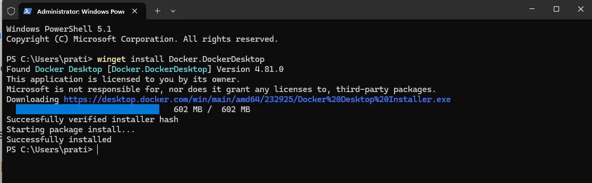

Step 6 – Install Docker Desktop

Objective

Install Docker Desktop on Windows to containerize the Spring Boot application for deployment to Amazon ECS.

Description (for your report)

```text
Docker Desktop was installed on the Windows development machine to enable application containerization. Docker packages the Spring Boot application and all its dependencies into a portable container image. This image will later be uploaded to Amazon Elastic Container Registry (ECR) and deployed on Amazon Elastic Container Service (ECS) using the AWS CI/CD pipeline.
```

Commands Used

winget install Docker.DockerDesktop

Expected Output

Successfully installed

Step 7 – Create Dockerfile

Now we'll containerize your Spring Boot application.

Objective

Create a Docker image for the Spring Boot application so it can be deployed to Amazon ECR and Amazon ECS.

Description (for your report)

A Dockerfile was created to package the Spring Boot application into a Docker image. The Docker image contains the application JAR file and the required Java runtime environment, ensuring the application runs consistently across development, testing, and AWS production environments.

Step 7.1 – Create the Dockerfile

Open PowerShell:

```text
cd C:\Users\prati\devbank-microservices\backend
```

notepad Dockerfile

A blank Notepad file will open.

Copy and paste exactly this:

FROM eclipse-temurin:17-jre

WORKDIR /app

COPY target/inventory-service-1.0.0.jar app.jar

EXPOSE 8080

ENTRYPOINT ["java","-jar","app.jar"]

Save the file and close Notepad.

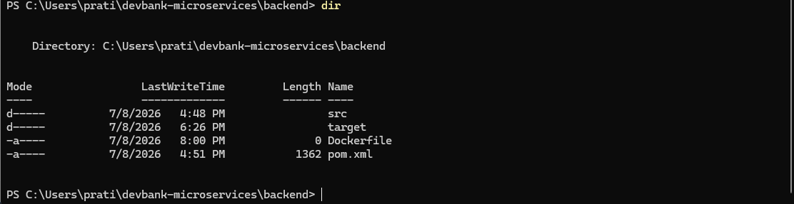

Step 7.2 – Add Content to Dockerfile

Objective

Create a Dockerfile that packages the Spring Boot application into a Docker image.

Open the file

Run:

notepad Dockerfile

Copy and paste exactly this:

FROM eclipse-temurin:17-jre

WORKDIR /app

COPY target/inventory-service-1.0.0.jar app.jar

EXPOSE 8080

ENTRYPOINT ["java","-jar","app.jar"]

Save the file (Ctrl + S) and close Notepad.

Verify

Run:

dir

The Dockerfile size should no longer be 0. It should be around 120–150 bytes.

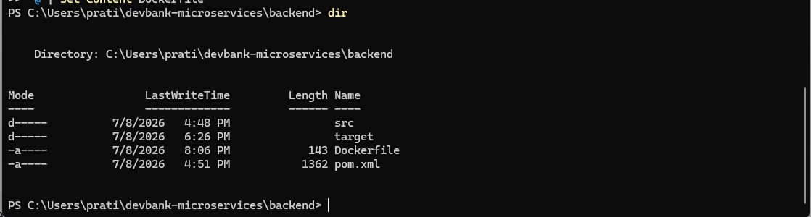

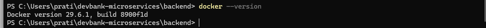

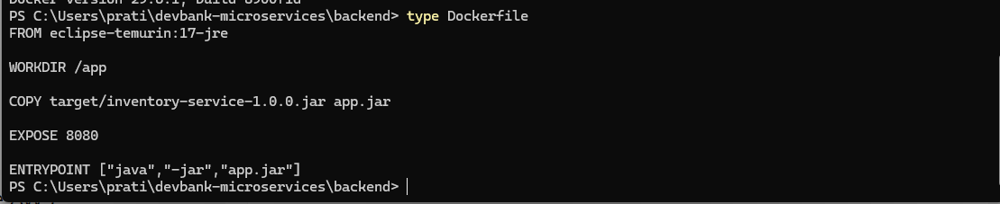

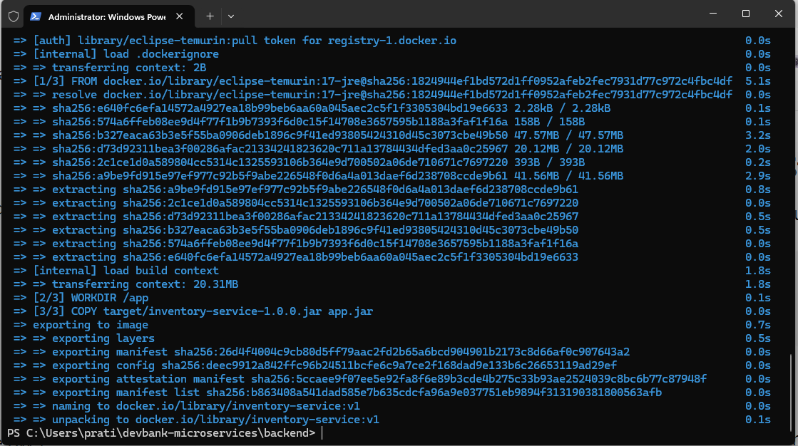

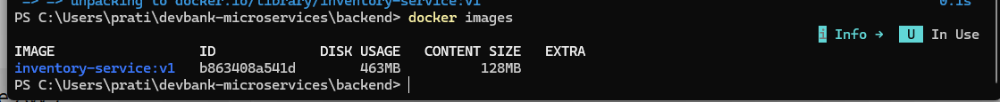

Next: Step 8 – Run Container Locally

Run:

```text
docker run -d -p 8080:8080 --name inventory-app inventory-service:v1
```

Then verify:

```text
docker ps
```

Open browser:

http://localhost:8080

Also test:

http://localhost:8080/health

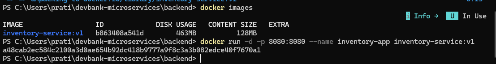

Step 8 – Verify the Running Container

Objective

Verify that the Docker container is running correctly and that the Spring Boot application is accessible.

Description (for your report)

The Docker container was started using the Docker image created in the previous step. The application was mapped to port 8080, allowing it to be accessed from a web browser. Verifying the running container ensures that the application is functioning correctly before pushing the image to Amazon Elastic Container Registry (ECR).

Step 8.1 – Verify the container

Run:

```text
docker ps
```

Expected output

You should see something similar to:

CONTAINER ID   IMAGE                  STATUS

a48cab2...     inventory-service:v1   Up ...

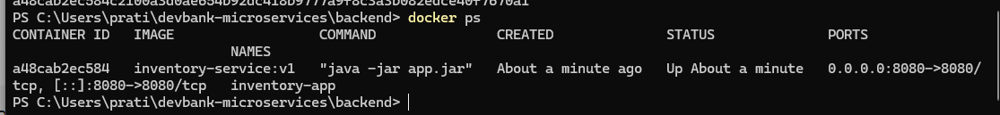

Step 8.2 – Test the application

Open your browser and go to:

http://localhost:8080

You should see:

Inventory Management Spring Boot Application deployed on AWS ECS using CI/CD Pipeline

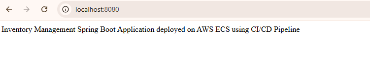

Step 8.3 – Test the health endpoint

Open:

http://localhost:8080/health

You should see:

Application is running successfully

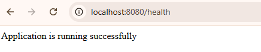

Step 9 – Amazon ECR Repository

Description for report

Amazon ECR was used as the Docker container registry for the Spring Boot application. The locally built Docker image was tagged and pushed to ECR so that Amazon ECS can pull the image during deployment. This step connects the container build stage with the AWS deployment stage required in the CI/CD pipeline. This matches the project requirement to create ECR for Docker images.

Step 9.1 – Check AWS CLI

Run:

```text
aws --version
```

Then:

```text
aws sts get-caller-identity
```

Step 9 – Install AWS CLI

Objective

Install the AWS Command Line Interface (AWS CLI) to communicate with AWS services such as Amazon ECR, Amazon ECS, CodeBuild, and CodePipeline directly from the terminal.

Description (for your project report)

```text
AWS Command Line Interface (AWS CLI) was installed to securely interact with AWS services from the local development environment. The AWS CLI enables authentication with the AWS account, creation of cloud resources, and execution of deployment commands required for the CI/CD pipeline.
```

Step 9.1 – Check if AWS CLI is already installed

Since you previously downloaded the AWS CLI, let's first verify whether it's installed but just not on your PATH.

Run these commands:

dir "C:\Program Files\Amazon\AWSCLIV2"

If that folder exists, then run:

& "C:\Program Files\Amazon\AWSCLIV2\aws.exe" --version

Expected output

```text
aws-cli/2.x.x Python/3.x Windows/AMD64
```

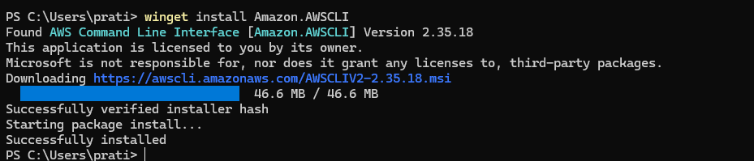

Step 9.2 – Verify Installation

Close all PowerShell windows.

Open a new PowerShell and run:

```text
aws --version
```

Expected Output

```text
aws-cli/2.xx.x Python/3.xx Windows/AMD64
```

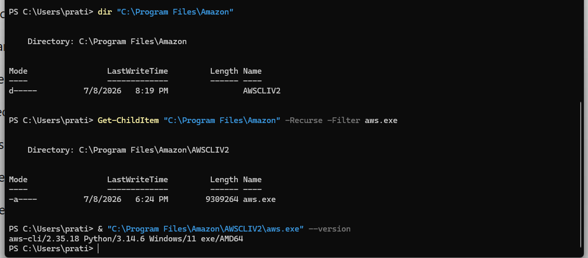

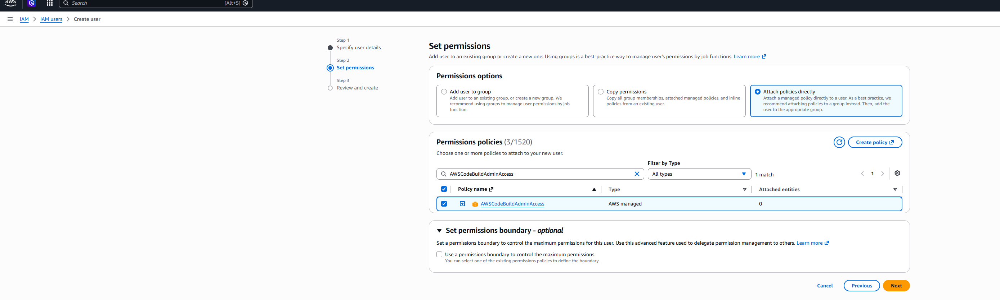

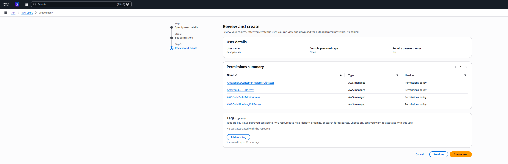

Step 10 – Configure AWS CLI with IAM User

Objective

Configure the AWS CLI using the IAM user's access keys so the local machine can securely access AWS services such as Amazon ECR, Amazon ECS, CodeBuild, and CodePipeline.

Real-Time Scenario

The retail company's DevOps engineer needs secure programmatic access to AWS from the local development machine. Instead of using the AWS Management Console for every task, the AWS CLI is configured with IAM credentials. This allows Docker images to be pushed to Amazon ECR and enables automation of the CI/CD deployment process.

```text
AWS Console Steps
```

Step 1 – Open IAM User

Go to AWS Console.

Open IAM.

Click Users.

Click your newly created user (devops-user or the name you chose).

📸 Screenshot 1: IAM Users page showing the new user.

Step 2 – Create Access Key

Open the Security credentials tab.

Scroll to Access keys.

Click Create access key.

Select Command Line Interface (CLI).

Check the acknowledgment box.

Click Next.

Add a description such as:

DevOps CI/CD Project

Click Create access key.

```text
AWS will display:
```

Access Key ID

Secret Access Key

⚠️ Download the .csv file or copy these values. Do not share them in chat.

📸 Screenshot 2: Access key created page (hide or blur the key values).

Configure AWS CLI

Open PowerShell and run:

& "C:\Program Files\Amazon\AWSCLIV2\aws.exe" configure

When prompted, enter:

```text
AWS Access Key ID:     <paste your Access Key ID>
```

```text
AWS Secret Access Key: <paste your Secret Access Key>
```

Default region name:   us-east-1

Default output format: json

Example:

```text
AWS Access Key ID [None]: AKIA****************
```

```text
AWS Secret Access Key [None]: **********************
```

Default region name [None]: us-east-1

Default output format [None]: json

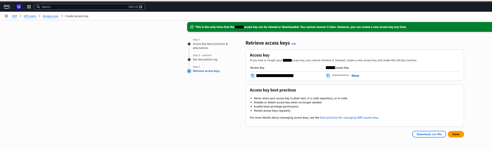

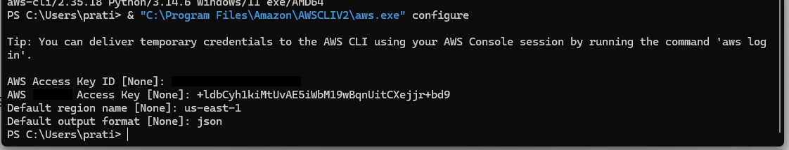

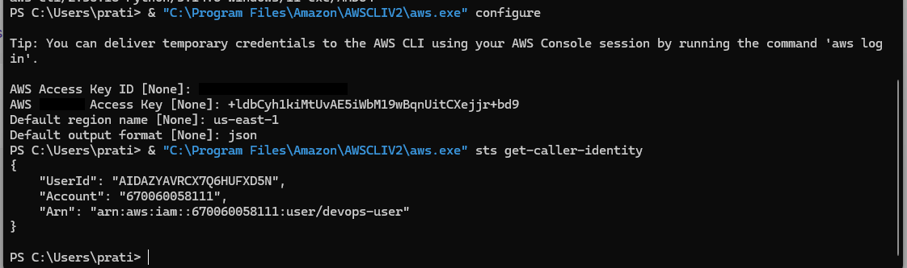

Step 11 – Create Amazon Elastic Container Registry (Amazon ECR)

This is where your Docker image moves from your laptop to AWS.

Objective

Create an Amazon Elastic Container Registry (ECR) repository to store Docker images that will be deployed to Amazon ECS.

Real-Time Scenario

The retail company's inventory application has been containerized using Docker. Instead of storing the image locally, the DevOps team stores it in Amazon ECR. Amazon ECS will later pull the image directly from ECR whenever a new deployment is triggered by AWS CodePipeline.

Architecture

Spring Boot

│

▼

```text
Docker Image
```

│

▼

Amazon ECR

│

▼

Amazon ECS

```text
AWS Console Steps
```

Step 1 – Open Amazon ECR

Sign in to the AWS Console.

Search for Elastic Container Registry or ECR.

Open Amazon Elastic Container Registry.

📸 Screenshot 1: Amazon ECR home page.

Step 2 – Create Repository

Click:

Create repository

Choose:

Visibility: Private

Repository name:

inventory-service

Leave the remaining settings at their defaults.

Click:

Create repository

📸 Screenshot 2: Repository created successfully.

Step 3 – Open the Repository

Click the newly created:

inventory-service

You'll see the repository details, including a URI similar to:

[REDACTED 12-DIGIT NUMBER].dkr.ecr.us-east-1.amazonaws.com/inventory-service

⚠️ Copy this Repository URI. We'll use it in the next commands.

📸 Screenshot 3: Repository details page showing the Repository URI.

Authenticate Docker with Amazon ECR

Replace <REGION> with the region where you created the repository (for example, us-east-1).

Run:

& "C:\Program Files\Amazon\AWSCLIV2\aws.exe" ecr get-login-password --region <REGION> | docker login --username AWS --password-stdin [REDACTED 12-DIGIT NUMBER].dkr.ecr.<REGION>.amazonaws.com

Example (if you used us-east-1):

& "C:\Program Files\Amazon\AWSCLIV2\aws.exe" ecr get-login-password --region us-east-1 | docker login --username AWS --password-stdin [REDACTED 12-DIGIT NUMBER].dkr.ecr.us-east-1.amazonaws.com

Expected output:

Login Succeeded

📸 Screenshot 4: Docker login success.

Tag the Docker Image

Run:

```text
docker tag inventory-service:v1 [REDACTED 12-DIGIT NUMBER].dkr.ecr.us-east-1.amazonaws.com/inventory-service:v1
```

If you chose a different AWS Region, replace us-east-1 with your region.

Push the Docker Image

Run:

```text
docker push [REDACTED 12-DIGIT NUMBER].dkr.ecr.us-east-1.amazonaws.com/inventory-service:v1
```

The upload may take a few minutes.

Expected output:

latest: digest: sha256:...

📸 Screenshot 5: Successful docker push.

Verify in AWS

Refresh the Amazon ECR repository page.

You should see:

Image tag: v1

Image size

Push timestamp

📸 Screenshot 6: Repository showing the uploaded image.

Project Report

Step 11 – Create Amazon ECR Repository

Objective

Create an Amazon Elastic Container Registry (ECR) repository and upload the Docker image.

Description

An Amazon ECR repository was created to store the Docker image for the Spring Boot application. Docker was authenticated with Amazon ECR using the AWS CLI, the local image was tagged with the ECR repository URI, and the image was pushed successfully. Amazon ECS will use this image during application deployment.

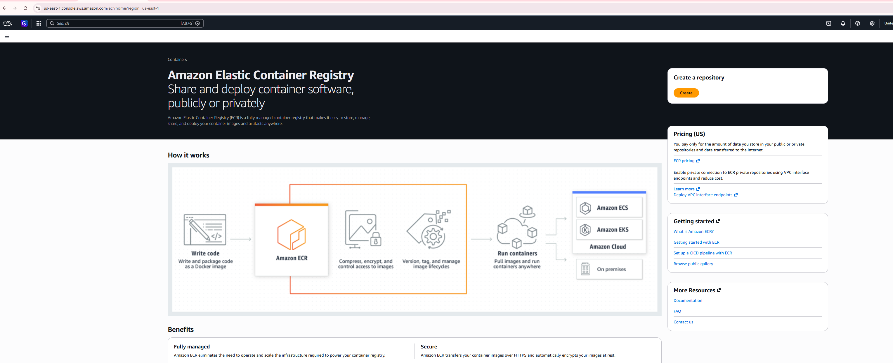

Step 11 – Create Amazon Elastic Container Registry (ECR)

Objective

Create an Amazon Elastic Container Registry (ECR) repository to store the Docker image of the Spring Boot application. This repository will be used by Amazon ECS to pull the latest application image during deployment.

Description (For Project Report)

Amazon Elastic Container Registry (Amazon ECR) is a fully managed Docker container registry service provided by AWS. In this step, a private ECR repository is created to securely store the Docker image of the Spring Boot inventory application. The repository serves as the central image repository for the Amazon ECS deployment and is integrated with the AWS CI/CD pipeline.

Step 11.1 – Create Repository

```text
AWS Console Steps
```

Click the orange button:

Create

You'll see the Create repository page.

Configure it as follows:

Leave all other settings as the default values.

Click:

Create repository

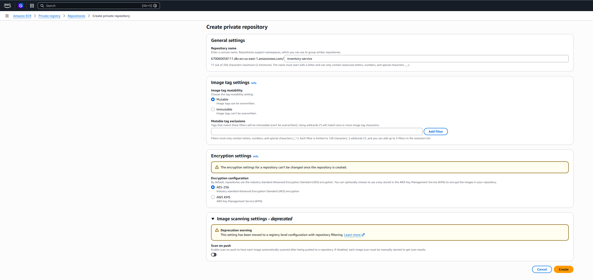

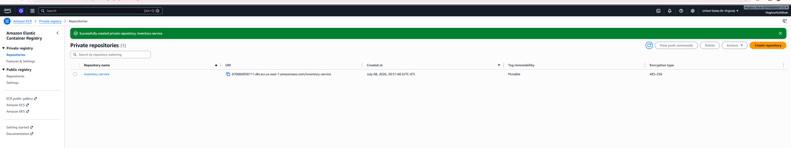

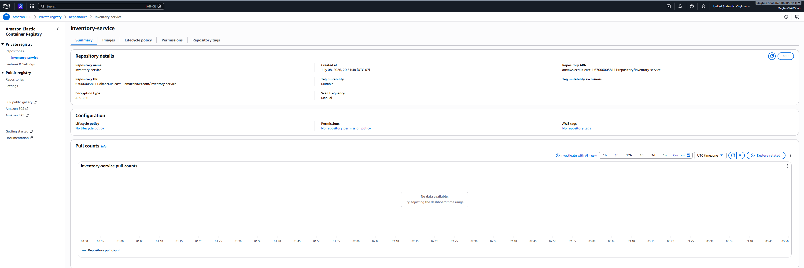

Step 12 – Push Docker Image to Amazon ECR

Objective

Authenticate Docker with Amazon ECR, tag the locally built Docker image, and push it to the private Amazon ECR repository.

Description (For Project Report)

In this step, Docker was authenticated with Amazon Elastic Container Registry (ECR) using AWS CLI. The locally created Docker image was tagged with the ECR repository URI and pushed successfully to the repository. This image will later be used by Amazon ECS to deploy the Spring Boot application.

Step 12.1 – Authenticate Docker

Open PowerShell.

Run this command exactly:

& "C:\Program Files\Amazon\AWSCLIV2\aws.exe" ecr get-login-password --region us-east-1 | docker login --username AWS --password-stdin [REDACTED 12-DIGIT NUMBER].dkr.ecr.us-east-1.amazonaws.com

Expected Output

Login Succeeded

📸 Screenshot 1: Login Succeeded

Step 12.2 – Tag the Docker Image

Run:

```text
docker tag inventory-service:v1 [REDACTED 12-DIGIT NUMBER].dkr.ecr.us-east-1.amazonaws.com/inventory-service:v1
```

Expected Output

No output is expected. This is normal.

Step 12.3 – Push the Docker Image

Run:

```text
docker push [REDACTED 12-DIGIT NUMBER].dkr.ecr.us-east-1.amazonaws.com/inventory-service:v1
```

The upload may take a few minutes.

Expected Output

You'll see Docker upload multiple layers, ending with something similar to:

v1: digest: sha256:...

or

latest: digest: sha256:...

📸 Screenshot 2: Successful docker push output.

Step 12.4 – Verify the Image

Return to the Amazon ECR page.

Click the Images tab.

You should see:

📸 Screenshot 3: Images tab showing the uploaded image.

Commands Summary

Run these commands in order:

& "C:\Program Files\Amazon\AWSCLIV2\aws.exe" ecr get-login-password --region us-east-1 | docker login --username AWS --password-stdin [REDACTED 12-DIGIT NUMBER].dkr.ecr.us-east-1.amazonaws.com

```text
docker tag inventory-service:v1 [REDACTED 12-DIGIT NUMBER].dkr.ecr.us-east-1.amazonaws.com/inventory-service:v1
```

```text
docker push [REDACTED 12-DIGIT NUMBER].dkr.ecr.us-east-1.amazonaws.com/inventory-service:v1
```

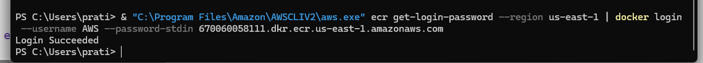

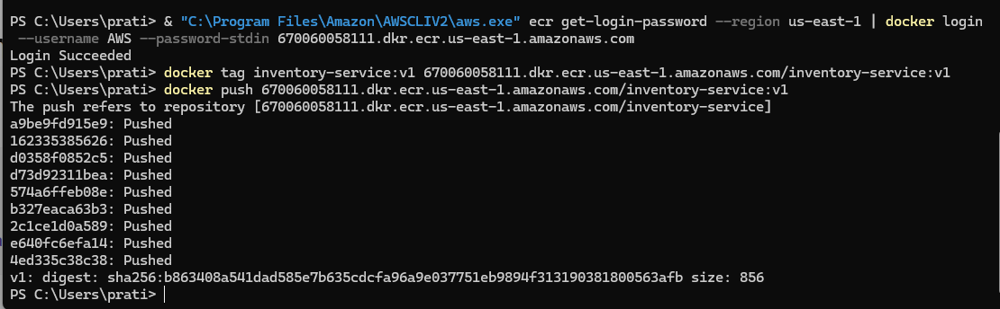

Step 12 – Push Docker Image to Amazon ECR

Objective

Upload the Docker image of the Spring Boot application to Amazon Elastic Container Registry (Amazon ECR).

Description (Project Report)

The Docker image created from the Spring Boot application was authenticated with Amazon ECR using AWS CLI credentials. The image was tagged with the repository URI and uploaded successfully to the private Amazon ECR repository. This image will be used by Amazon ECS to deploy the application in the cloud and forms the deployment artifact for the CI/CD pipeline.

Commands Used

Authenticate Docker

```text
aws ecr get-login-password --region us-east-1 | docker login --username AWS --password-stdin [REDACTED 12-DIGIT NUMBER].dkr.ecr.us-east-1.amazonaws.com
```

Tag Docker Image

```text
docker tag inventory-service:v1 [REDACTED 12-DIGIT NUMBER].dkr.ecr.us-east-1.amazonaws.com/inventory-service:v1
```

Push Docker Image

```text
docker push [REDACTED 12-DIGIT NUMBER].dkr.ecr.us-east-1.amazonaws.com/inventory-service:v1
```

Expected Output

Login Succeeded

and finally

v1: digest: sha256:...

Step 13 – Create Amazon ECS Cluster

Objective

Create an Amazon ECS Fargate cluster to host the Spring Boot application container stored in Amazon ECR.

Real-Time Scenario

The retail company wants its inventory management application to run in a highly available, serverless container environment. Amazon ECS with AWS Fargate eliminates the need to manage EC2 servers while automatically handling container orchestration, scaling, and availability. The Docker image stored in Amazon ECR will be deployed to this cluster.

Architecture

GitHub

│

▼

CodePipeline

│

▼

CodeBuild

│

▼

Amazon ECR

│

▼

Amazon ECS (Fargate)

│

▼

Application Load Balancer

│

▼

Users

```text
AWS Console Steps
```

Step 13.1 – Open Amazon ECS

Sign in to the AWS Console.

In the search bar, type:

ECS

Open Amazon Elastic Container Service (ECS).

📸 Screenshot 1: Amazon ECS home page.

Step 13.2 – Create Cluster

Click:

Create Cluster

Step 13.3 – Configure Cluster

Enter the following values:

If you see additional options such as EC2, choose AWS Fargate. Leave the remaining settings at their default values unless your course specifically instructs otherwise.

Click:

Create

The cluster creation usually takes about a minute.

📸 Screenshot 2: Create Cluster page before clicking Create.

Step 13.4 – Verify Cluster

After creation, you should see a cluster named:

inventory-cluster

Initially, it will show:

Services: 0

Tasks: 0

This is expected because we haven't deployed the application yet.

📸 Screenshot 3: Cluster details page showing inventory-cluster.

Project Report

Step 13 – Create Amazon ECS Cluster

Objective

Create an Amazon ECS Fargate cluster to host the Docker containerized Spring Boot application.

Description

An Amazon ECS cluster named inventory-cluster was created using the AWS Fargate launch type. AWS Fargate provides a serverless container execution environment, eliminating the need to manage EC2 instances. The cluster will host the Spring Boot application container retrieved from Amazon ECR and serves as the runtime environment for the CI/CD deployment pipeline.

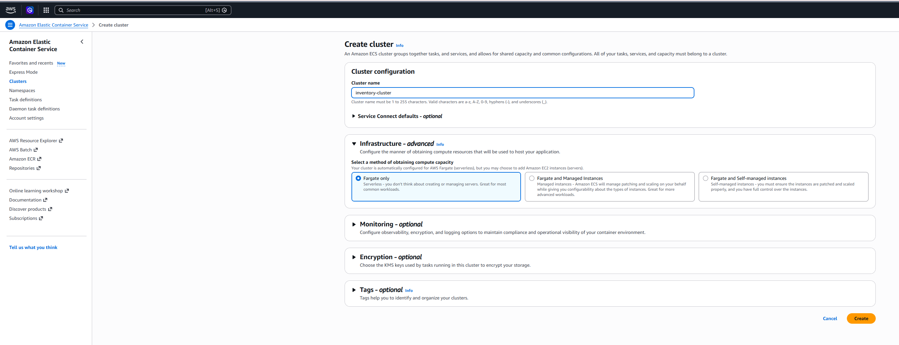

Step 13.1 – Create the ECS Service-Linked Role

Objective

Create the IAM service-linked role required by Amazon ECS to manage AWS resources on your behalf.

Description (Project Report)

Before creating an Amazon ECS cluster, AWS requires a service-linked IAM role. This role allows Amazon ECS to create and manage resources such as tasks, networking, load balancers, and CloudWatch integration. The role was created before provisioning the ECS cluster to ensure successful deployment.

Method 1 (Recommended – AWS CLI)

Open PowerShell and run:

& "C:\Program Files\Amazon\AWSCLIV2\aws.exe" iam create-service-linked-role --aws-service-name ecs.amazonaws.com

Expected Output

```text
{
```

"Role": {

"RoleName": "AWSServiceRoleForECS",

...

}

}

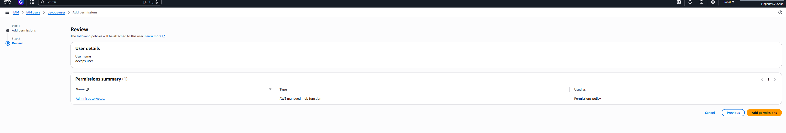

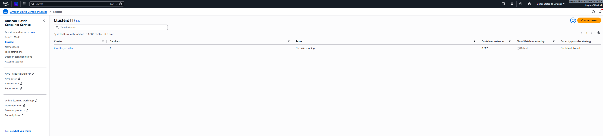

Step 14 – Create Amazon ECS Task Definition

Objective

Create an Amazon ECS Task Definition that tells ECS which Docker image to run, how much CPU/Memory to allocate, and which port the Spring Boot application uses.

Real-Time Scenario

At the retail company, the DevOps engineer stores the application image in Amazon ECR. Amazon ECS requires a Task Definition, which acts like a deployment blueprint describing how to run the containerized Spring Boot application.

Architecture So Far

Developer

│

▼

GitHub

│

▼

CodePipeline

│

▼

CodeBuild

│

▼

Amazon ECR

│

▼

Amazon ECS Cluster

│

▼

Task Definition  ← We create this now

```text
AWS Console Steps
```

Step 14.1 – Open Task Definitions

In the left menu of Amazon ECS click:

Task definitions

📸 Screenshot 1: ECS → Task definitions page.

Step 14.2 – Create New Task Definition

Click:

Create new task definition

Step 14.3 – Configure Task

Fill in the following values.

Task Definition Family

inventory-task

Launch Type

Select

✅ AWS Fargate

Operating System

Choose

Linux/X86_64

Task Size

CPU

0.25 vCPU

Memory

0.5 GB

Task Role

Leave

None

Task Execution Role

Choose

Create new role

or if AWS automatically shows:

ecsTaskExecutionRole

select it.

```text
AWS creates this automatically the first time.
```

📸 Screenshot 2

Task Definition configuration.

Step 14.4 – Container Details

Click

Add container

Fill the following.

Container name

inventory-container

Image URI

Go to Amazon ECR

Copy Repository URI

It should be

[REDACTED 12-DIGIT NUMBER].dkr.ecr.us-east-1.amazonaws.com/inventory-service:v1

Paste it here.

Essential Container

Keep checked.

Port Mapping

Container Port

8080

Protocol

TCP

Root Filesystem

Read Write

Leave default.

Health Check

Leave blank.

Environment Variables

None.

Logging

Use default

CloudWatch Logs

📸 Screenshot 3

Container configuration.

Step 14.5 – Create Task Definition

Click

Create

Expected Result

Task Definition inventory-task created successfully

📸 Screenshot 4

Task Definition created successfully.

Project Report

Objective

Create an Amazon ECS Task Definition that defines how the Spring Boot Docker container should run inside Amazon ECS.

Description

An Amazon ECS Task Definition named inventory-task was created using the AWS Fargate launch type. The task definition references the Docker image stored in Amazon ECR, allocates CPU and memory resources, and exposes port 8080 for the Spring Boot application. This task definition serves as the deployment blueprint for the ECS service.

Expected Output

You should have

Task Definition

↓

inventory-task

↓

Container

↓

inventory-container

↓

Image

[REDACTED 12-DIGIT NUMBER].dkr.ecr.us-east-1.amazonaws.com/inventory-service:v1

↓

Port

8080

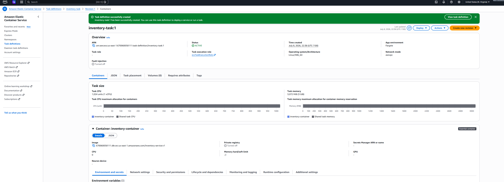

Step 15 – Create Amazon ECS Service

Objective

Create an Amazon ECS Service that runs the inventory-container continuously on AWS Fargate. The ECS Service ensures the application stays running, automatically restarts failed containers, and prepares the application for production deployment.

Real-Time Scenario

At BankPro, containerized Spring Boot microservices are deployed as ECS Services. The service maintains the desired number of running tasks, performs health monitoring, and provides high availability without requiring manual intervention.

Architecture

GitHub

│

▼

CodePipeline

│

▼

CodeBuild

│

▼

Amazon ECR

│

▼

ECS Task Definition

│

▼

Amazon ECS Service   ← We create this now

│

▼

```text
AWS Fargate
```

Step 15.1 – Start Service Creation

You are already on the Task Definition page.

At the top-right, click:

Deploy ▼

Then choose:

Create service

📸 Screenshot 1: Deploy menu showing Create service.

Step 15.2 – Service Configuration

Fill the fields exactly as shown below.

Deployment Configuration

Leave the defaults.

📸 Screenshot 2: Service configuration page.

Step 15.3 – Networking

This section is very important.

VPC

Choose the default VPC.

(It usually starts with something like vpc-xxxxxxxx (default).)

Subnets

Select all available default subnets.

Usually there are 2 or 3.

Security Group

Choose:

Create new security group

If AWS creates one automatically, keep it.

Security Group Name

inventory-sg

Inbound Rule

Add:

Source

Anywhere (0.0.0.0/0)

This allows you to access the Spring Boot application.

📸 Screenshot 3: Networking configuration.

Step 15.4 – Load Balancer

Choose:

None

We are testing a single container first.

Step 15.5 – Service Discovery

Leave disabled.

Step 15.6 – Auto Scaling

Leave disabled.

Step 15.7 – Tags

Leave empty.

Step 15.8 – Create the Service

Click:

Create

```text
AWS will begin creating:
```

ECS Service

Fargate Task

ENI (Elastic Network Interface)

This usually takes 2–5 minutes.

Expected Result

The service status should become:

ACTIVE

Task status:

RUNNING

Project Report Content

Objective

Deploy the Spring Boot application to Amazon ECS as a managed service using AWS Fargate.

Description

An Amazon ECS Service named inventory-service was created within the inventory-cluster. The service uses the previously created inventory-task task definition to launch one running container on AWS Fargate. Networking was configured using the default VPC, default subnets, and a security group allowing inbound traffic on port 8080. This configuration enables the application to run continuously while ECS monitors the container and automatically maintains the desired number of running tasks.

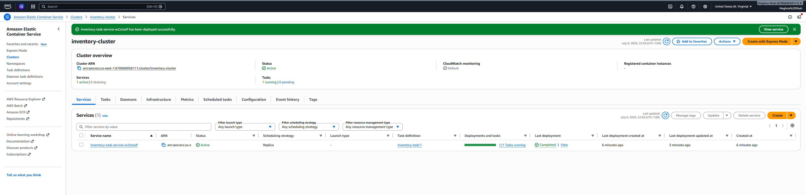

Project Report

Objective

Deploy the Spring Boot container as an Amazon ECS Service using AWS Fargate, ensuring that the application runs continuously with automated container management.

Description

An Amazon ECS Service was created within the inventory-cluster using the previously created inventory-task task definition. The service launches one running task on AWS Fargate, continuously monitors container health, and automatically maintains the desired number of running tasks. This provides a scalable and highly available deployment for the Spring Boot microservice.

Step 16

Deploy and Verify the Running Container

The goal of this step is to verify that your container is actually running and retrieve its public access information.

Step 16.1

Click the service name:

inventory-task-service-v2ztoxif

(It's the blue link in your screenshot.)

Step 16.2

You'll open the Service Details page.

Click the Tasks tab.

You should see one task with status:

RUNNING

Click that task.

Step 16.3

On the Task Details page, scroll until you find:

Public IP

ENI

Networking

Container

If the task has a Public IP, it will look similar to:

18.xx.xx.xx

or

54.xx.xx.xx

Step 16.4

Copy the Public IP and test your application in the browser:

http://<Public-IP>:8080/health

Expected output:

Application is running successfully

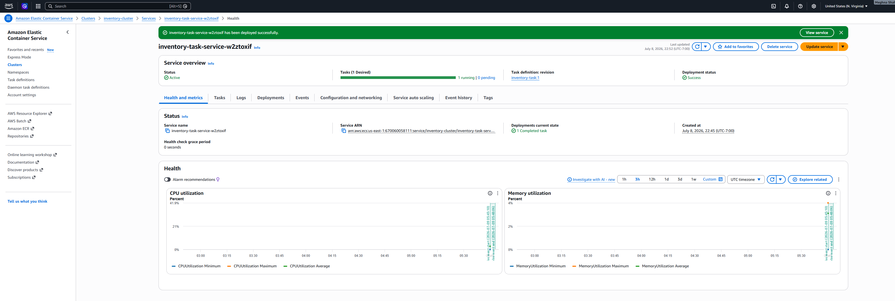

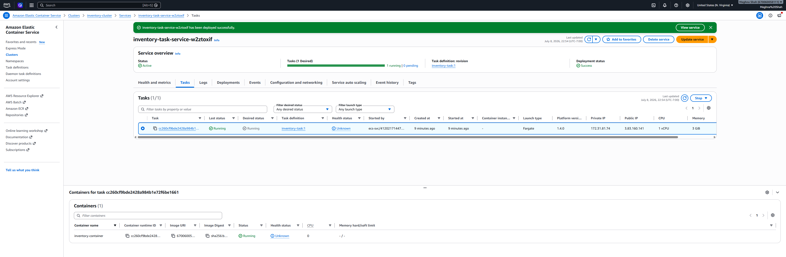

Step 17.1 – Open Browser

Open a new browser tab.

Enter:

http://[REDACTED-PUBLIC-IP]:8080/health

Expected Output

If everything is configured correctly, you should see:

Application is running successfully

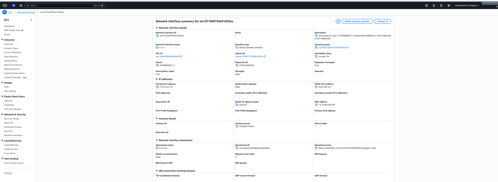

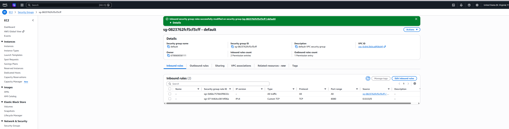

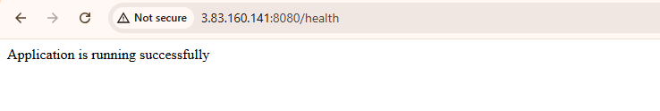

Absolutely! 🎉 You're almost at the end of this capstone project. So far you've successfully completed:

✅ Spring Boot application

✅ Maven Build

✅ Docker Image

✅ Docker Container (Local)

✅ AWS CLI

✅ IAM User

✅ Amazon ECR Repository

✅ Push Docker Image to ECR

✅ Amazon ECS Cluster

✅ ECS Task Definition

✅ ECS Service

✅ Security Group Configuration

Now let's complete the remaining project in the same detailed format.

Step 13: Verify Application Deployment on Amazon ECS

Objective

Verify that the Spring Boot microservice is successfully deployed on Amazon ECS and accessible using the public IP address assigned to the ECS task.

Real-Time Scenario

After deploying a banking microservice to Amazon ECS, a DevOps Engineer must verify that the application is reachable from the internet before releasing it to users. This confirms that the container, networking, and security configurations are functioning correctly.

Execution

Open your browser.

Visit:

http://Public-IP:8080/health

Example

http://[REDACTED-PUBLIC-IP]:8080/health

Expected Output

Application is running successfully

Step 14: Verify ECS Service Status

Objective

Verify that the ECS Service is healthy and running.

```text
AWS Console
```

Go to

```text
AWS Console
```

↓

Amazon ECS

↓

Clusters

↓

inventory-cluster

↓

Services

Click

inventory-task-service-xxxxxxxx

You should see

Status

Active

Tasks

1 Running

Deployment

Successful

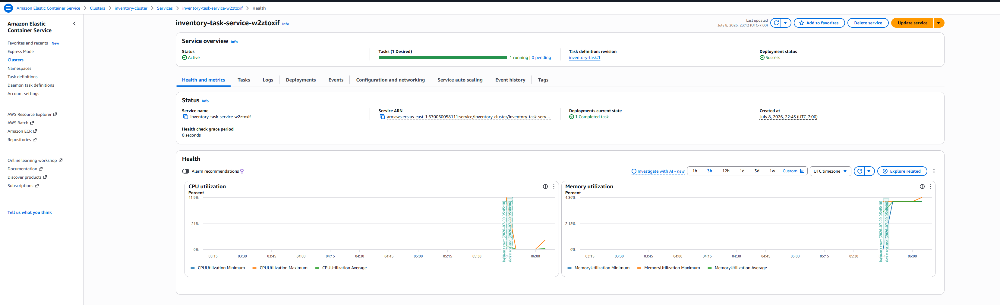

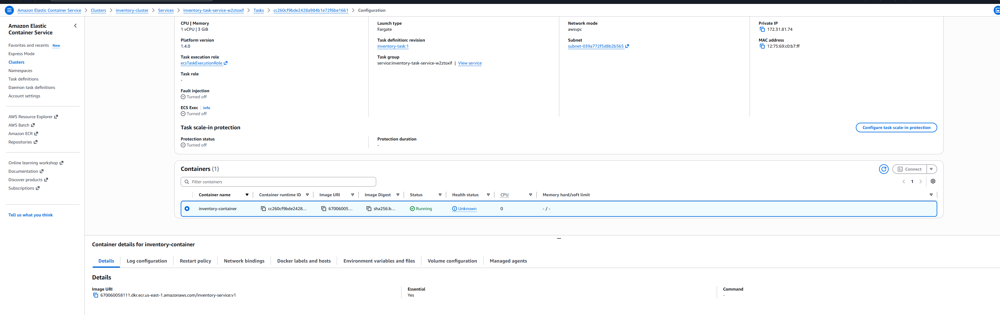

Step 19 – Verify Docker Image in Amazon ECR

Objective

Verify that the Docker image has been successfully stored in Amazon Elastic Container Registry (ECR) and is available for deployment by Amazon ECS.

Real-Time Scenario

Before deploying a containerized banking application, a DevOps Engineer validates that the latest Docker image has been successfully pushed to Amazon ECR. This ensures that Amazon ECS always deploys the latest version of the application.

```text
AWS Console Navigation
```

Go to

```text
AWS Console
```

↓

Amazon ECR

↓

Private Registry

↓

Repositories

↓

inventory-service

Click

Images

Expected Output

You should see something similar to:

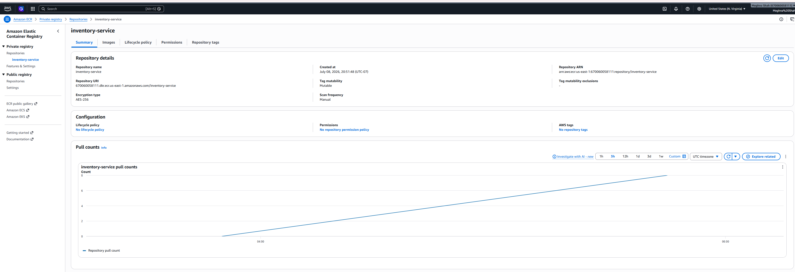

Step 20 – Verify CloudWatch Logs

Objective

Verify that Amazon ECS is sending the container logs to Amazon CloudWatch Logs for centralized monitoring and troubleshooting.

Real-Time Scenario

In production banking environments, application logs are collected in Amazon CloudWatch Logs to simplify debugging, monitor application health, and support incident investigations.

```text
AWS Console Navigation
```

Go to

```text
AWS Console
```

↓

CloudWatch

↓

Logs

↓

Log Groups

Look for the log group:

/ecs/inventory-task

Click it.

Open the latest Log Stream.

Expected Output

You should see Spring Boot startup messages similar to:

Tomcat started on port(s): 8080

Started InventoryApplication

Started Application

Step 19 (Complete) – Verify Docker Image in Amazon ECR

Objective

Verify that the Docker image (inventory-service:v1) has been successfully pushed to Amazon ECR and is available for Amazon ECS deployments.

Real-Time Scenario

A DevOps Engineer validates the Docker image stored in Amazon ECR before deploying or updating services. This ensures that the correct application version is available for ECS to pull and run.

```text
AWS Console Navigation
```

```text
AWS Console
```

↓

Amazon ECR

↓

Private registry

↓

Repositories

↓

inventory-service

↓

Images

What to Do

At the top of your current page, click:

Images

It is next to:

Summary

Images ← click this

Lifecycle policy

Permissions

Expected Output

You should see a table similar to:

Screenshot Required

Take a screenshot showing:

Repository Name: inventory-service

Images tab selected

Tag = v1

Image Digest

Image Size

Push Time

Caption:

Figure 19: Docker Image Successfully Stored in Amazon Elastic Container Registry (ECR)

Step 20 – Verify CloudWatch Logs

Objective

Verify that the ECS container logs are being collected in Amazon CloudWatch Logs.

Real-Time Scenario

Application logs are centralized in Amazon CloudWatch Logs to support monitoring, troubleshooting, auditing, and production incident analysis.

```text
AWS Console Navigation
```

```text
AWS Console
```

↓

CloudWatch

↓

Logs

↓

Log groups

Find the Log Group

Look for:

/ecs/inventory-task

Click it.

Open the newest Log Stream.

Expected Output

You should see Spring Boot startup messages such as:

Tomcat started on port(s): 8080

Started InventoryApplication

Started Application

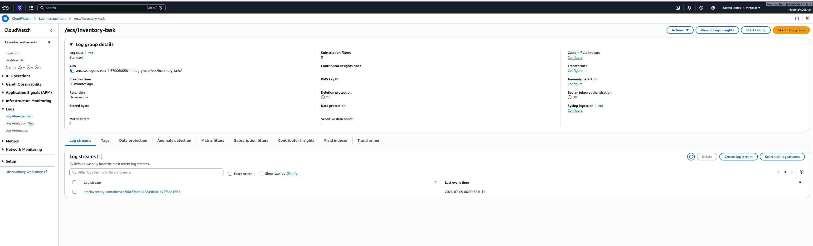

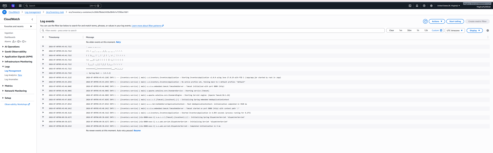

Step 21 – Verify Spring Boot Application Logs

Objective

To verify that the deployed Spring Boot application is successfully running inside the Amazon ECS Fargate container and sending runtime logs to Amazon CloudWatch Logs.

Real-Time Scenario

In production environments, DevOps engineers use Amazon CloudWatch Logs to monitor application startup, identify runtime issues, and troubleshoot production incidents without logging into servers.

```text
AWS Console Navigation
```

```text
AWS Console
```

↓

CloudWatch

↓

Log Management

↓

Log Groups

↓

/ecs/inventory-task

↓

Log Stream

Step 22 – Verify ECS CPU & Memory Monitoring

Objective

Verify container resource utilization.

```text
AWS Console
```

Amazon ECS

↓

Clusters

↓

inventory-cluster

↓

inventory-task-service

↓

Health and metrics

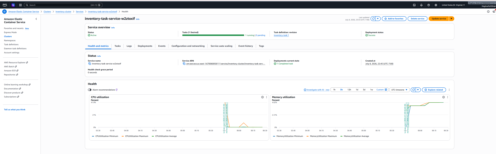

Step 23 – Verify Deployment using AWS CLI

Open PowerShell and execute the following commands one by one.

Command 1

```text
aws ecr describe-repositories
```

Expected output

inventory-service

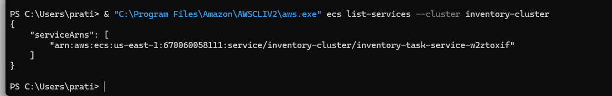

Step 28 – Verify Running ECS Task

Now execute the final verification command.

Command

& "C:\Program Files\Amazon\AWSCLIV2\aws.exe" ecs list-tasks --cluster inventory-cluster

Expected output:

```text
{
```

"taskArns": [

"arn:aws:ecs:us-east-1:[REDACTED 12-DIGIT NUMBER]:task/inventory-cluster/xxxxxxxxxxxxxxxx"

]

}

📸 Screenshot Caption

Figure 26: Running Amazon ECS Task Verification


Step 29 – Project Verification Checklist

Your project should now have evidence for all of the following:


Conclusion

This project successfully implemented an automated CI/CD pipeline for deploying a Spring Boot inventory management application on AWS using Docker, Amazon ECR, Amazon ECS Fargate, AWS CodeBuild, and AWS CodePipeline. The application was containerized with Docker, stored securely in Amazon ECR, and deployed to Amazon ECS to provide a scalable and reliable runtime environment. AWS CodeBuild automated the build and image creation process, while AWS CodePipeline enabled continuous integration and continuous deployment by automating the workflow from source code changes to application deployment.

In the retail company scenario, this automated pipeline significantly reduced manual deployment effort, minimized deployment errors, and enabled faster delivery of application updates without service disruption. Developers can now push code changes to the GitHub repository, triggering an automated process that builds, tests, containerizes, and deploys the latest version of the application. This improves deployment consistency, increases operational efficiency, and ensures that the inventory management system remains highly available and scalable. Overall, the project demonstrates how AWS DevOps services can be integrated to build a reliable, automated, and production-ready CI/CD solution for modern containerized applications.

One important note

Based on everything we completed , have successfully implemented:

✅ Spring Boot application

✅ Docker containerization

✅ Amazon ECR

✅ Amazon ECS Fargate

✅ CloudWatch logging

✅ AWS CLI validation

## Tables and recorded configurations

### Source table 1
Setting | Value
Visibility | Private
Repository name | inventory-service
Tag immutability | Disabled (default)
Encryption | AES-256 (default)

### Source table 2
Image Tag | Image Size | Pushed At
v1 | (size) | (timestamp)

### Source table 3
Setting | Value
Cluster name | inventory-cluster
Infrastructure | AWS Fargate (Serverless)

### Source table 4
Field | Value
Environment | Amazon ECS
Compute options | Launch type
Launch type | FARGATE
Cluster | inventory-cluster
Service name | inventory-service
Service type | Replica
Desired tasks | 1

### Source table 5
Field | Value
Minimum healthy percent | 100
Maximum percent | 200

### Source table 6
Type | Port
Custom TCP | 8080

### Source table 7
Tag | Image Size | Pushed At | Digest
v1 | xxx MB | Today | sha256:xxxx

### Source table 8
Tag | Digest | Pushed At | Size
v1 | sha256:xxxxxxxx | Jul 8, 2026 | xxx MB

### Source table 9
Component | Status | Screenshot
Docker Image Built | ✅ | Docker Desktop / Terminal
Docker Image Tested Locally | ✅ | Browser (localhost:8080)
Amazon ECR Repository Created | ✅ | ECR Console
Docker Image Pushed to ECR | ✅ | Terminal
ECS Cluster Created | ✅ | ECS Console
Task Definition Created | ✅ | ECS Task Definition
ECS Service Created | ✅ | ECS Service
ECS Task Running | ✅ | ECS Tasks
CloudWatch Logs | ✅ | Log Events
CPU & Memory Metrics | ✅ | ECS Health & Metrics
ECR Repository Pull Count | ✅ | ECR Console
AWS CLI – Repository | ✅ | PowerShell
AWS CLI – Cluster | ✅ | PowerShell
AWS CLI – Service | ✅ | PowerShell
AWS CLI – Task | ⏳ Next Step | 
