# Highly Available Architecture by Distributing Incoming Traffic

**Source:** Original supplied project document. Technical steps and screenshots are reproduced for portfolio review.

**Before publishing:** Review every screenshot for credentials, IP addresses, customer information and private account details.

Create Highly Available Architecture by Distributing Incoming Traffic among Healthy Service Instances in Cloud Services or Virtual Machines in a Load Balanced Set with the Help of Command-Line Interface

Course-end Project 1

Description

Project Agenda

To create high available architecture by distributing incoming traffic among healthy service instances in cloud services or virtual machines in a load-balanced set with the help of a command-line interface

Description:

The Rand Enterprises Corporation wants to deploy a web application in a highly available environment so that only the healthy instances will be serving the traffic so end users will not be facing any downtime. They have decided to work on an Azure public load balancer to implement the functionality.

The operations team at Rand decides to define the entire architecture using the load balancer and its backend pool, once that’s in place they intend to create the frontend IP and health probe along with virtual machines housing their application.

Rand Enterprises works extensively on delivering highly available web applications for their users in a secure way by avoiding directly exposing the virtual machines hosting the applications to the public internet. The communication from the application in the VM to the end-user must take place via the Load Balancer.

The expectation of the operation team is to create a reusable method that can be used for automation if in the future we need to deploy the same kind of infrastructure. So, rather than deploying resources in the Azure portal, they should leverage the command-line interface to deploy the resources so that in the future these commands can be used

As a security measure, you need to ensure that only the health instances of the virtual machine will be serving the traffic.

Tools required:

Azure account with administrator access

Prerequisites:

None

Expected Deliverables:

Identify Virtual machines and Networking

Configure the load balancer

Extend the load balancer with backend pool and frontend IP

Define the Health probe

Project Architecture

INTERNET USERS

|

|

Public IP Address

|

Azure Load Balancer

|

HTTP Load Balancing Rule

Port 80

|

Health Probe

HTTP :80

|

┌────────────┴────────────┐

|                         |

VM-01                     VM-02

Healthy                    Healthy

NGINX Web App              NGINX Web App

|                         |

└──────── Backend Pool ──┘

Azure VNet

|

Subnet

|

NSG

The important security idea is that users access the application through the Load Balancer public IP rather than directly through individual VM public IPs.

PART 1 — Project Introduction

Project Title

Create Highly Available Architecture by Distributing Incoming Traffic Among Healthy Virtual Machine Instances Using Azure Load Balancer and Azure CLI

Objective

The objective of this project is to implement a highly available web application architecture on Microsoft Azure using a Standard Public Load Balancer. Two Linux virtual machines will host web application instances and will be configured as members of the Load Balancer backend pool. A health probe will continuously monitor the health of each application instance, while a load-balancing rule will distribute HTTP traffic only to healthy virtual machines. The entire environment will be created using Azure CLI commands, creating a reusable and automation-friendly deployment process.

PART 2 — Why This Architecture Is Needed

Suppose Rand Enterprises has:

One web server

If that VM crashes:

Customer

↓

Web Server ❌

↓

Application unavailable

That is a single point of failure.

Instead:

Customer

↓

Load Balancer

├── VM1 ✅

└── VM2 ✅

If VM1 fails:

Customer

↓

Load Balancer

├── VM1 ❌

└── VM2 ✅ ← receives traffic

This is the main business benefit of the project.

First make sure you are in:

Bash

If the top-left says Switch to Bash, click it.

Your prompt should look similar to:

meghna@Azure:~$

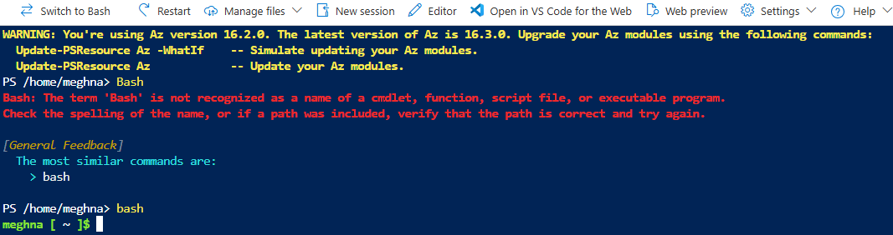

Command 1 — Check Azure CLI

```text
az version
```

This verifies that Azure CLI is available.

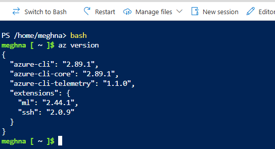

Then run:

```text
az account show --output table
```

This verifies the active Azure subscription.

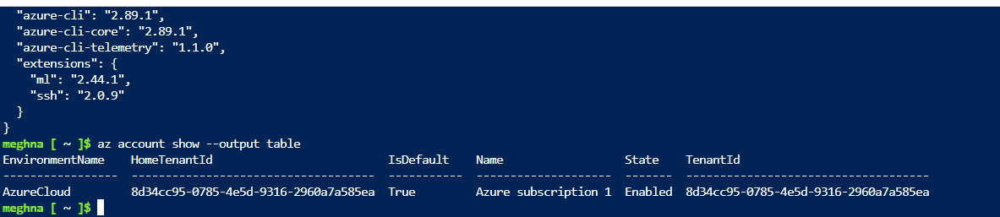

Azure CLI Authentication and Subscription Verification

Azure Cloud Shell with Bash was initialized to provide command-line access to Microsoft Azure. The Azure CLI installation and active Azure subscription were verified successfully using the az version and az account show commands. This confirmed that the environment was authenticated and ready for infrastructure deployment.

PART 4 — Define Reusable Project Variables

Purpose

Instead of repeatedly typing long resource names, reusable variables will be defined.

This also makes the deployment easier to automate later.

Copy this whole block:

RESOURCE_GROUP="rand-ha-rg"

LOCATION="eastus"

VNET="rand-vnet"

SUBNET="rand-web-subnet"

NSG="rand-web-nsg"

PUBLIC_IP="rand-lb-public-ip"

LB="rand-public-lb"

FRONTEND="rand-frontend"

BACKEND_POOL="rand-backend-pool"

PROBE="rand-health-probe"

LB_RULE="rand-http-rule"

VM1="rand-web-vm1"

VM2="rand-web-vm2"

NIC1="rand-web-nic1"

NIC2="rand-web-nic2"

Verify:

```text
echo $RESOURCE_GROUP
```

```text
echo $LOCATION
```

```text
echo $LB
```

```text
echo $VM1
```

```text
echo $VM2
```

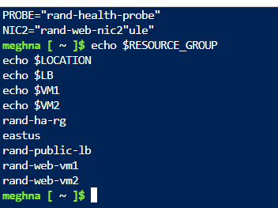

Reusable Bash variables were defined for all Azure resource names including the resource group, virtual network, load balancer, backend pool, health probe, network interfaces and virtual machines. This approach improves consistency and allows the deployment commands to be easily reused in future environments.

PART 5 — Create Resource Group

Purpose

The Resource Group acts as the main container for all project resources.

Run:

```text
az group create \
```

--name $RESOURCE_GROUP \

--location $LOCATION

Verify:

```text
az group show \
```

--name $RESOURCE_GROUP \

--output table

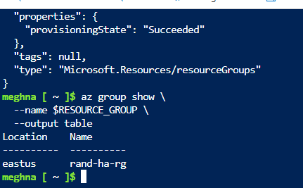

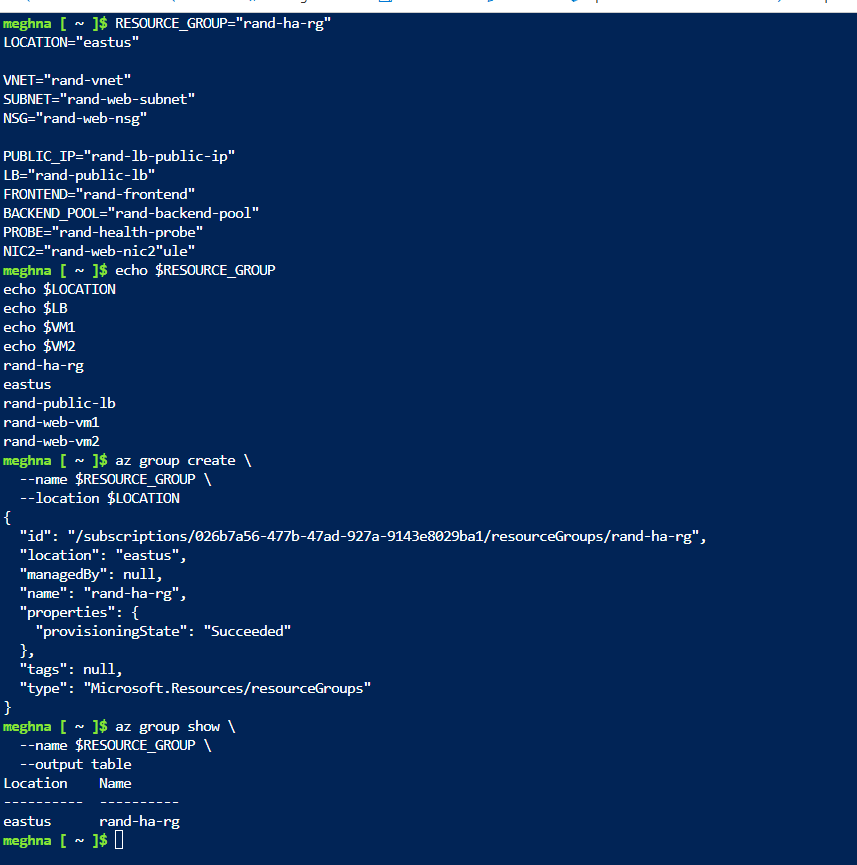

A dedicated Azure Resource Group named rand-ha-rg was created in the East US region. All networking, compute and load-balancing resources for the project will be maintained within this Resource Group for easier administration and cleanup.

PART 6 — Create Virtual Network and Subnet

Purpose

The Virtual Network provides the private network in which the backend virtual machines will operate.

Run:

```text
az network vnet create \
```

--resource-group $RESOURCE_GROUP \

--name $VNET \

--address-prefix 10.10.0.0/16 \

--subnet-name $SUBNET \

--subnet-prefix 10.10.1.0/24

Verify:

```text
az network vnet show \
```

--resource-group $RESOURCE_GROUP \

--name $VNET \

--output table

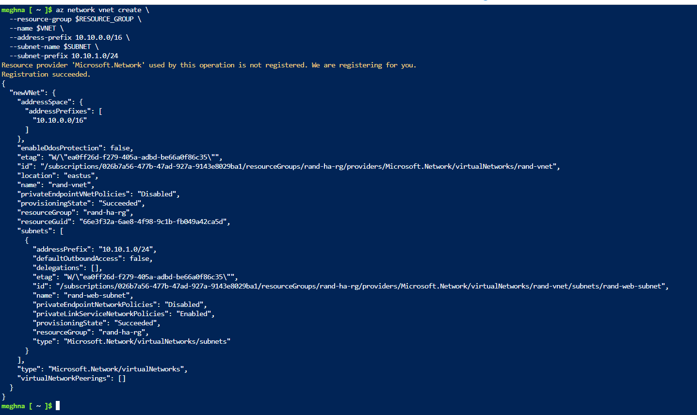

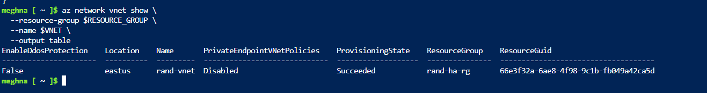

A Virtual Network named rand-vnet was created with the address space 10.10.0.0/16. A dedicated web subnet using 10.10.1.0/24 was also created for hosting the backend virtual machines.

PART 7 — Create Network Security Group

Purpose

The NSG works as a network firewall.

We need the web application to receive HTTP traffic on:

TCP Port 80

Create NSG:

```text
az network nsg create \
```

--resource-group $RESOURCE_GROUP \

--name $NSG

Create HTTP rule:

```text
az network nsg rule create \
```

--resource-group $RESOURCE_GROUP \

--nsg-name $NSG \

--name Allow-HTTP \

--priority 200 \

--direction Inbound \

--access Allow \

--protocol Tcp \

--destination-port-ranges 80

Attach the NSG to the subnet:

```text
az network vnet subnet update \
```

--resource-group $RESOURCE_GROUP \

--vnet-name $VNET \

--name $SUBNET \

--network-security-group $NSG

Verify:

```text
az network nsg rule list \
```

--resource-group $RESOURCE_GROUP \

--nsg-name $NSG \

--output table

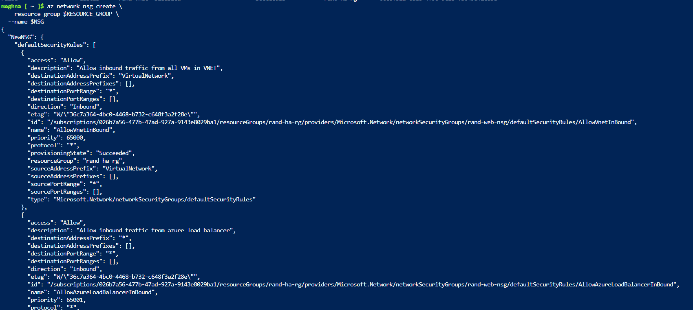

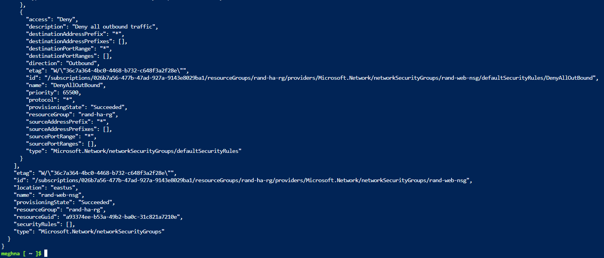

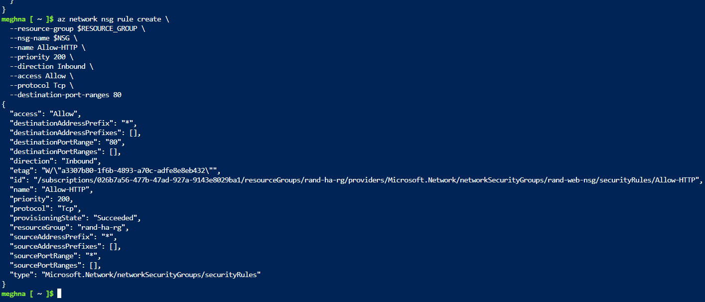

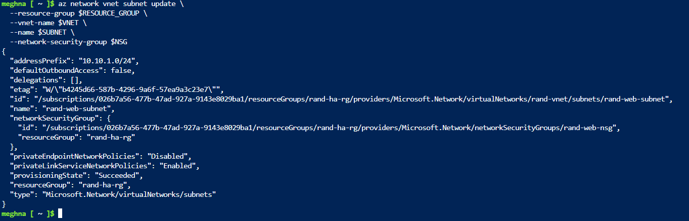

A Network Security Group was created to protect the backend network. An inbound rule was added to permit HTTP communication over TCP port 80, allowing the Load Balancer to communicate with the web application instances.

PART 8 — Create Public IP for Load Balancer

Purpose

Users need one public address to access the application.

The individual VMs will not receive public IPs.

Run:

```text
az network public-ip create \
```

--resource-group $RESOURCE_GROUP \

--name $PUBLIC_IP \

--sku Standard \

--allocation-method Static

Verify:

```text
az network public-ip show \
```

--resource-group $RESOURCE_GROUP \

--name $PUBLIC_IP \

--query "{Name:name,IPAddress:ipAddress,SKU:sku.name}" \

--output table

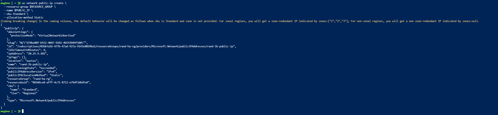

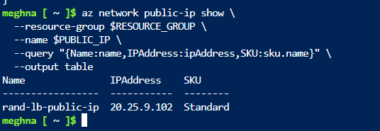

A Standard static public IP address was created for the Azure Load Balancer. This IP provides a single public endpoint for end users while avoiding direct public exposure of the individual backend virtual machines.

PART 9 — Create Azure Public Load Balancer

Purpose

The Load Balancer receives incoming user traffic and distributes it across healthy backend servers.

Run:

```text
az network lb create \
```

--resource-group $RESOURCE_GROUP \

--name $LB \

--sku Standard \

--public-ip-address $PUBLIC_IP \

--frontend-ip-name $FRONTEND \

--backend-pool-name $BACKEND_POOL

Azure CLI currently supports creating a Standard Load Balancer with a frontend IP and backend pool in this way.

Verify:

```text
az network lb show \
```

--resource-group $RESOURCE_GROUP \

--name $LB \

--output table

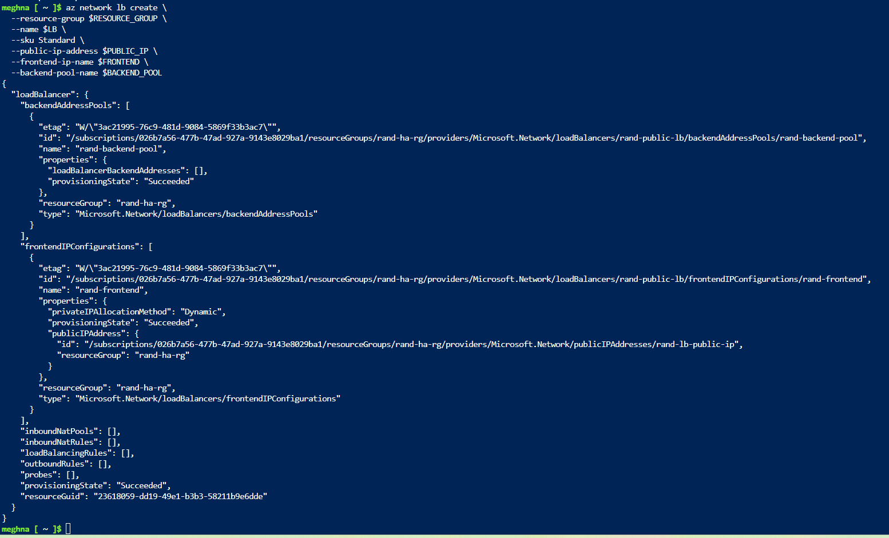

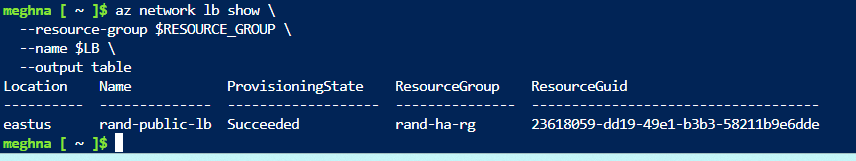

A Standard Public Azure Load Balancer named rand-public-lb was created. The Load Balancer includes a frontend IP configuration for receiving incoming traffic and a backend pool that will contain the web server virtual machines.

PART 10 — Create Health Probe

Purpose

The health probe decides whether a backend VM is healthy enough to receive traffic.

Run:

```text
az network lb probe create \
```

--resource-group $RESOURCE_GROUP \

--lb-name $LB \

--name $PROBE \

--protocol Http \

--port 80 \

--path /

Current Azure CLI supports HTTP probes using protocol, port and path parameters.

Verify:

```text
az network lb probe show \
```

--resource-group $RESOURCE_GROUP \

--lb-name $LB \

--name $PROBE \

--output table

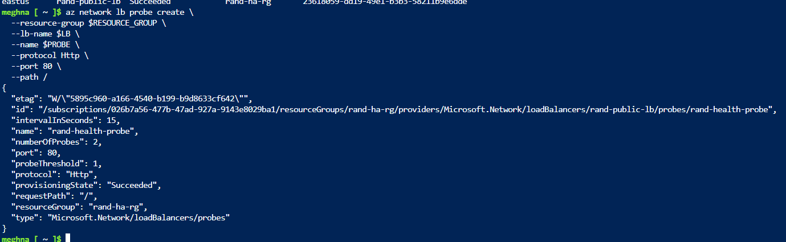

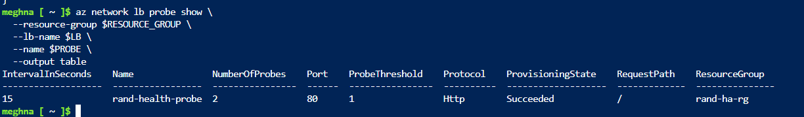

An HTTP health probe named rand-health-probe was configured on port 80. The Load Balancer uses the health probe to determine whether each backend web server can successfully respond to HTTP requests. Unhealthy instances are removed from new load-balanced traffic until they recover.

PART 11 — Create Load-Balancing Rule

Purpose

The rule tells Azure:

Traffic arriving at frontend port 80

↓

Send to healthy backend VM port 80

Run:

```text
az network lb rule create \
```

--resource-group $RESOURCE_GROUP \

--lb-name $LB \

--name $LB_RULE \

--protocol Tcp \

--frontend-port 80 \

--backend-port 80 \

--frontend-ip-name $FRONTEND \

--backend-pool-name $BACKEND_POOL \

--probe-name $PROBE \

--idle-timeout 15 \

--enable-tcp-reset true

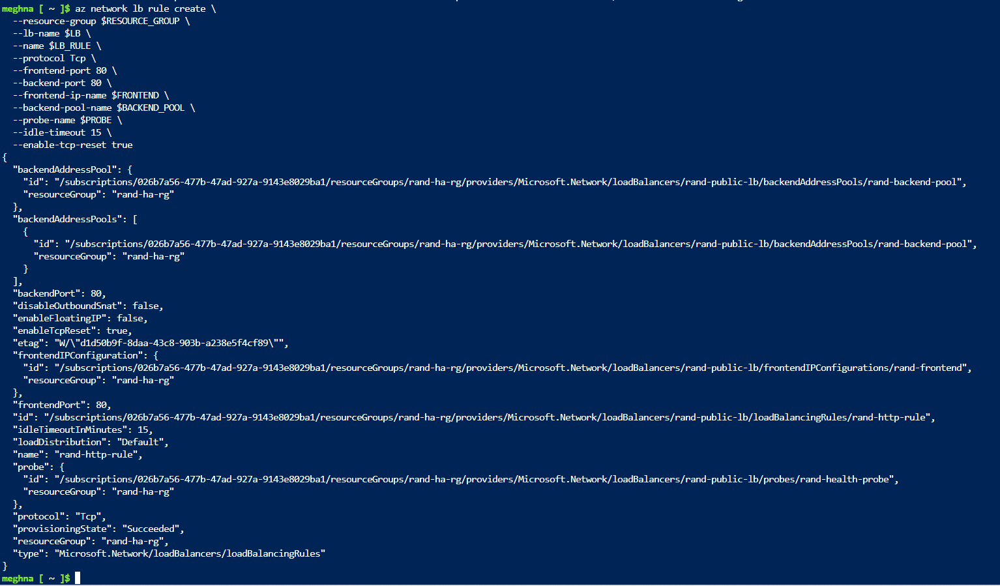

Microsoft documents this same relationship between the frontend IP, backend pool and health probe.

Verify:

```text
az network lb rule show \
```

--resource-group $RESOURCE_GROUP \

--lb-name $LB \

--name $LB_RULE \

--output table

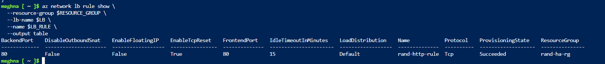

A load-balancing rule was configured to accept TCP traffic on frontend port 80 and forward it to port 80 of healthy backend virtual machines. The health probe was associated with this rule to ensure that only available web servers receive new requests.

PART 12 — Create Network Interfaces

Purpose

Each VM requires a Network Interface Card, or NIC.

The NIC will also connect each VM to the Load Balancer backend pool.

Azure CLI supports associating NICs with Load Balancer backend pools.

VM1

```text
az network nic create \
```

--resource-group $RESOURCE_GROUP \

--name $NIC1 \

--vnet-name $VNET \

--subnet $SUBNET \

--lb-name $LB \

--lb-address-pools $BACKEND_POOL

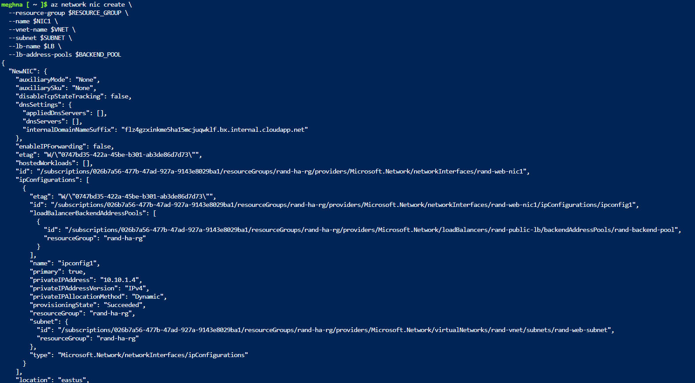

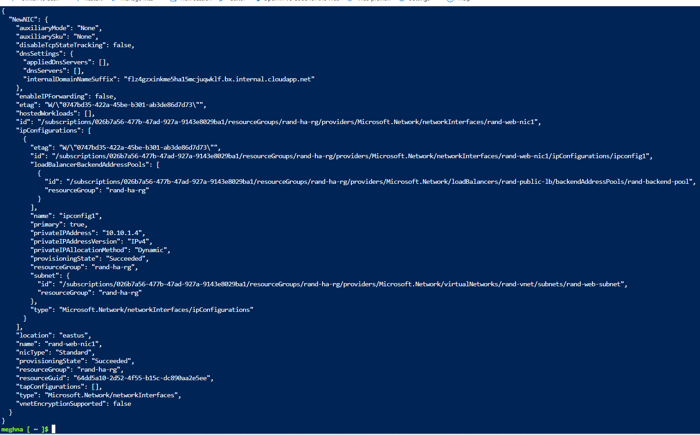

VM2

```text
az network nic create \
```

--resource-group $RESOURCE_GROUP \

--name $NIC2 \

--vnet-name $VNET \

--subnet $SUBNET \

--lb-name $LB \

--lb-address-pools $BACKEND_POOL

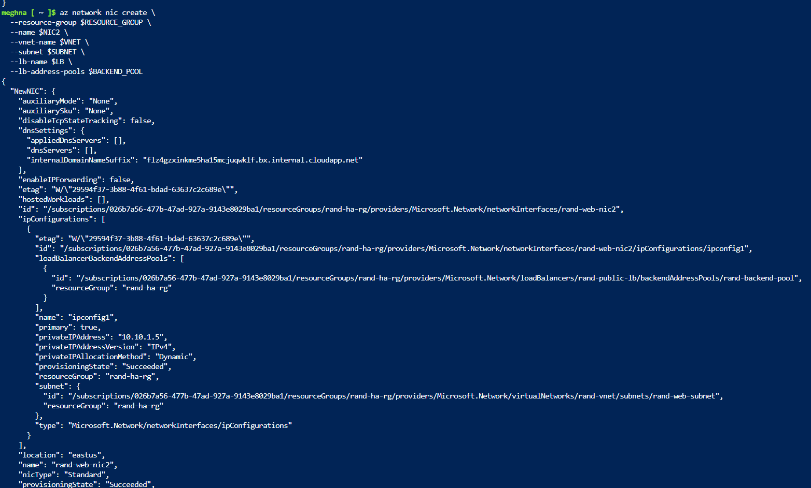

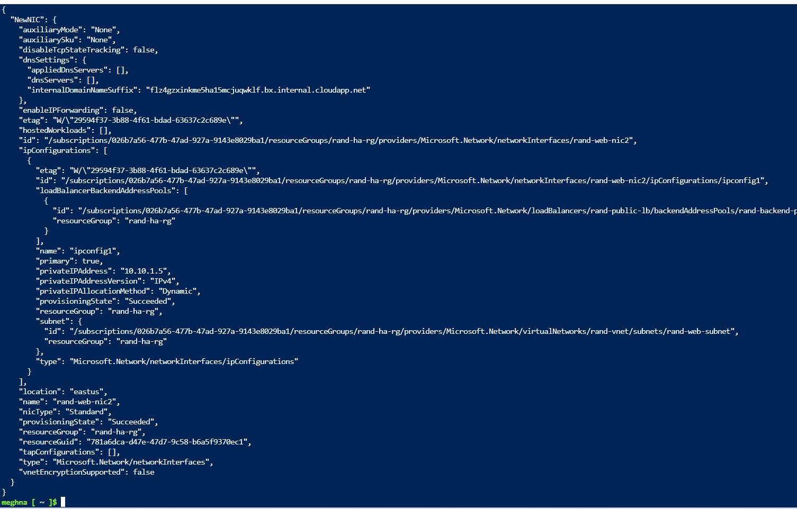

Verify:

```text
az network nic list \
```

--resource-group $RESOURCE_GROUP \

--output table

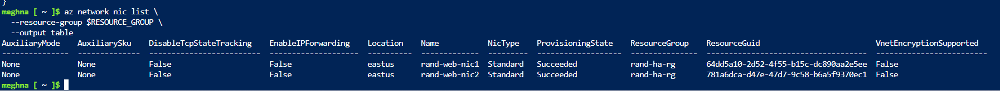

Two network interfaces were created for the backend virtual machines and connected to the application's Virtual Network and subnet. Both network interfaces were associated with the Azure Load Balancer backend pool.

PART 13 — Create Automatic Web-Server Setup Script

This avoids manually SSHing into both machines.

Run:

```text
cat > cloud-init.txt <<'EOF'
```

#cloud-config

package_update: true

packages:

- nginx

runcmd:

- systemctl enable nginx

- systemctl start nginx

- bash -c 'echo "<html><body><h1>Rand Enterprises</h1><h2>Highly Available Web Application</h2><p>Healthy Web Server</p><p>Server: $(hostname)</p></body></html>" > /var/www/html/index.html'

EOF

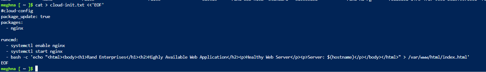

Verify:

```text
cat cloud-init.txt
```

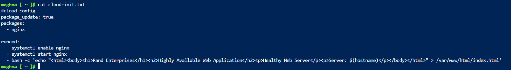

A cloud-init configuration file was created to automate application deployment on both virtual machines. During VM provisioning, Nginx is installed and started automatically, and a sample Rand Enterprises web page is created. This eliminates the need to manually configure each web server.

PART 14 — Create Two Backend Virtual Machines

This is the part that may take several minutes.

We deliberately do not create public IPs for the VMs.

VM1

```text
az vm create \
```

--resource-group $RESOURCE_GROUP \

--name $VM1 \

--nics $NIC1 \

--image Ubuntu2204 \

--size Standard_B1s \

--admin-username azureuser \

--generate-ssh-keys \

--public-ip-address "" \

--custom-data cloud-init.txt

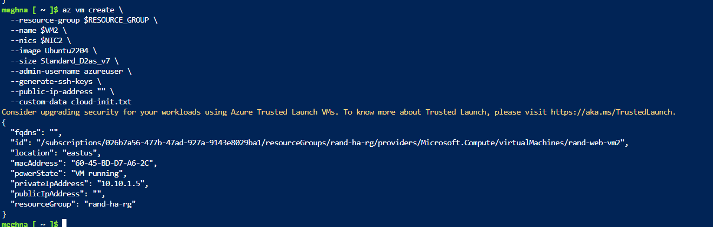

Create VM2

```text
az vm create \
```

--resource-group $RESOURCE_GROUP \

--name $VM2 \

--nics $NIC2 \

--image Ubuntu2204 \

--size Standard_D2as_v7 \

--admin-username azureuser \

--generate-ssh-keys \

--public-ip-address "" \

--custom-data cloud-init.txt

Then verify both:

```text
az vm list \
```

--resource-group $RESOURCE_GROUP \

--show-details \

--output table

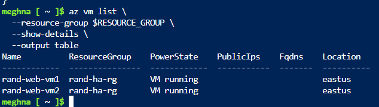

Two Ubuntu Linux virtual machines were successfully deployed as backend web servers using Azure CLI. Because smaller B-series VM sizes were unavailable in the selected East US region, an available D-series size was selected after validating regional SKU availability. Both virtual machines were connected through private network interfaces associated with the Azure Load Balancer backend pool and were created without individual public IP addresses.

PART 15 — Verify the Load Balancer Backend Pool

Purpose

The Load Balancer backend pool must contain both virtual-machine network interfaces so that traffic can be distributed between them.

Run:

```text
az network lb address-pool show \
```

--resource-group $RESOURCE_GROUP \

--lb-name $LB \

--name $BACKEND_POOL

You should see backend IP configuration references associated with:

rand-web-nic1

rand-web-nic2

For cleaner output, you can also run:

```text
az network lb address-pool show \
```

--resource-group $RESOURCE_GROUP \

--lb-name $LB \

--name $BACKEND_POOL \

--query "{BackendPool:name,BackendCount:length(backendIPConfigurations)}" \

--output table

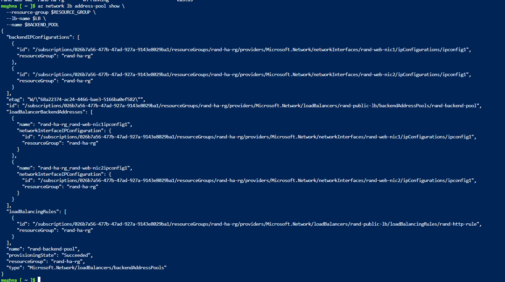

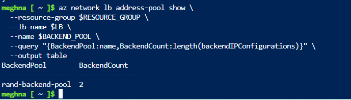

Load Balancer Backend Pool Verification

The Azure Load Balancer backend pool was verified to confirm that both virtual-machine network interfaces were registered successfully. This allows incoming application requests to be distributed among the two backend web-server instances.

PART 16 — Retrieve the Load Balancer Public IP

Purpose

The Load Balancer public IP is the single application endpoint that end users will access.

Run:

LB_IP=$(az network public-ip show \

--resource-group $RESOURCE_GROUP \

--name $PUBLIC_IP \

--query ipAddress \

--output tsv)

Then:

```text
echo "Rand Enterprises Load Balancer Public IP: $LB_IP"
```

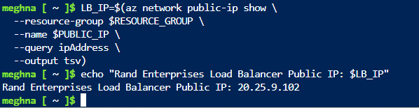

The static public IP associated with the Azure Load Balancer was retrieved using Azure CLI. This IP address acts as the single public endpoint for the Rand Enterprises web application, allowing users to access the service without directly connecting to the backend virtual machines.

PART 17 — Test the Web Application

Cloud-init may need a little time to finish installing Nginx.

Wait about 2 minutes after the VMs finish creating.

First test:

```text
curl http://$LB_IP
```

Expected result similar to:

<html>

<body>

<h1>Rand Enterprises</h1>

<h2>Highly Available Web Application</h2>

<p>Healthy Web Server</p>

<p>Server: rand-web-vm1</p>

</body>

</html>

Test several requests

Run:

for i in {1..10}; do

```text
echo "Request $i"
```

```text
curl -s http://$LB_IP | grep "Server:"
```

sleep 1

done

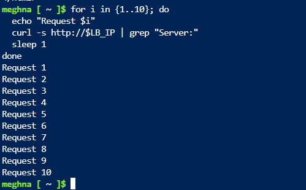

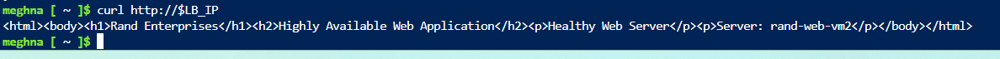

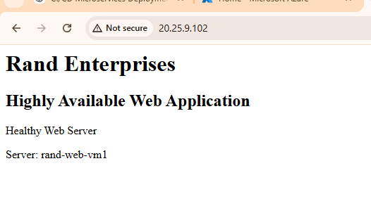

The Rand Enterprises web application was successfully accessed using the Azure Load Balancer public IP address. The HTTP response confirmed that incoming client traffic reached the Load Balancer and was forwarded to a healthy backend Nginx web server. The response showed that rand-web-vm2 served the request, validating the Load Balancer frontend IP, backend pool, health probe and load-balancing configuration.

Use this block first:

RESOURCE_GROUP="rand-ha-rg"

LOCATION="eastus"

VNET="rand-vnet"

SUBNET="rand-web-subnet"

NSG="rand-web-nsg"

PUBLIC_IP="rand-lb-public-ip"

LB="rand-public-lb"

FRONTEND="rand-frontend"

BACKEND_POOL="rand-backend-pool"

PROBE="rand-health-probe"

LB_RULE="rand-http-rule"

VM1="rand-web-vm1"

VM2="rand-web-vm2"

NIC1="rand-web-nic1"

NIC2="rand-web-nic2"

LB_IP=$(az network public-ip show \

--resource-group $RESOURCE_GROUP \

--name $PUBLIC_IP \

--query ipAddress \

--output tsv)

Verify:

```text
echo $RESOURCE_GROUP
```

```text
echo $VM1
```

```text
echo $VM2
```

```text
echo $LB_IP
```

You should see:

rand-ha-rg

rand-web-vm1

rand-web-vm2

[REDACTED-PUBLIC-IP]

PART 18 — High Availability Test

Purpose

The purpose of this step is to prove that the application remains available even when one backend virtual machine fails.

First confirm both VMs are running:

```text
az vm list \
```

--resource-group $RESOURCE_GROUP \

--show-details \

--output table

First check both VMs:

```text
az vm list \
```

--resource-group $RESOURCE_GROUP \

--show-details \

--output table

Now stop VM1:

```text
az vm stop \
```

--resource-group $RESOURCE_GROUP \

--name $VM1

Verify VM1 status:

```text
az vm get-instance-view \
```

--resource-group $RESOURCE_GROUP \

--name $VM1 \

--query "instanceView.statuses[?starts_with(code, 'PowerState/')].displayStatus" \

--output tsv

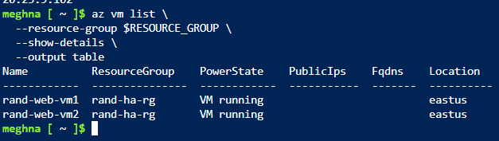

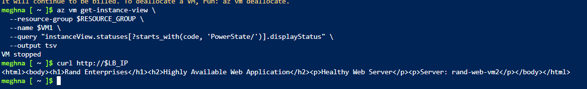

Now test the application:

```text
curl http://$LB_IP
```

Expected output:

<html><body><h1>Rand Enterprises</h1><h2>Highly Available Web Application</h2><p>Healthy Web Server</p><p>Server: rand-web-vm2</p></body></html>

You can also run:

for i in {1..5}; do

```text
echo "Request $i"
```

```text
curl -s http://$LB_IP | grep "Server:"
```

sleep 2

done

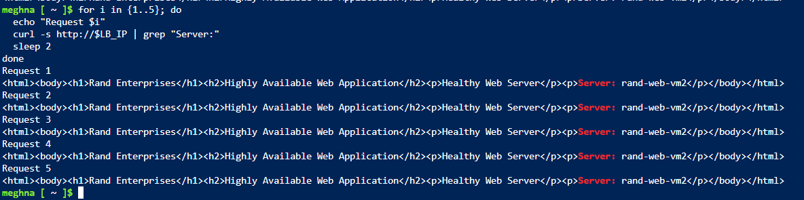

High availability was validated by intentionally stopping the first backend virtual machine. After the Azure Load Balancer health probe detected that VM1 was unavailable, new requests continued to be processed by VM2. The application remained accessible through the same Load Balancer public IP address, demonstrating fault tolerance and continued service availability despite the failure of one backend server.

Part 19 — Restore VM1

Start VM1 again:

```text
az vm start \
```

--resource-group $RESOURCE_GROUP \

--name $VM1

Verify both VMs:

```text
az vm list \
```

--resource-group $RESOURCE_GROUP \

--show-details \

--output table

Then test again:

```text
curl http://$LB_IP
```

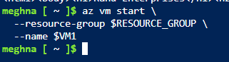

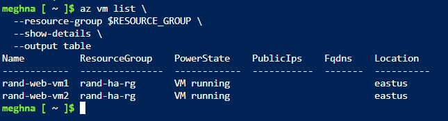

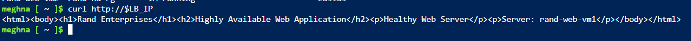

After the high-availability test, VM1 was restarted. Once the virtual machine became healthy and the Nginx service was available, it became eligible to receive load-balanced application traffic again.

Part 20 — Backend Pool Verification

Run:

```text
az network lb address-pool show \
```

--resource-group $RESOURCE_GROUP \

--lb-name $LB \

--name $BACKEND_POOL \

--query "{BackendPool:name,BackendCount:length(backendIPConfigurations)}" \

--output table

Expected:

BackendPool          BackendCount

-------------------  ------------

rand-backend-pool    2

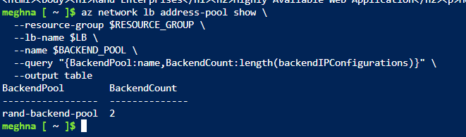

The Azure Load Balancer backend pool was verified and confirmed to contain two backend targets. Both virtual-machine network interfaces remained associated with the Load Balancer, providing multiple application instances for traffic distribution and high availability.

Part 21 — Health Probe Verification

Run:

```text
az network lb probe show \
```

--resource-group $RESOURCE_GROUP \

--lb-name $LB \

--name $PROBE \

--query "{Name:name,Protocol:protocol,Port:port,Path:requestPath}" \

--output table

Expected:

Name                Protocol    Port    Path

------------------  ----------  ------  ----

rand-health-probe   Http        80      /

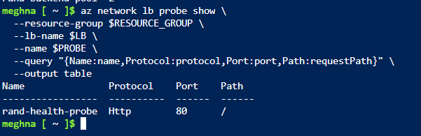

The Azure Load Balancer health probe was verified to use HTTP on port 80 with the root path /. This probe continuously checks the availability of the backend web servers and prevents unhealthy instances from receiving new application traffic.

Part 22 — Load Balancing Rule Verification

Run:

```text
az network lb rule show \
```

--resource-group $RESOURCE_GROUP \

--lb-name $LB \

--name $LB_RULE \

--query "{Name:name,Protocol:protocol,FrontendPort:frontendPort,BackendPort:backendPort}" \

--output table

Expected:

Name              Protocol    FrontendPort    BackendPort

----------------  ----------  --------------  -----------

rand-http-rule    Tcp         80              80

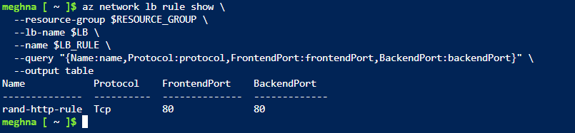

The load-balancing rule was verified to receive TCP traffic on frontend port 80 and forward it to port 80 on the backend application servers. This configuration works together with the health probe so that incoming requests are sent only to healthy backend instances.

Part 23 — Final Application Test

Run:

```text
curl http://$LB_IP
```

Then:

for i in {1..10}; do

```text
echo "Request $i"
```

```text
curl -s http://$LB_IP | grep "Server:"
```

sleep 1

done

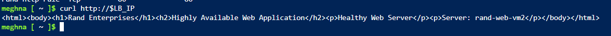

Final application testing confirmed that the Rand Enterprises web application remained accessible through the Azure Load Balancer public endpoint. Requests were successfully forwarded to healthy backend servers, validating the overall Load Balancer configuration and application availability.

Part 24 — Final Architecture Summary

Run:

```text
echo "========================================================"
```

```text
echo "   RAND ENTERPRISES HIGH AVAILABILITY ARCHITECTURE"
```

```text
echo "========================================================"
```

```text
echo "Resource Group        : $RESOURCE_GROUP"
```

```text
echo "Location              : $LOCATION"
```

```text
echo "Virtual Network       : $VNET"
```

```text
echo "Subnet                : $SUBNET"
```

```text
echo "Network Security      : $NSG"
```

```text
echo "Load Balancer         : $LB"
```

```text
echo "Frontend              : $FRONTEND"
```

```text
echo "Backend Pool          : $BACKEND_POOL"
```

```text
echo "Health Probe          : $PROBE"
```

```text
echo "Load Balancing Rule   : $LB_RULE"
```

```text
echo "Virtual Machine 1     : $VM1"
```

```text
echo "Virtual Machine 2     : $VM2"
```

```text
echo "Application Public IP : $LB_IP"
```

```text
echo "========================================================"
```

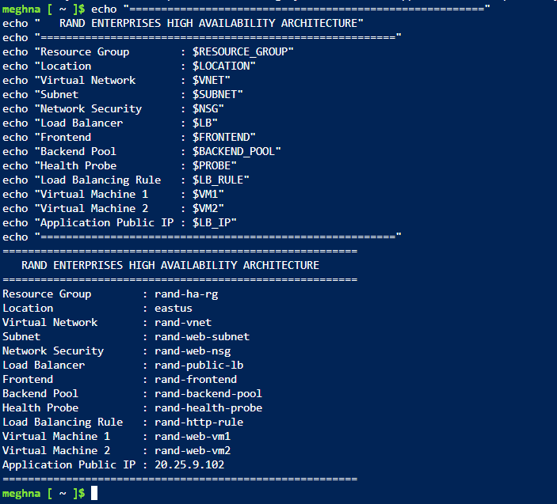

The completed Rand Enterprises architecture consisted of a dedicated Resource Group, Virtual Network, subnet, Network Security Group, Standard Public Load Balancer, frontend public IP, backend pool, HTTP health probe, load-balancing rule, and two Ubuntu web-server virtual machines. The application was exposed through a single Load Balancer public endpoint while the backend virtual machines remained without individual public IP addresses.

Part 25 — Final Project Result

The Rand Enterprises highly available web application architecture was successfully deployed using Microsoft Azure and Azure CLI. Two Ubuntu virtual machines running Nginx were configured as backend application servers and connected to the Azure Load Balancer backend pool. A Standard Public Load Balancer provided a single public endpoint for users, while an HTTP health probe continuously monitored the health of the backend servers. High availability was successfully demonstrated by intentionally stopping one backend virtual machine and confirming that the application remained accessible through the second healthy server. After the failed virtual machine was restored, it again became eligible to receive application traffic. The project successfully demonstrated traffic distribution, fault tolerance, health monitoring, private backend servers, and command-line infrastructure deployment.

Part 26 — Conclusion

This project successfully demonstrated the implementation of a highly available web application architecture using Microsoft Azure Load Balancer and Azure CLI. The infrastructure was deployed through reusable command-line instructions, providing an automation-friendly approach to cloud infrastructure management. A Virtual Network and subnet provided private connectivity for the backend servers, while a Network Security Group controlled HTTP access. Two Ubuntu virtual machines running Nginx were deployed as backend web servers and associated with the Azure Load Balancer backend pool. A Standard Public Load Balancer provided a single frontend application endpoint, while an HTTP health probe continuously monitored backend server availability. The load-balancing rule forwarded incoming HTTP traffic only to healthy application instances. High availability was validated by intentionally stopping one backend virtual machine and confirming that the application remained accessible through the remaining healthy server. The failed VM was later restored and rejoined the available backend infrastructure. Overall, the project demonstrated load balancing, health monitoring, fault tolerance, network security, private backend infrastructure, and reusable Azure CLI-based deployment.
