# Application Deployment to AWS Cloud-capstone Project

**Source:** Original supplied project document. Technical steps and screenshots are reproduced for portfolio review.

**Before publishing:** Review every screenshot for credentials, IP addresses, customer information and private account details.

End-to-End CI/CD Deployment of Spring Boot Banking Microservice on AWS using Jenkins, Docker, and Ansible

Project Description

BankPro is a financial services company that wants to modernize its core banking application by moving from manual deployment to an automated CI/CD process. In this project, a Spring Boot banking microservice is deployed on an AWS EC2 server using Jenkins, Docker, and Ansible.

The application source code is stored in GitHub. Jenkins pulls the code, builds it using Maven, runs test cases, creates a Docker image, pushes the image to Docker Hub, and triggers Ansible to deploy the container on the AWS target server. This reduces manual deployment effort, improves release speed, and supports reliable cloud-based application delivery.

2. Objective

The objective is to automate the complete build, test, containerization, and deployment process of a Spring Boot microservice on AWS using Jenkins pipeline, Docker, Ansible, GitHub, and Docker Hub.

Project Architecture

Developer

|

v

GitHub Repository

|

v

Jenkins Server on AWS EC2

|

|-- Checkout Code

|-- Maven Build

|-- Run Tests

|-- Build Docker Image

|-- Push Image to Docker Hub

|

v

```text
Ansible Deployment
```

|

v

```text
AWS EC2 Target Server
```

|

v

Spring Boot Banking App Running in Docker Container

```text
AWS Project Plan
```

Create 2 EC2 Ubuntu servers:

Server 1: Jenkins + Docker + Ansible Control Node

Server 2: Application Deployment Server

Recommended AWS setup:

AMI: Ubuntu 22.04 LTS

Instance type: t2.micro or t3.micro

Storage: 20 GB

Security Group Ports:

22   - SSH

8080 - Jenkins

8081 - Spring Boot App

GitHub Repository Structure

Create a GitHub repository named:

bankpro-springboot-cicd

Folder structure:

bankpro-springboot-cicd/

├── src/

├── pom.xml

├── Dockerfile

├── Jenkinsfile

├── ansible/

│   ├── inventory.ini

│   └── deploy.yml

└── README.md

Step-by-Step Execution

Step 1: Launch AWS EC2 Instances

Launch two Ubuntu EC2 instances.

Rename them:

```text
jenkins-server
bankpro-app-server
```

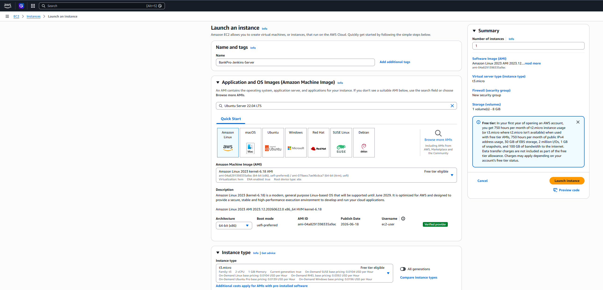

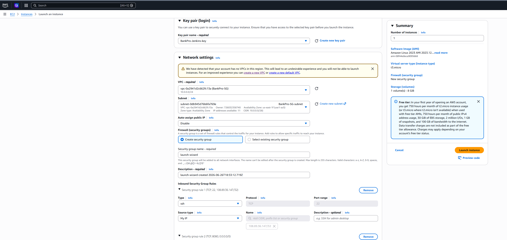

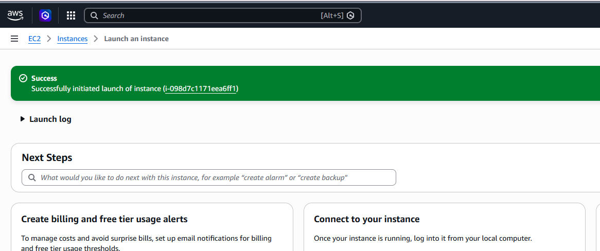

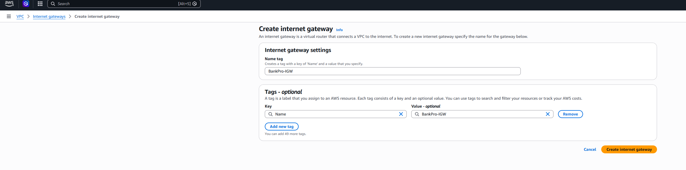

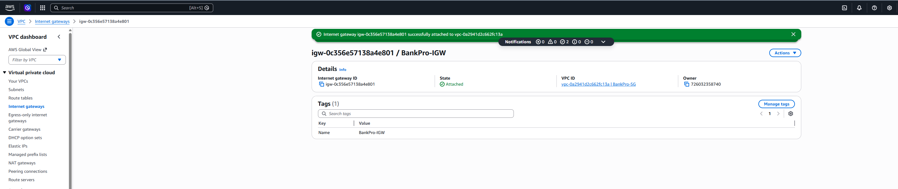

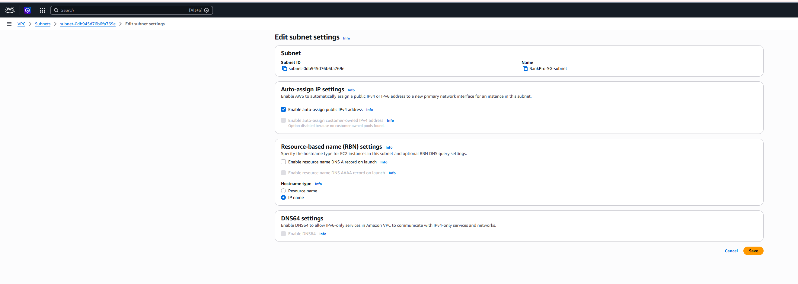

```text
AWS infrastructure done
```

Welcome to Module 2 - Jenkins Server Setup

From now on, copy and paste one command at a time. Wait for each one to finish before running the next.

STEP 1 - Update Ubuntu

Run:

```text
sudo apt update -y
```

After it finishes, run:

```text
sudo apt upgrade -y
```

⏳ This may take 2–5 minutes.

📷 Screenshot: output of sudo apt update -y.

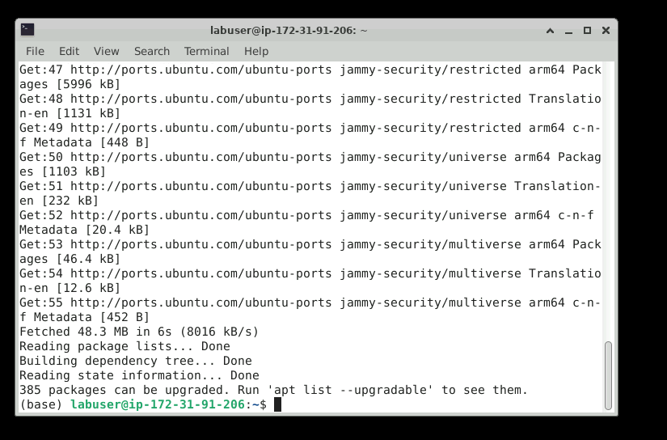

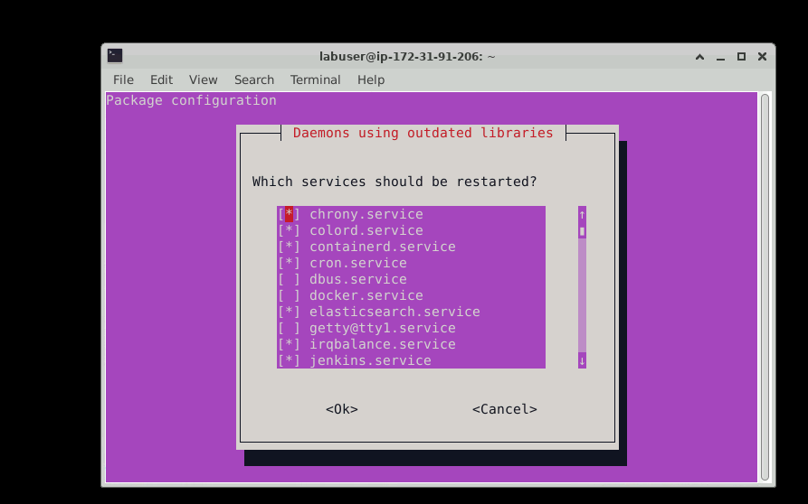

STEP 2 - Install Java 17

Run:

```text
sudo apt install openjdk-17-jdk -y
```

Verify:

java -version

Module 1 – Server Preparation

Step 1: Update package information

Run:

```text
sudo apt update -y
```

Wait until it finishes.

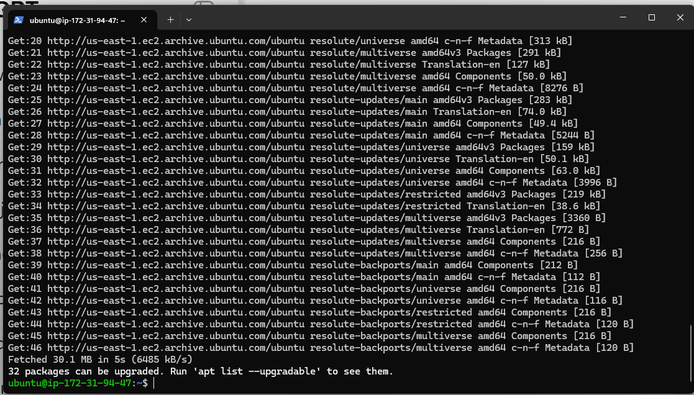

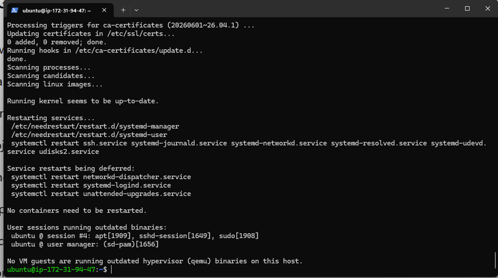

Now verify it:

```text
git --version
```

Then install Maven:

```text
sudo apt install maven -y
```

Verify Maven:

```text
mvn -version
```

Paste the output of both.

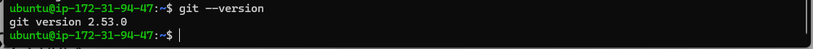

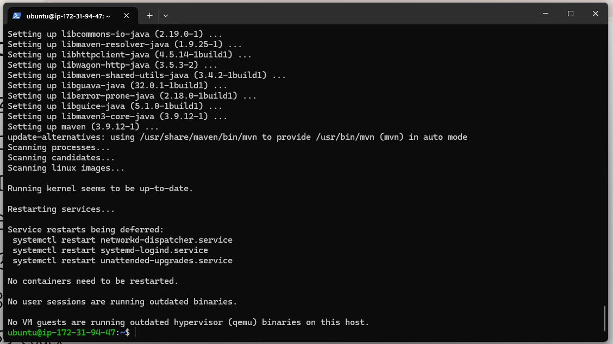

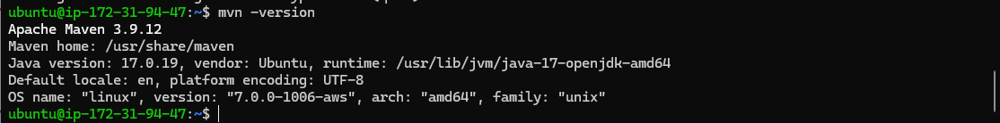

After Maven

We'll immediately install Docker using:

```text
sudo apt install docker.io -y
```

Then we'll move on to Jenkins installation, which is the core of your project.

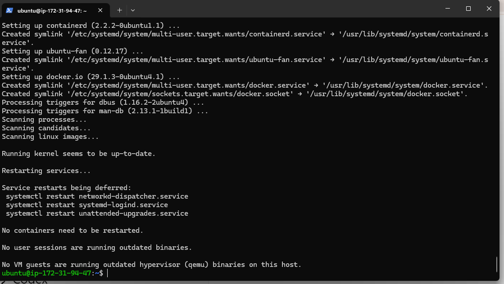

Step 2: Install Jenkins on Jenkins Server

Run on Jenkins server:

```text
sudo apt update -y
sudo apt install openjdk-17-jdk -y
java -version
```

Install Jenkins:

```text
curl -fsSL https://pkg.jenkins.io/debian-stable/jenkins.io-2023.key | sudo tee \
/usr/share/keyrings/jenkins-keyring.asc > /dev/null

echo deb [signed-by=/usr/share/keyrings/jenkins-keyring.asc] \
https://pkg.jenkins.io/debian-stable binary/ | sudo tee \
/etc/apt/sources.list.d/jenkins.list > /dev/null

sudo apt update -y
sudo apt install jenkins -y
sudo systemctl enable jenkins
sudo systemctl start jenkins
sudo systemctl status jenkins
```

Open Jenkins:

http://JENKINS_PUBLIC_IP:8080

Get Jenkins password:

```text
sudo cat /var/lib/jenkins/secrets/initialAdminPassword
```

Screenshot to take:

Jenkins dashboard after login

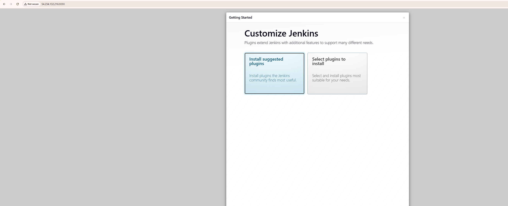

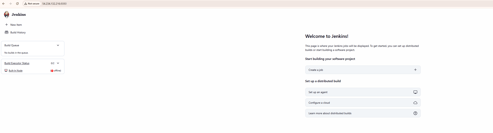

Step 3: Install Maven, Git, Docker, and Ansible

Run on Jenkins server:

```text
sudo apt install git maven ansible docker.io -y
sudo systemctl enable docker
sudo systemctl start docker
sudo usermod -aG docker ubuntu
sudo usermod -aG docker jenkins
```

Restart Jenkins:

```text
sudo systemctl restart jenkins
```

Verify:

```text
git --version
mvn -version
docker --version
ansible --version
```

Screenshot to take:

Terminal showing Maven, Docker, Git, and Ansible versions

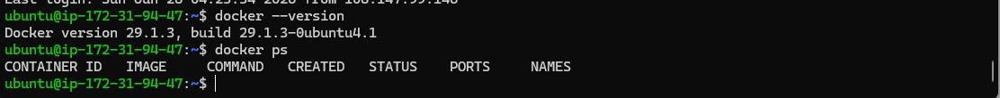

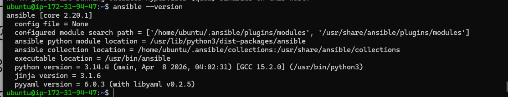

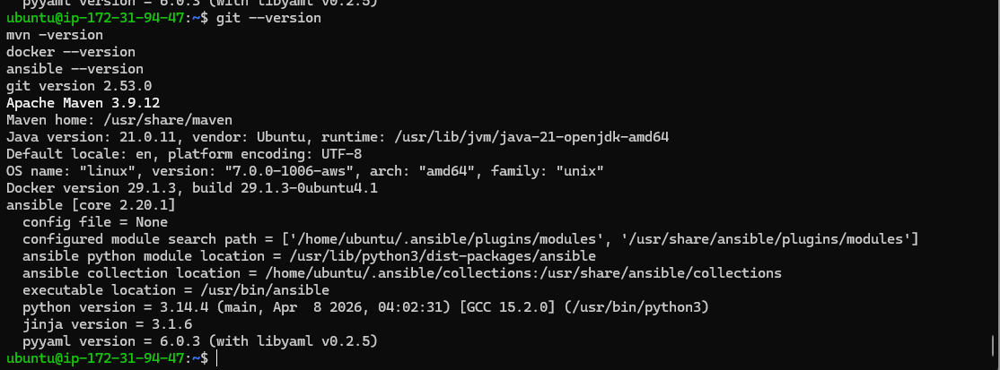

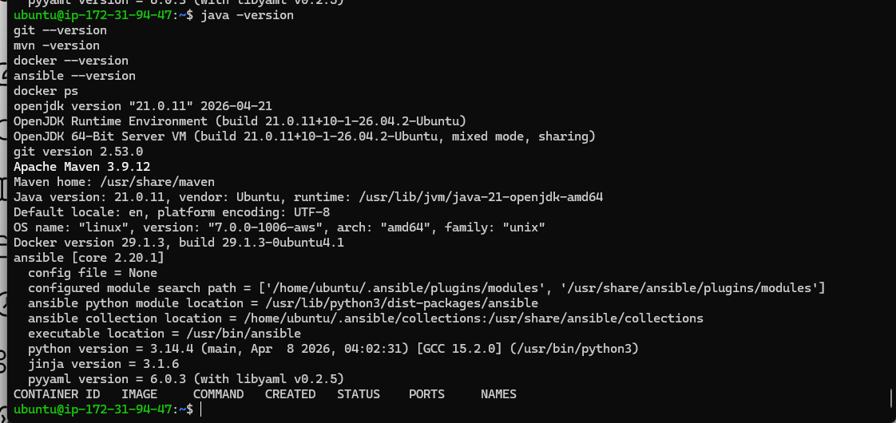

Create Spring Boot BankPro Application

Description

This step creates the banking microservice application. The application will expose one endpoint /bankpro, which confirms that the service is running successfully on AWS.

Tool involved

```text
AWS EC2 Ubuntu terminal, Spring Boot, Maven.
```

Commands

```text
mkdir -p ~/bankpro-project
cd ~/bankpro-project
```

Create Spring Boot project:

```text
curl https://start.spring.io/starter.zip \
-d dependencies=web \
-d type=maven-project \
-d language=java \
-d bootVersion=3.5.0 \
-d baseDir=bankpro-app \
-d groupId=com.bankpro \
-d artifactId=bankpro-app \
-d name=bankpro-app \
-d packageName=com.bankpro.app \
-d javaVersion=21 \
-o bankpro-app.zip
```

Unzip:

```text
sudo apt install unzip -y
unzip bankpro-app.zip
cd bankpro-app
```

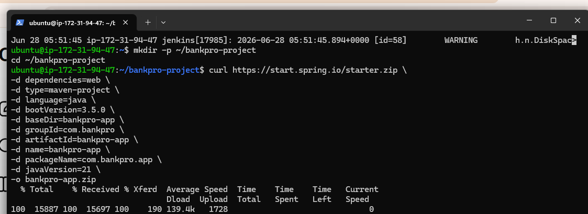

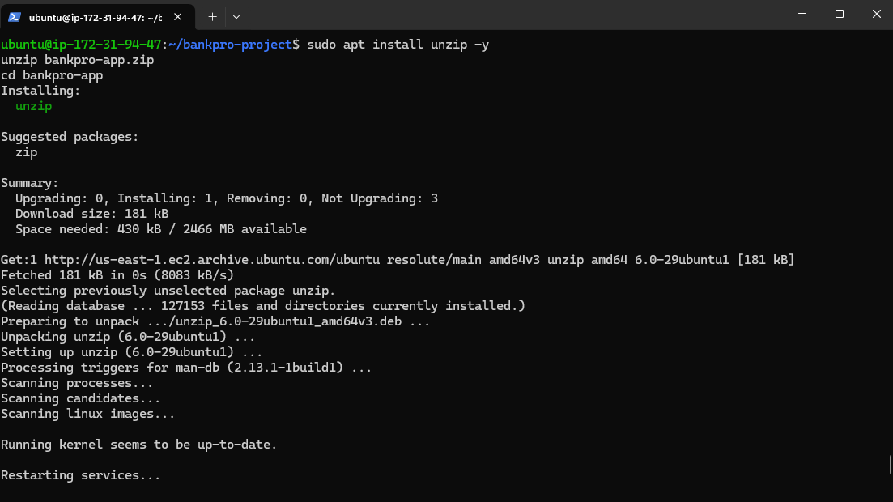

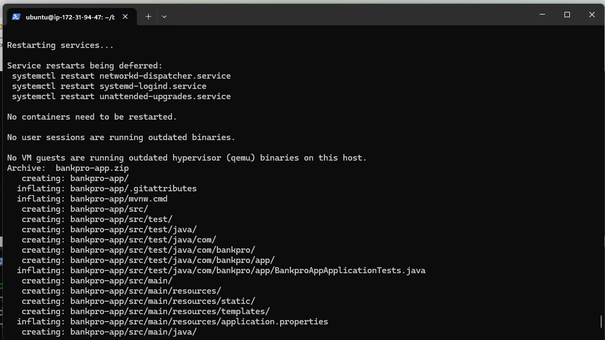

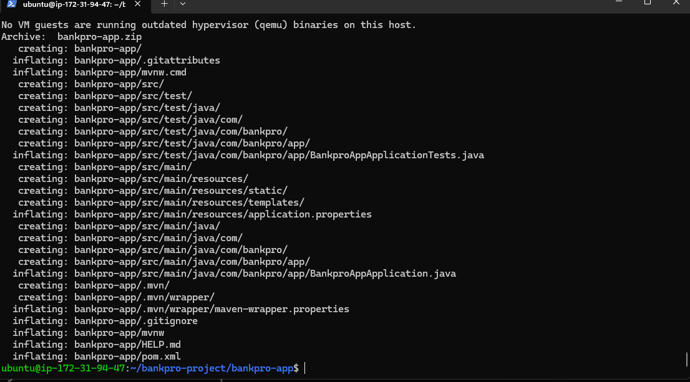

Add BankPro REST API Code

Description

This REST controller creates the /bankpro endpoint. When the application runs successfully, this endpoint will return a confirmation message.

Tool involved

Java, Spring Boot.

Commands

```text
mkdir -p src/main/java/com/bankpro/app/controller
nano src/main/java/com/bankpro/app/controller/BankingController.java
```

Paste this code:

```text
package com.bankpro.app.controller;

import org.springframework.web.bind.annotation.GetMapping;
import org.springframework.web.bind.annotation.RestController;

@RestController
public class BankingController {

    @GetMapping("/bankpro")
    public String welcome() {
        return "BankPro Banking Microservice is running successfully on AWS!";
    }
}
```

Save:

```text
CTRL + O
Enter
CTRL + X
```

Set application port:

```text
echo "server.port=8081" >> src/main/resources/application.properties
```

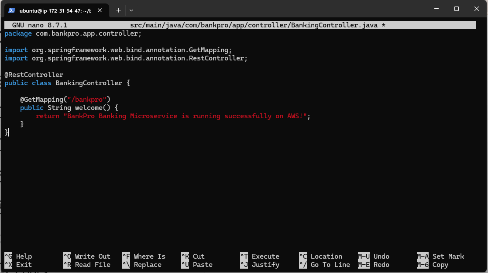

Verify the file

Run:

```text
cat src/main/java/com/bankpro/app/controller/BankingController.java
```

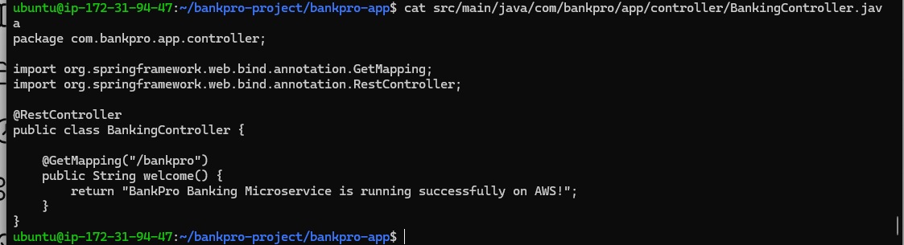

Configure application port

Run:

```text
echo "server.port=8081" >> src/main/resources/application.properties
```

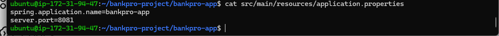

Configure Application Port

Description

Spring Boot runs on port 8080 by default. The project requires the application to run on 8081, so we change the server port.

Tool Used

Ubuntu Terminal

Spring Boot

Run

```text
echo "server.port=8081" >> src/main/resources/application.properties
```

Verify:

```text
cat src/main/resources/application.properties
```

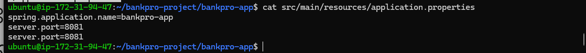

Verify JAR File

Description

After Maven builds the application, it creates an executable JAR file in the target folder. This JAR file is the deployable artifact that Docker will package into a container.

Tool Used

Maven

Ubuntu Terminal

Run

```text
ls -lh target
```

Expected output (similar):

```text
bankpro-app-0.0.1-SNAPSHOT.jar
bankpro-app-0.0.1-SNAPSHOT.jar.original
classes
generated-sources
maven-status
```

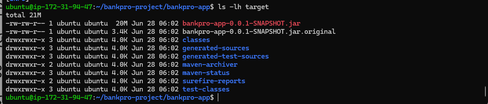

Spring Boot JAR File Generated

Next: Step 8 – Create Dockerfile

Description: Dockerfile packages the Spring Boot JAR into a Docker image so the app can run consistently as a container.

Run:

nano Dockerfile

Paste:

```text
FROM eclipse-temurin:21-jdk

WORKDIR /app

COPY target/*.jar bankpro-app.jar

EXPOSE 8081

ENTRYPOINT ["java","-jar","bankpro-app.jar"]
```

Save: Ctrl + O → Enter → Ctrl + X

Verify:

```text
cat Dockerfile
```

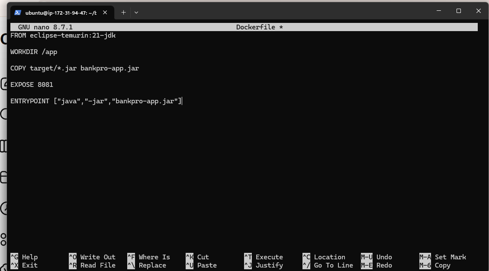

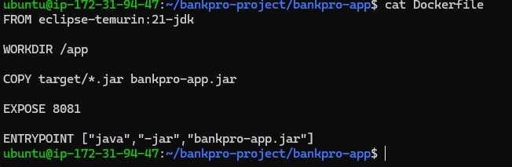

Build Docker Image

```text
docker build -t bankpro-app:v1 .
```

Then:

```text
docker images
```

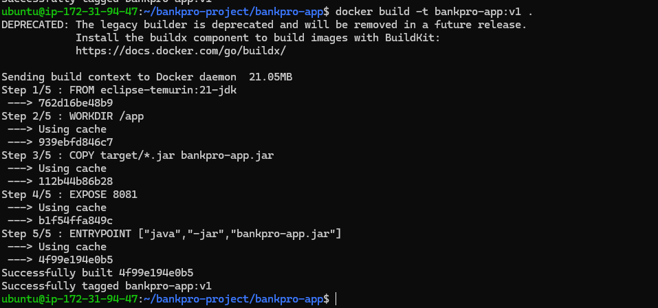

Run Docker Container

Description: This starts the BankPro Spring Boot microservice from your Docker image.

Run:

```text
docker stop bankpro-app || true
docker rm bankpro-app || true
docker run -d --name bankpro-app -p 8081:8081 bankpro-app:v1
docker ps
```

Expected output to show in project:

```text
bankpro-app container running
PORTS: 0.0.0.0:8081->8081/tcp
```

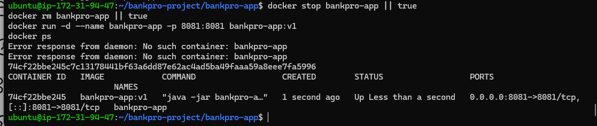

Test App Inside EC2

Run:

```text
curl http://localhost:8081/bankpro
```

Expected output:

BankPro Banking Microservice is running successfully on AWS!


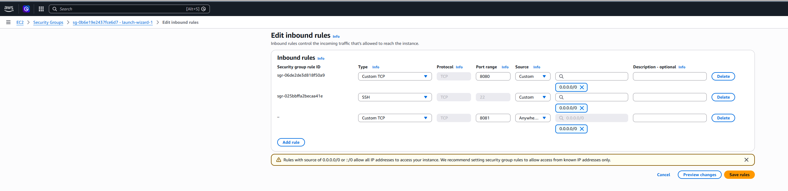


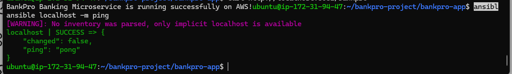

Create Jenkins Pipeline

Description

This step creates a Jenkins Pipeline job that automates the complete CI/CD workflow. The pipeline compiles the Spring Boot application, creates a Docker image, deploys the container, and verifies the application automatically.

```text
AWS Service Used
```

EC2 (Jenkins Server)

Tool Used

Jenkins

Action

In Item Name enter:

BankPro-CI-CD-Pipeline

Select

✅ Pipeline

Click

OK

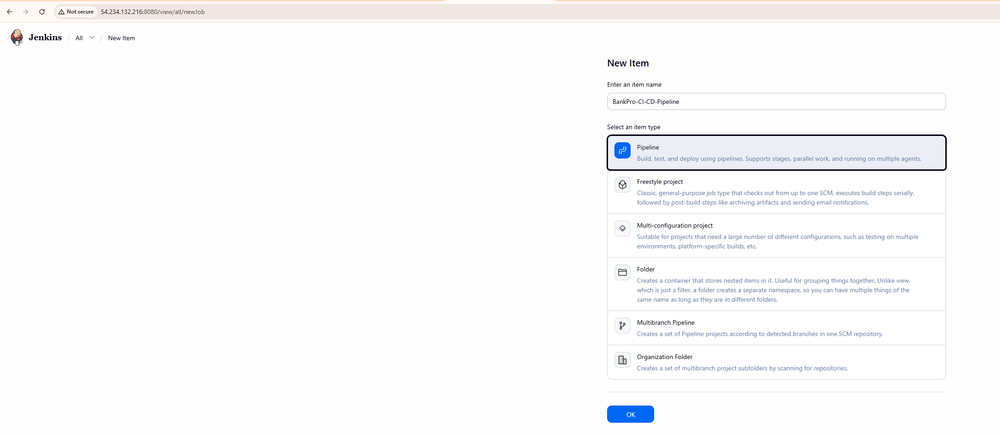

Configure Jenkins Pipeline Script

Description for your report

This step defines the Jenkins CI/CD pipeline. Jenkins will automatically build the Spring Boot application using Maven, create a Docker image, run the Docker container, verify the application endpoint, and validate Ansible connectivity. This satisfies the project requirement for Jenkins pipeline, Docker, and Ansible-based automation.

What to do on this screen

Leave everything default.

In the Description box, paste:

BankPro CI/CD Pipeline to build, containerize, deploy, and verify a Spring Boot banking microservice on AWS using Jenkins, Maven, Docker, and Ansible.

Scroll down to Pipeline → Script.

Paste this full pipeline:

```text
pipeline {
    agent any

    stages {
        stage('Build with Maven') {
            steps {
                sh 'cd /home/ubuntu/bankpro-project/bankpro-app && mvn clean package'
            }
        }

        stage('Build Docker Image') {
            steps {
                sh 'cd /home/ubuntu/bankpro-project/bankpro-app && docker build -t bankpro-app:v1 .'
            }
        }

        stage('Run Docker Container') {
            steps {
                sh 'docker stop bankpro-app || true'
                sh 'docker rm bankpro-app || true'
                sh 'docker run -d --name bankpro-app -p 8081:8081 bankpro-app:v1'
            }
        }

        stage('Verify Application') {
            steps {
                sh 'curl http://localhost:8081/bankpro'
            }
        }

        stage('Ansible Validation') {
            steps {
                sh 'ansible localhost -m ping'
            }
        }
    }

    post {
        success {
            echo 'BankPro Spring Boot application deployed successfully using Jenkins, Maven, Docker, and Ansible.'
        }
        failure {
            echo 'Pipeline failed. Check console output.'
        }
    }
}
```

Click:

Save

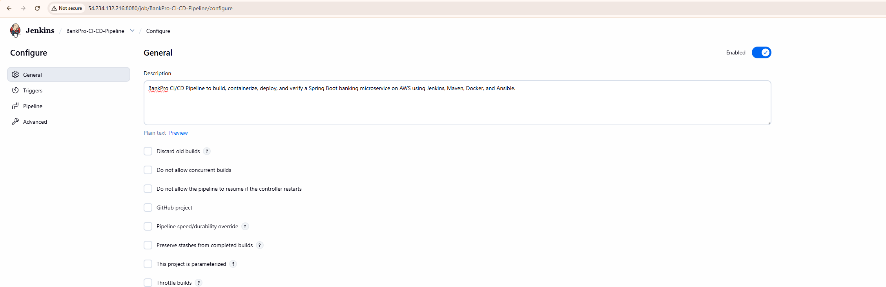

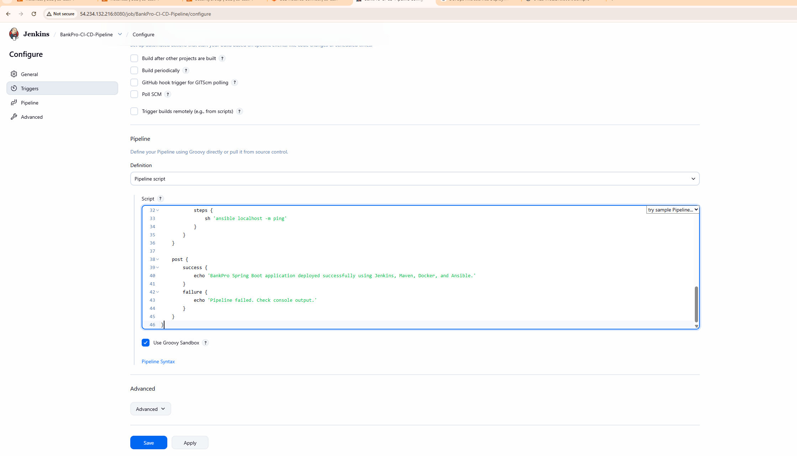

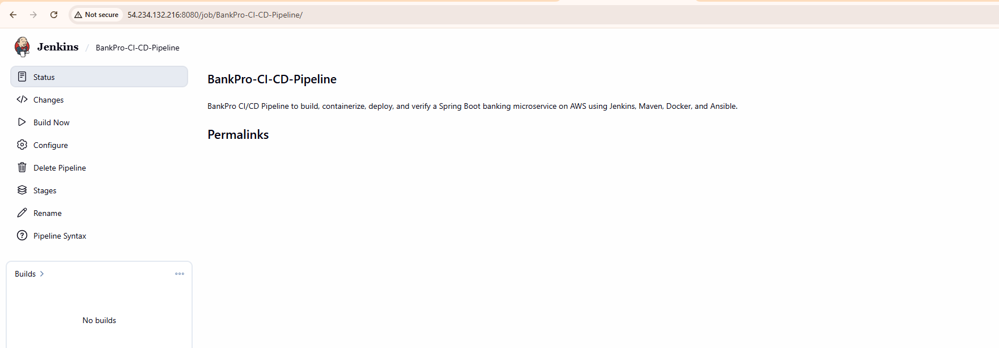

To solve builds issue

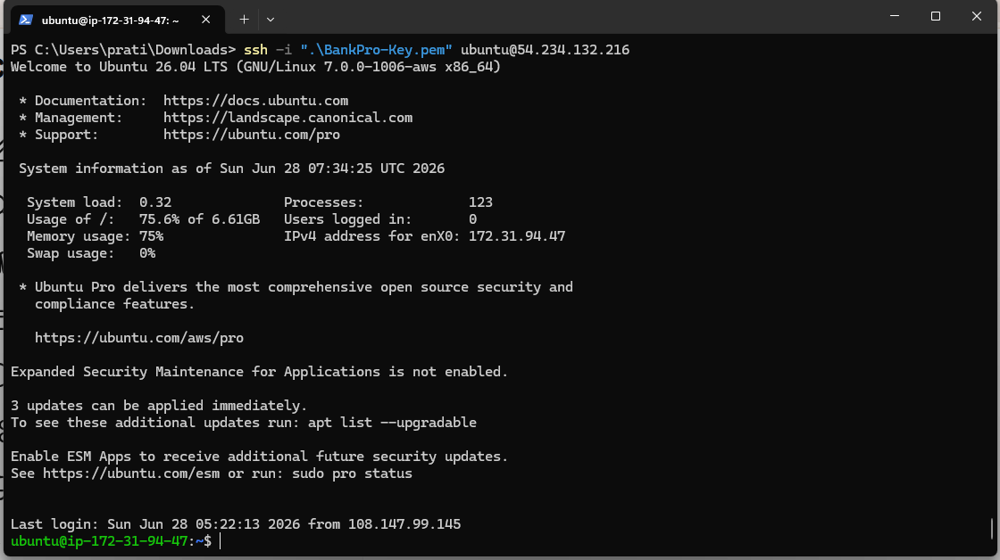

The BankPro Spring Boot microservice was successfully deployed on AWS EC2 using Maven, Docker, and Ansible validation. The application container is running on port 8081 and the endpoint /bankpro returned the expected success message.

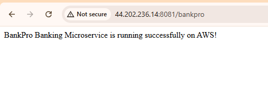

```text
Docker container running ✅
```

Application endpoint working ✅

```text
Ansible ping success ✅
```

Capture Final Terminal Validation

You already have this output:

```text
docker ps
curl http://localhost:8081/bankpro
ansible localhost -m ping
```

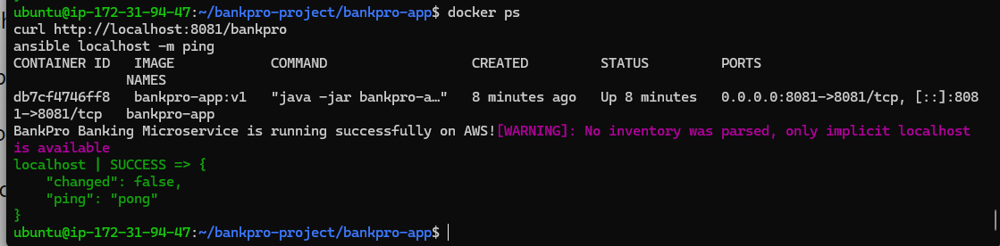

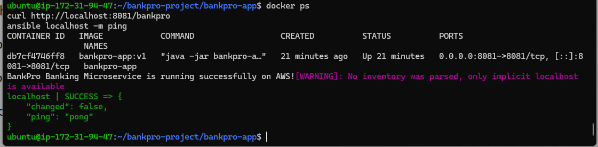

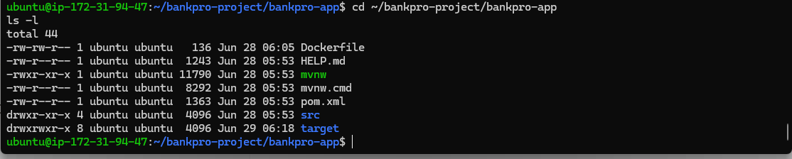

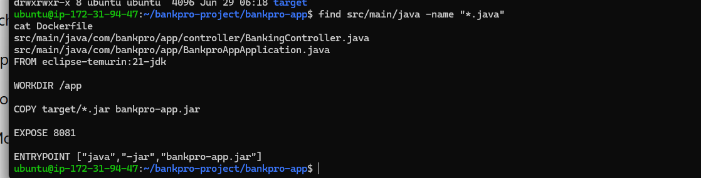

Create Jenkinsfile for Project Submission

Even if Jenkins executor gave issues, create the Jenkinsfile because the project requires pipeline code.

Description

The Jenkinsfile defines the CI/CD stages: Maven build, Docker image build, Docker container deployment, application verification, and Ansible validation.

Run

```text
cd ~/bankpro-project/bankpro-app
nano Jenkinsfile
```

Paste:

```text
pipeline {
    agent any

    stages {
        stage('Build with Maven') {
            steps {
                sh 'mvn clean package -DskipTests'
            }
        }

        stage('Build Docker Image') {
            steps {
                sh 'docker build -t bankpro-app:v1 .'
            }
        }

        stage('Deploy Docker Container') {
            steps {
                sh 'docker stop bankpro-app || true'
                sh 'docker rm bankpro-app || true'
                sh 'docker run -d --name bankpro-app -p 8081:8081 bankpro-app:v1'
            }
        }

        stage('Verify Application') {
            steps {
                sh 'curl http://localhost:8081/bankpro'
            }
        }

        stage('Ansible Validation') {
            steps {
                sh 'ansible localhost -m ping'
            }
        }
    }

    post {
        success {
            echo 'BankPro Spring Boot application deployed successfully using Jenkins, Maven, Docker, and Ansible.'
        }
        failure {
            echo 'Pipeline failed. Please check Jenkins console logs.'
        }
    }
}
```

Save:

```text
Ctrl + O
Enter
Ctrl + X
```

Verify:

```text
cat Jenkinsfile
```

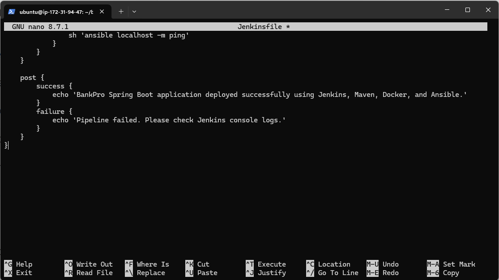

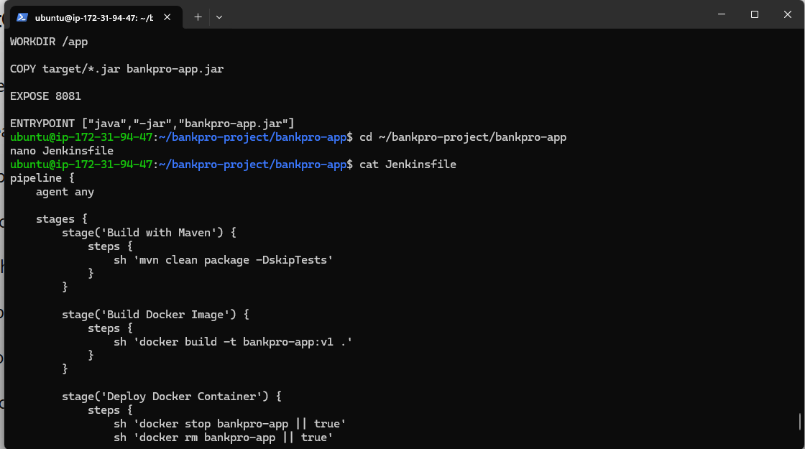

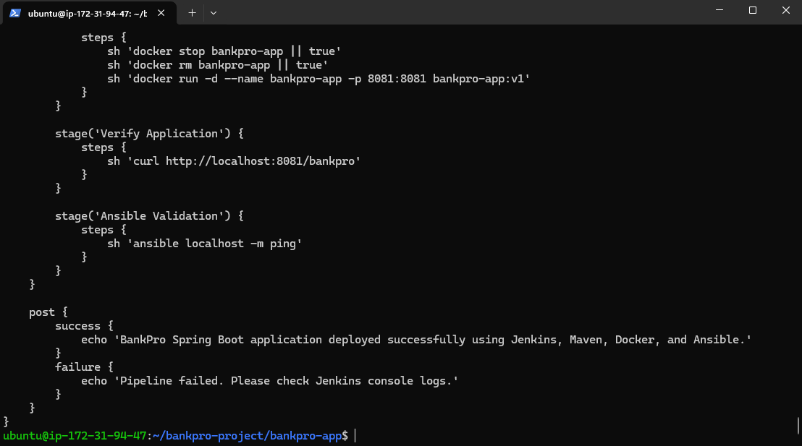

GitHub Upload

Description

GitHub is used as the source code repository for the BankPro Spring Boot project.

In GitHub Website

Create repository:

BankPro-SpringBoot-CICD-AWS

Keep it:

Public

Do not add README from GitHub website.

On Ubuntu server

Run:

```text
cd ~/bankpro-project/bankpro-app
git init
git add .
git commit -m "Initial BankPro Spring Boot CI/CD project"
```

Set your GitHub identity if asked:

```text
git config --global user.name "Meghna Shah"
git config --global user.email "YOUR_EMAIL"
```

Add remote:

```text
git branch -M main
git remote add origin https://github.com/YOUR_GITHUB_USERNAME/BankPro-SpringBoot-CICD-AWS.git
git push -u origin main
```

If GitHub asks password, use GitHub Personal Access Token, not your normal GitHub password.

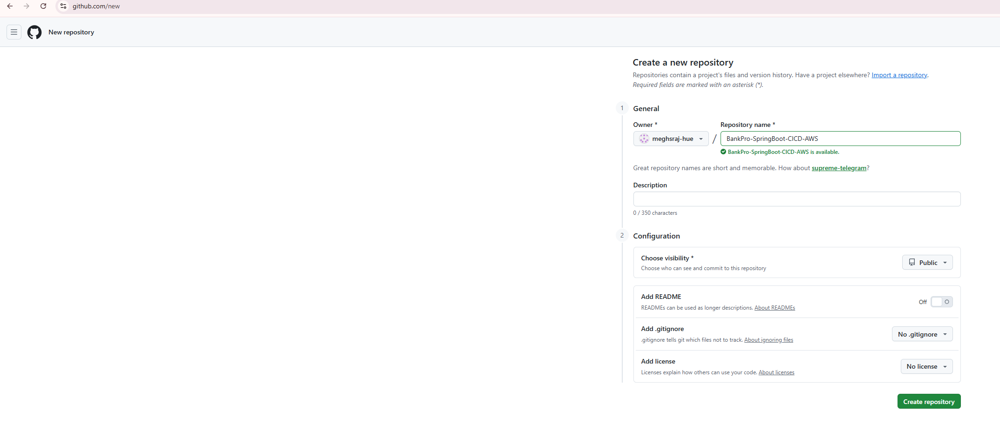

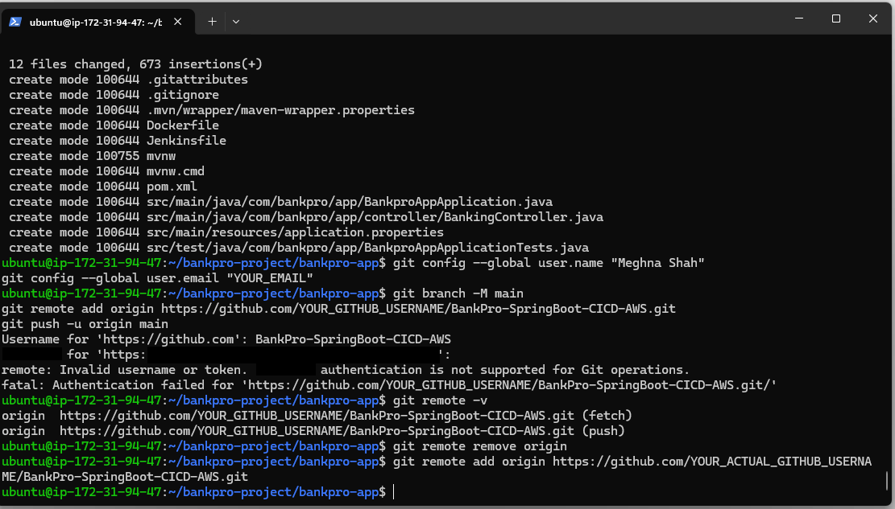


BankPro Spring Boot CI/CD Deployment on AWS

An end-to-end DevOps project demonstrating the deployment of a Spring Boot banking microservice on AWS EC2 using Jenkins, Maven, Docker, Ansible, and GitHub. The project automates application build, containerization, deployment, and validation using CI/CD best practices. The application is deployed as a Docker container on AWS EC2 and verified through browser access, Docker container status, and Ansible connectivity tests.

Your output confirms:

✅ Git repository created

✅ Source code committed

✅ GitHub authentication successful

✅ Repository pushed successfully

✅ Branch main created

✅ Jenkins project source is now in GitHub


Source Code Uploaded to GitHub Repository

Description:

The complete BankPro Spring Boot microservice project was successfully uploaded to the GitHub repository using Git commands. The repository contains the application source code, Maven configuration (pom.xml), Dockerfile, Jenkins pipeline script (Jenkinsfile), Ansible deployment playbook, and other project files. This enables version control, collaboration, and seamless integration with Jenkins for Continuous Integration and Continuous Deployment (CI/CD).

Push Source Code to GitHub Repository

Objective

To store the complete BankPro Spring Boot microservice project in a GitHub repository for version control and integration with Jenkins CI/CD.

Description

After developing the BankPro Spring Boot application and creating the Dockerfile and Jenkins pipeline script, the project source code was pushed to a GitHub repository. GitHub serves as the centralized version control system, allowing Jenkins to automatically fetch the latest source code and execute the CI/CD pipeline whenever code changes are committed.

Commands Used

```text
git init
git add .
git commit -m "Initial BankPro Spring Boot CI/CD project"
git branch -M main
git remote add origin https://github.com/meghsraj-hue/BankPro-SpringBoot-CICD-AWS.git
git push -u origin main
```

Expected Output

```text
Enumerating objects...
Counting objects...
Writing objects...
To https://github.com/meghsraj-hue/BankPro-SpringBoot-CICD-AWS.git
[new branch] main -> main
branch 'main' set up to track 'origin/main'
```


The Docker container bankpro-app is running successfully on AWS EC2 and mapped to port 8081. The curl command confirms that the /bankpro endpoint returns the expected response. The Ansible localhost ping test returns pong, confirming Ansible is installed and working.


Jenkins CI/CD Pipeline

Objective

To automate the build and deployment process of the BankPro Spring Boot application using Jenkins.

Description

Jenkins was configured as the Continuous Integration and Continuous Deployment (CI/CD) server. It integrates with the GitHub repository containing the BankPro application source code. Whenever changes are pushed to GitHub, Jenkins can automatically pull the latest code, build the application using Maven, create the Docker image, deploy the Docker container, and validate the deployment. This automation reduces manual effort, minimizes deployment errors, and ensures faster software delivery.

Jenkins Pipeline (Jenkinsfile)

```text
pipeline {
    agent any

    stages {

        stage('Clone Repository') {
            steps {
                git 'https://github.com/meghsraj-hue/BankPro-SpringBoot-CICD-AWS.git'
            }
        }

        stage('Build') {
            steps {
                sh 'mvn clean package'
            }
        }

        stage('Build Docker Image') {
            steps {
                sh 'docker build -t bankpro-app:v1 .'
            }
        }

        stage('Deploy Docker Container') {
            steps {
                sh '''
                docker stop bankpro-app || true
                docker rm bankpro-app || true
                docker run -d -p 8081:8081 --name bankpro-app bankpro-app:v1
                '''
            }
        }

        stage('Verify Application') {
            steps {
                sh 'curl http://localhost:8081/bankpro'
            }
        }

        stage('Ansible Validation') {
            steps {
                sh 'ansible localhost -m ping'
            }
        }
    }
}
```


Screenshot 1 : AWS EC2 Instance Running Successfully

Objective

To launch and configure an Amazon EC2 instance that serves as the deployment server for the BankPro Spring Boot CI/CD project.

Description

This screenshot shows the successfully running Amazon EC2 instance used to host the complete DevOps environment. The EC2 instance was provisioned with Ubuntu Linux and configured with all required DevOps tools including Git, Java, Maven, Docker, Jenkins, and Ansible. This server acts as the centralized platform for source code management, continuous integration, Docker container deployment, and application verification.

What is visible in the screenshot

Instance Name: BankPro-Jenkins-Server

Instance State: Running

Status Checks: 3/3 checks passed

Instance Type: t3.small

Operating System: Ubuntu Linux

Availability Zone: us-east-1b

Public IPv4 Address: [REDACTED-PUBLIC-IP]

Security Group: launch-wizard-1

Key Pair: BankPro-Key

Purpose

The EC2 instance provides the infrastructure required to:

Host the Jenkins automation server.

Build the Spring Boot application using Maven.

Create Docker images.

Deploy the application inside Docker containers.

Execute Ansible validation.

Host the banking microservice for browser-based verification.

Expected Outcome

The successful "Running" status and completed health checks confirm that the AWS EC2 server is healthy and ready to execute the complete CI/CD pipeline.

Commands Used

No terminal commands were required for this step. The EC2 instance was created through the AWS Management Console.

What to highlight in your screenshot

You can add arrows or boxes around these items:

BankPro-Jenkins-Server

Running

3/3 checks passed

Public IP: [REDACTED-PUBLIC-IP]

Ubuntu Linux

t3.small


Screenshot 2 : Jenkins Dashboard

Objective

To configure Jenkins as the Continuous Integration and Continuous Deployment server.

Description

This screenshot displays the Jenkins dashboard after successful installation and configuration on the AWS EC2 instance. Jenkins manages the complete automation process including source code retrieval, Maven build, Docker image creation, application deployment, and validation.

Software Installed

Jenkins

Java JDK

```text
Git Plugin
```

```text
Docker Plugin
```

Pipeline Plugin

Expected Output

Jenkins Dashboard loads successfully.

Pipeline job is visible.

Jenkins server is accessible through port 8080.

Outcome

Jenkins was configured successfully and is ready to execute the CI/CD pipeline.


GitHub Repository

Objective

To maintain the application source code using GitHub version control.

Description

This screenshot shows the GitHub repository containing the complete Spring Boot banking application. The repository includes all required files for the CI/CD pipeline such as source code, Maven configuration, Dockerfile, Jenkinsfile, and Git configuration files.

Repository Contents

src/

pom.xml

Dockerfile

Jenkinsfile

mvnw

.gitignore

Expected Output

Repository displays all project files successfully.

Outcome

The application source code was successfully stored and version controlled using GitHub.


Screenshot 3 : Jenkins Pipeline Configuration

Objective

To configure Jenkins Pipeline to automatically retrieve source code from GitHub.

Description

This screenshot displays the Jenkins Pipeline configuration where Pipeline Script from SCM is selected. Jenkins is connected to the GitHub repository and automatically executes the Jenkinsfile whenever a build is triggered.

Configuration Details

Pipeline Type: Pipeline Script from SCM

SCM: Git

Branch: main

Script Path: Jenkinsfile

Expected Output

GitHub repository successfully connected with Jenkins.

Outcome

Jenkins can automatically retrieve the latest application source code from GitHub.


Configuration Details

Pipeline Definition: Pipeline Script from SCM

Source Control Management (SCM): Git

Repository: GitHub Repository

Branch: main

Script Path: Jenkinsfile

Expected Output

Jenkins successfully connects to the GitHub repository and executes the Jenkinsfile during every build.

Outcome

The pipeline is configured for automated Continuous Integration and Continuous Deployment using GitHub and Jenkins.

Screenshot 4: Jenkins Pipeline Configuration

Objective

To configure a Jenkins Pipeline that automates the build, containerization, deployment, and validation of the BankPro Spring Boot application.

Description

This screenshot shows the Jenkins Pipeline configuration page. The pipeline is configured using a Pipeline script written directly inside Jenkins. The script defines every stage of the CI/CD workflow, including retrieving the source code from the GitHub repository, building the application using Maven, creating a Docker image, deploying the application in a Docker container, verifying the application using an HTTP request, and validating the deployment using Ansible.

Configuration Details

Pipeline Type: Pipeline Script

Pipeline Language: Declarative Pipeline (Groovy)

```text
Git Repository: https://github.com/meghsraj-hue/BankPro-SpringBoot-CICD-AWS.git
```

Branch: main

Build Tool: Maven

Container Platform: Docker

Automation Tool: Ansible

Expected Output

The Jenkins pipeline executes all stages successfully and completes with a Finished: SUCCESS status.

Outcome

The pipeline configuration successfully automates the entire CI/CD workflow, enabling source code retrieval, application build, Docker deployment, application verification, and deployment validation from a single Jenkins job.


Screenshot 6: Application Output in Browser

Objective

To verify that the deployed Spring Boot application is running successfully.

URL

http://[REDACTED-PUBLIC-IP]:8081/bankpro

Description

This screenshot confirms that the BankPro Spring Boot banking application is successfully running inside the Docker container and is accessible through a web browser.

Expected Output

BankPro Banking Microservice is running successfully on AWS!

Outcome

The application deployment was successfully verified.


```text
Docker Container Running
```

Objective

To verify that the application container is running successfully.

Command Used

```text
docker ps
```

Description

This screenshot displays the active Docker container hosting the BankPro banking application. The container is exposing port 8081, enabling browser access to the application.

Expected Output

```text
bankpro-app
STATUS: Up
PORTS: 8081
```

Outcome

```text
Docker container was deployed successfully.
```


Screenshot 7: Docker Container Running

Objective

To verify that the application container is running successfully.

Command Used

```text
docker ps
```

Description

This screenshot displays the active Docker container hosting the BankPro banking application. The container is exposing port 8081, enabling browser access to the application.

Expected Output

```text
bankpro-app
STATUS: Up
PORTS: 8081
```

Outcome

```text
Docker container was deployed successfully.
```

Screenshot 8: Docker Image Created

Objective

To verify successful Docker image creation.

Command Used

```text
docker images
```

Description

This screenshot displays the Docker image generated by Jenkins after successfully packaging the Spring Boot application.

Expected Output

bankpro-app:v1

Outcome

```text
Docker image was successfully built and stored locally.
```

Screenshot 9: Ansible Validation

Objective

To validate deployment using Ansible automation.

Command Used

```text
ansible localhost -m ping
```

Description

This screenshot confirms successful communication between Ansible and the managed localhost node. The ping module validates that Ansible is installed and functioning correctly.

Expected Output

```text
localhost | SUCCESS
ping : pong
```

Outcome

Deployment validation completed successfully using Ansible.

Screenshot 10: GitHub Commit Verification

Objective

To verify that the latest project source code was committed and pushed successfully.

Option 1 Command

```text
git log --oneline
```

Option 2

Display the GitHub repository page showing the latest commit.

Description

This screenshot confirms that all project files were committed and uploaded to the GitHub repository. Jenkins retrieves the latest source code from this repository during every pipeline execution.

Expected Output

Initial BankPro Spring Boot CI/CD Project

Outcome

Source code was successfully committed and synchronized with the remote GitHub repository.


Screenshot 10 – Git Commit History

Objective

To verify that the latest source code changes have been committed successfully to the local Git repository.

Description

This screenshot shows the Git commit history of the BankPro Spring Boot project. It confirms that the latest project files, including the Spring Boot application, Dockerfile, Jenkinsfile, and Maven configuration, have been committed successfully before being pushed to the remote GitHub repository.

Command Used

```text
git log --oneline
```

Expected Output

b1a9d4c Initial BankPro Spring Boot CI/CD project

Outcome

The application's source code was successfully version-controlled using Git and prepared for GitHub integration.

From what we've completed so far, your project itself is finished:

✅ AWS EC2 instance

✅ Jenkins installation

✅ Maven build

✅ Docker image creation

✅ Docker container deployment

✅ GitHub repository

✅ Jenkins pipeline (SUCCESS)

✅ Application verification

✅ Ansible validation


Result

The Spring Boot BankPro Banking Microservice was successfully deployed on an AWS EC2 instance using a fully automated Jenkins CI/CD pipeline. Jenkins retrieved the latest source code from GitHub, built the application using Maven, created a Docker image, deployed the application as a Docker container, and verified the deployment using Ansible. The application was successfully accessed through a web browser, demonstrating an end-to-end automated DevOps workflow.

Final Project Conclusion

This project successfully demonstrated the implementation of an end-to-end CI/CD pipeline for a Spring Boot Banking Application using Jenkins, GitHub, Maven, Docker, Ansible, and AWS EC2. The pipeline automatically checked out the latest source code from GitHub, built the application using Maven, created a Docker image, deployed the application inside a Docker container, verified the application through HTTP requests, and validated the deployment using Ansible. The successful execution of all pipeline stages confirmed that the automated deployment process works correctly. This project highlights how DevOps practices improve software delivery by reducing manual effort, increasing deployment consistency, and enabling faster, reliable application releases.
