# Implementing Microservices with AWS CodePipeline and Amazon ECS Fargate-project2

**Source:** Original supplied project document. Technical steps and screenshots are reproduced for portfolio review.

**Before publishing:** Review every screenshot for credentials, IP addresses, customer information and private account details.

Project Title

Implementing Microservices with AWS CodePipeline and Amazon ECS Fargate

Project Description

DevBank is moving its digital banking platform from a traditional deployment model to a scalable microservices architecture. In this project, I created two separate services: a NodeJS backend API and a React frontend UI. Both services are containerized using Docker, stored in Amazon ECR, built automatically using AWS CodeBuild, deployed through AWS CodePipeline, and hosted on Amazon ECS using AWS Fargate. This setup removes manual deployment, improves release speed, and allows DevBank to scale backend and frontend services independently.

Objective

The objective is to implement an end-to-end CI/CD pipeline for two microservices using AWS-native DevOps services. The backend and frontend applications are stored in GitHub, built into Docker images using CodeBuild, pushed to Amazon ECR, and deployed to ECS Fargate using CodePipeline. AWS requires imagedefinitions.json for standard ECS deployments through CodePipeline, so the build process will generate this file during every release.

Architecture Design

Architecture

This section will include professional architecture diagrams like:

```text
Developer
      │
      ▼
GitHub Repository
      │
      ▼
AWS CodePipeline
      │
      ▼
AWS CodeBuild
      │
      ▼
Amazon ECR
      │
      ▼
Amazon ECS (Fargate)
      │
      ▼
Application Load Balancer
      │
      ▼
React Frontend
      │
      ▼
NodeJS Backend
```

```text
Flow:
Developer pushes code to GitHub → CodePipeline starts → CodeBuild builds Docker image → image is pushed to ECR → imagedefinitions.json is created → ECS Fargate service is updated → frontend and backend run publicly.
```

```text
AWS Services Used: GitHub, ECR, CodeBuild, CodePipeline, ECS Fargate, Application Load Balancer, CloudWatch Logs, IAM.
```

Prerequisites

Every installation with:

Purpose

Command

Expected Output

Screenshot to Capture

Example:

Install Docker

Description

Step 1: Install Docker

Description

```text
Docker is an open-source containerization platform that packages an application together with its source code, libraries, runtime, and dependencies into a lightweight container. These containers run consistently across different environments such as a developer's laptop, testing servers, and production AWS infrastructure. In this project, Docker is used to containerize both the NodeJS backend API and the React frontend application so they can be deployed on Amazon ECS Fargate without requiring manual software installation or configuration on the servers.
```

Why Docker is Required in This Project

```text
Docker plays a critical role in implementing a microservices architecture because each service is packaged independently. The backend and frontend applications have different dependencies and runtime requirements, and Docker ensures they run consistently regardless of the underlying operating system.
```

Using Docker in this project provides the following benefits:

Creates isolated containers for the Backend and Frontend microservices.

Ensures the application behaves the same in Development, Testing, and Production environments.

Eliminates dependency conflicts between different applications.

Allows AWS CodeBuild to automatically build Docker images during the CI/CD pipeline.

Enables Amazon ECS Fargate to deploy containers without managing EC2 servers.

Simplifies version control and rollback by storing container images in Amazon ECR.

Reduces deployment time and supports continuous delivery using AWS CodePipeline.

Without Docker, Amazon ECS cannot deploy the application because ECS is designed to run containerized workloads.

Real-Time Industry Scenario

At DevBank, software developers frequently release new banking features such as account management, payment processing, and customer dashboards. Installing software manually on multiple production servers for every release is time-consuming and error-prone. Docker solves this problem by packaging the complete application into a portable container image. The same image that is tested by developers is deployed by AWS CodePipeline into Amazon ECS Fargate, ensuring consistency, reliability, and faster software releases.

Commands

```text
sudo apt update
sudo apt install docker.io -y
```

Expected Output

```text
Docker version xx.xx
```

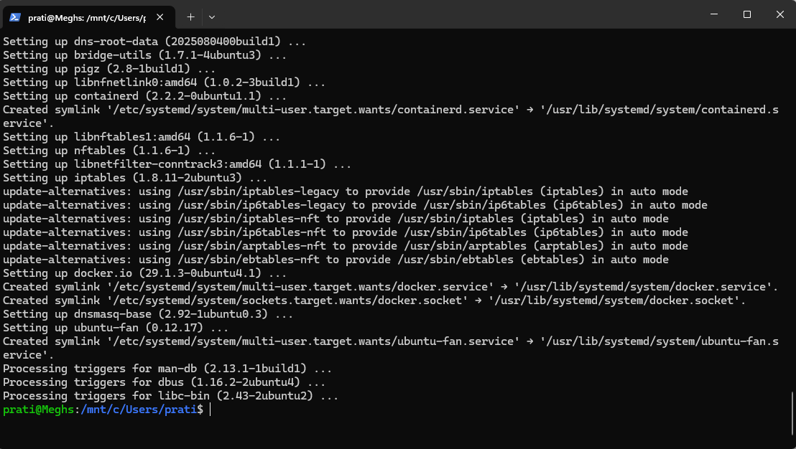

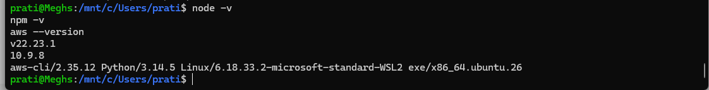

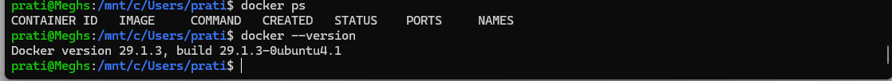

STEP 2 – Develop the Backend Microservice (Node.js API)

2.1 Step Objective

The objective of this step is to develop the Backend Microservice for the DevBank application. This backend service acts as the business logic layer and provides REST APIs that the React frontend will consume.

The backend is responsible for processing client requests, returning customer account information, and exposing health check endpoints that Amazon ECS can use to monitor container health.

At the end of this step, a fully functional Node.js API will be running locally and ready to be containerized using Docker.

2.2 Why is a Backend Microservice Required?

In a microservices architecture, every application is divided into independent services.

Instead of building one huge banking application, DevBank separates responsibilities into different microservices.

For example

For this capstone project, we will build one Backend API that simulates banking data.

The React frontend will communicate with this backend through REST APIs.

This separation makes applications

scalable

independently deployable

fault tolerant

easier to update

This is exactly how companies like Amazon, Netflix, PayPal and banking organizations build applications today.

2.3 Real-Time Industry Scenario

DevBank serves millions of banking customers across North America.

Whenever a customer logs into the mobile banking application,

the React application does NOT directly connect to the database.

Instead

Customer

↓

React Frontend

↓

NodeJS API

↓

Database

The NodeJS API validates requests, retrieves customer account information, applies business rules, and returns JSON responses.

This architecture improves security and allows frontend and backend teams to work independently.

2.4 Project Folder Structure

Move to your project directory:

```text
cd ~
mkdir devbank-microservices
cd devbank-microservices
```

Create backend folder

```text
mkdir backend
cd backend
```

Take Screenshot

Screenshot 2.1

Terminal showing

```text
devbank-microservices
└── backend
```

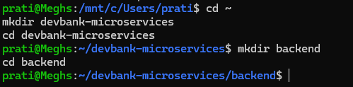

2.5 Initialize Node Project

Description

The npm init command creates the package.json file.

This file contains

project information

dependencies

version

scripts

Run

```text
npm init -y
```

Expected Output

package.json created

Take Screenshot

2.6 Install Backend Packages

Run:

```text
npm install express cors
```

Take screenshot after it finishes.

Expected output:

```text
added packages
found 0 vulnerabilities
```

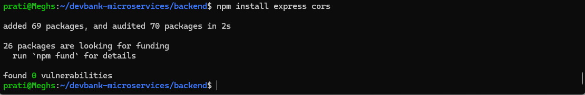

2.7 Create Backend API File

Run:

```text
cat > server.js <<'EOF'
const express = require("express");
const cors = require("cors");

const app = express();
app.use(cors());
app.use(express.json());

const PORT = process.env.PORT || 5000;

app.get("/", (req, res) => {
  res.json({
    project: "DevBank Microservices",
    service: "Backend API",
    version: "1.0",
    status: "Running Successfully",
    timestamp: new Date()
  });
});

app.get("/health", (req, res) => {
  res.json({
    status: "Healthy",
    uptime: process.uptime()
  });
});

app.get("/api/accounts", (req, res) => {
  res.json([
    { id: 1, customer: "John Smith", account: "Savings", balance: 12000 },
    { id: 2, customer: "Emma Watson", account: "Current", balance: 8500 },
    { id: 3, customer: "David Miller", account: "Business", balance: 250000 }
  ]);
});

app.listen(PORT, () => {
  console.log(`Backend running on port ${PORT}`);
});
EOF
```

Verify file:

```text
cat server.js
```

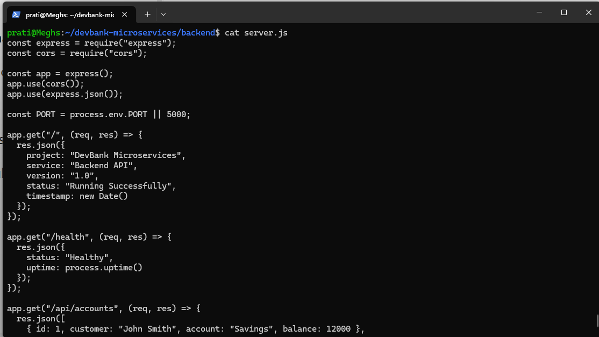

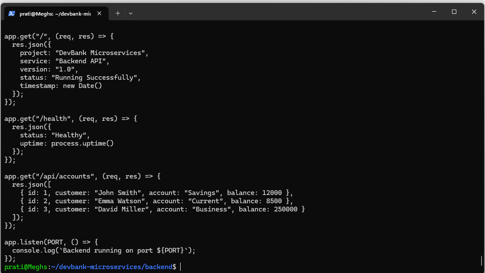

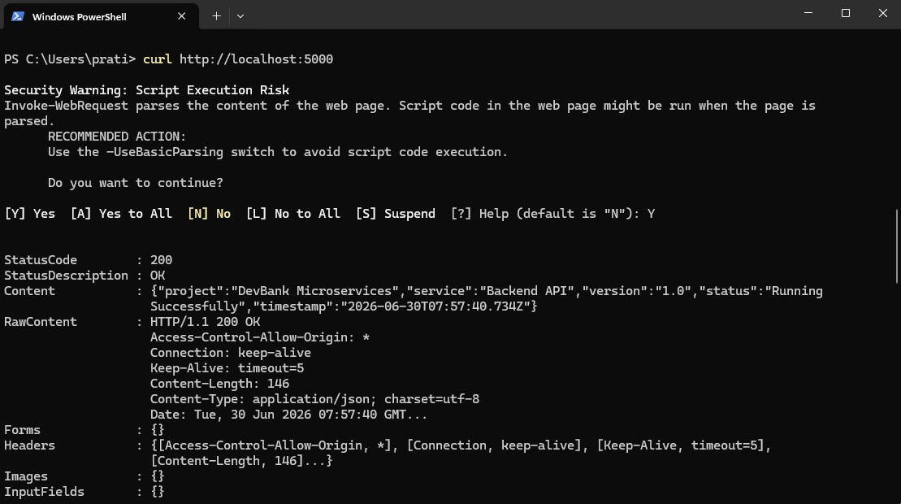

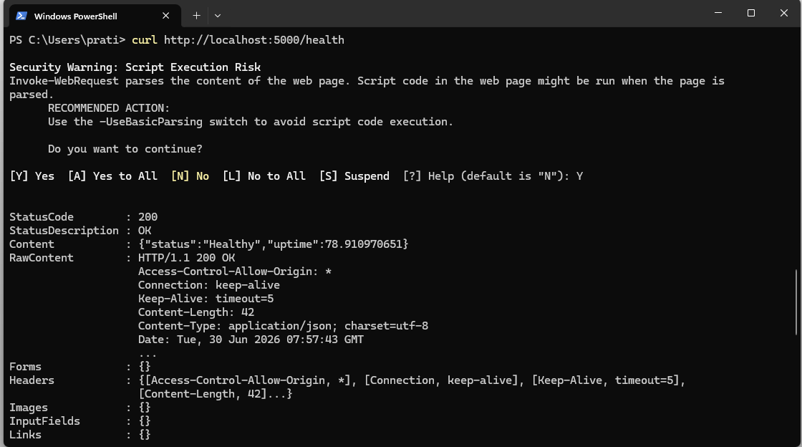

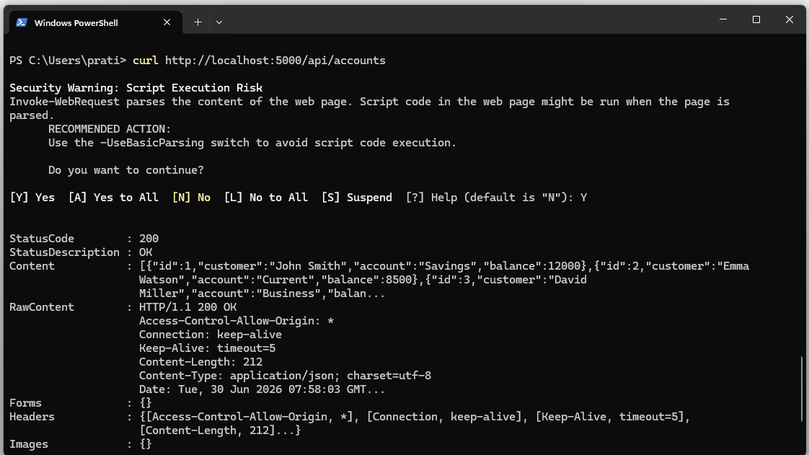

STEP 3 – Dockerize Backend Microservice

3.1 Step Objective

In this step, we will package the NodeJS backend API into a Docker container. This makes the backend portable and ready for deployment on Amazon ECS Fargate.

3.2 Why This Step Is Required

Amazon ECS runs applications as containers. So before deploying the backend to ECS, we must create a Docker image.

This image contains:

```text
Node.js runtime
Backend source code
package.json dependencies
Express and CORS packages
Startup command
Port configuration
```

In a real company, developers do not manually install Node.js and dependencies on production servers. Instead, the application is packaged once as a Docker image and deployed consistently through CI/CD.

3.3 Create Dockerfile

Run in Ubuntu:

```text
cd ~/devbank-microservices/backend
```

Create Dockerfile:

```text
cat > Dockerfile <<'EOF'
FROM node:20-alpine
WORKDIR /app
COPY package*.json ./
RUN npm install --only=production
COPY server.js .
EXPOSE 5000
CMD ["node", "server.js"]
EOF
```

Verify:

```text
cat Dockerfile
```

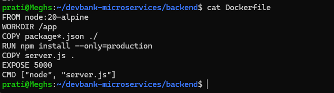

3.4 Dockerfile Explanation

FROM node:20-alpine

Uses lightweight Node.js image.

WORKDIR /app

Creates working directory inside container.

COPY package*.json ./

Copies dependency files.

RUN npm install --only=production

Installs required backend packages.

COPY server.js .

Copies backend API code.

EXPOSE 5000

Documents that the app uses port 5000.

CMD ["node", "server.js"]

Starts the backend when the container runs.

Step 3.5 – Create the Dockerfile

Go to the backend folder:

```text
cd ~/devbank-microservices/backend
```

Now create the file with this command:

```text
cat > Dockerfile <<'EOF'
FROM node:20-alpine
WORKDIR /app
COPY package*.json ./
RUN npm install --only=production
COPY server.js .
EXPOSE 5000
CMD ["node", "server.js"]
EOF
```

Nothing will be printed. That is normal.

Now verify the file:

```text
cat Dockerfile
```

You should see:

```text
FROM node:20-alpine
WORKDIR /app
COPY package*.json ./
RUN npm install --only=production
COPY server.js .
EXPOSE 5000
CMD ["node", "server.js"]
```

📸 Screenshot 3.1: Dockerfile displayed with cat Dockerfile.

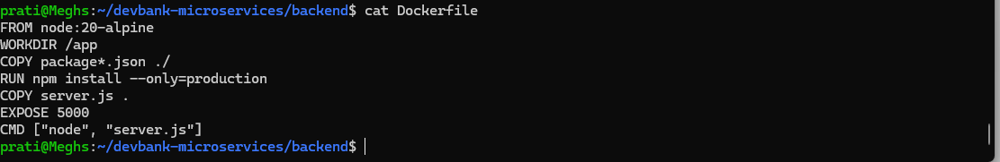

Step 3.6– Build the Docker Image

Run:

```text
docker build -t devbank-backend .
```

Expected output:

```text
Successfully built xxxxxxxxx
Successfully tagged devbank-backend:latest
```

📸 Screenshot 3.2: Docker build completed successfully.

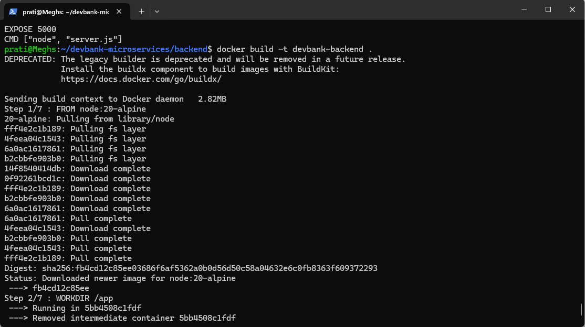

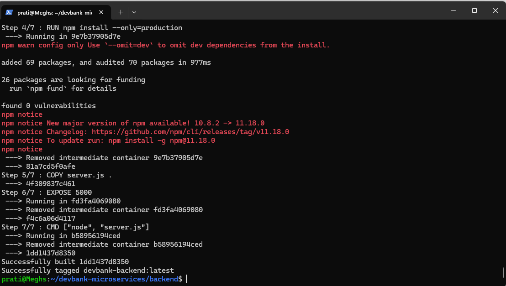

Step 3.7 – Verify the Image

Run:

```text
docker images
```

Expected output:

```text
REPOSITORY          TAG       IMAGE ID
devbank-backend     latest    xxxxxxxxx
```

📸 Screenshot 3.3: Docker image listed.

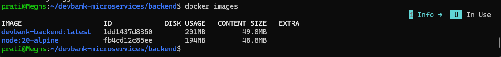

Step 3.8 – Run the Container

If your Node.js server is still running on port 5000, stop it by pressing:

Ctrl + C

in the terminal where you started node server.js.

Then run:

```text
docker run -d -p 5000:5000 --name devbank-backend-container devbank-backend
```

Verify:

```text
docker ps
```

📸 Screenshot 3.4: Running container.

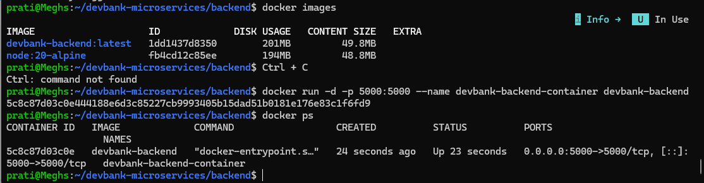

Step 3.9 – Test the Container

Run:

```text
curl http://localhost:5000
```

```text
curl http://localhost:5000/health
```

```text
curl http://localhost:5000/api/accounts
```

📸 Screenshot 3.5: JSON responses from the Docker container.

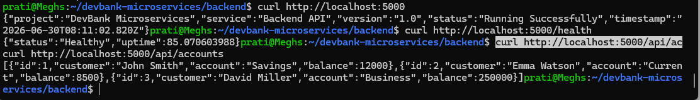

STEP 4 – Create Frontend React Microservice

Description

In this step, we create the React frontend application for DevBank. This frontend will act as the user interface of the banking platform and will later connect to the backend API to display customer account data.

Why this step is required

The capstone requires two separate microservices:

```text
Backend: NodeJS API
Frontend: React Application
```

The frontend and backend must be developed, containerized, pushed to GitHub, built through CodeBuild, and deployed to ECS/Fargate.

4.1 Create React App

Run in Ubuntu:

```text
cd ~/devbank-microservices
npx create-react-app frontend
```

This may take a few minutes.

Screenshot 4.1

Take screenshot when it shows:

Success! Created frontend

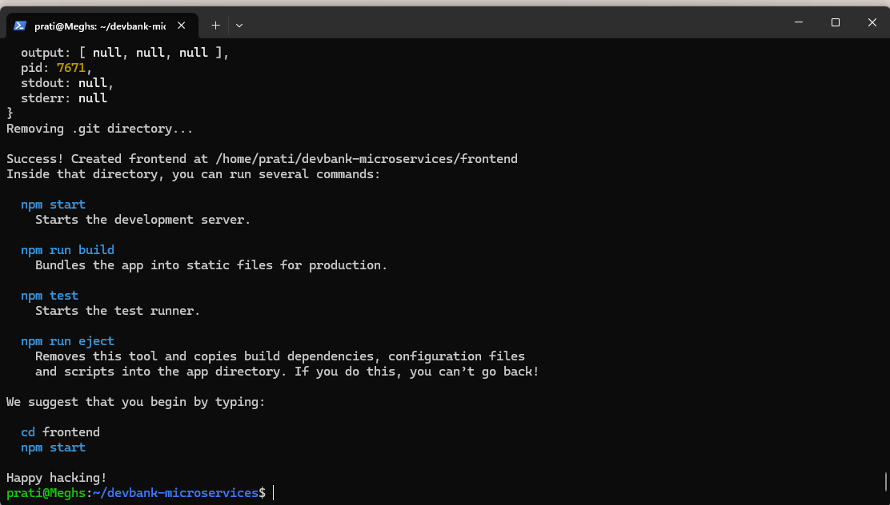

4.2 Go to Frontend Folder

```text
cd ~/devbank-microservices/frontend
```

Check files:

```text
ls
```

Expected files:

```text
README.md
node_modules
package.json
public
src
```

Screenshot 4.2

Take screenshot showing frontend folder files.

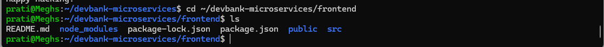

4.3 Replace React App Code

Run:

```text
cat > src/App.js <<'EOF'
import React, { useEffect, useState } from "react";
import "./App.css";

function App() {
  const [accounts, setAccounts] = useState([]);

  useEffect(() => {
    fetch("http://localhost:5000/api/accounts")
      .then((response) => response.json())
      .then((data) => setAccounts(data))
      .catch((error) => console.log("Backend API error:", error));
  }, []);

  return (
    <div className="App">
      <h1>DevBank Digital Banking Platform</h1>
      <p>React Frontend Microservice connected with NodeJS Backend API</p>

      <h2>Customer Account Summary</h2>

      <table>
        <thead>
          <tr>
            <th>ID</th>
            <th>Customer Name</th>
            <th>Account Type</th>
            <th>Balance</th>
          </tr>
        </thead>

        <tbody>
          {accounts.map((account) => (
            <tr key={account.id}>
              <td>{account.id}</td>
              <td>{account.customer}</td>
              <td>{account.account}</td>
              <td>${account.balance}</td>
            </tr>
          ))}
        </tbody>
      </table>
    </div>
  );
}

export default App;
EOF
```

Verify:

```text
cat src/App.js
```

Screenshot 4.3

Take screenshot showing App.js.

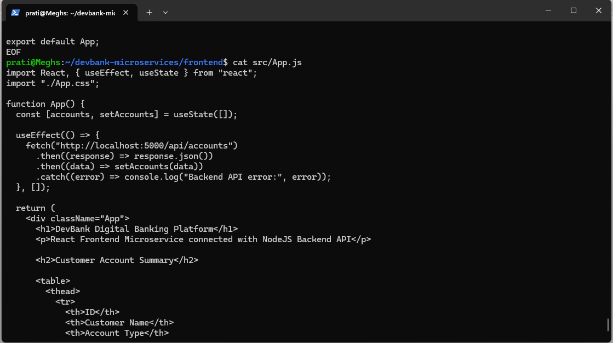

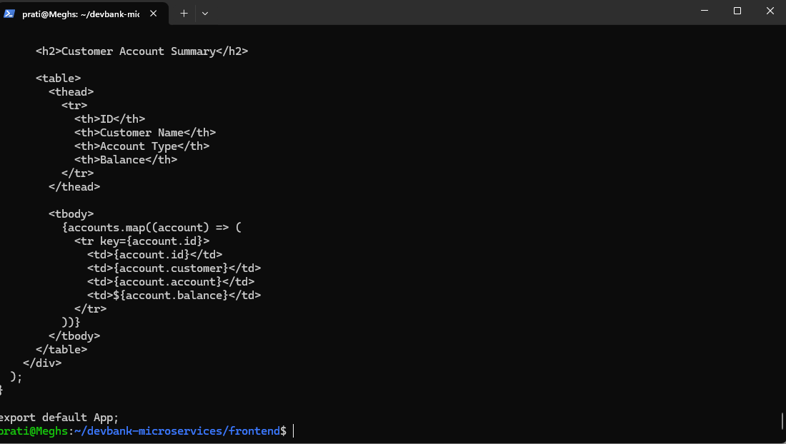

4.4 Add CSS Styling

Run:

```text
cat > src/App.css <<'EOF'
.App {
  text-align: center;
  font-family: Arial, sans-serif;
  background-color: #f4f7fb;
  min-height: 100vh;
  padding: 40px;
}

h1 {
  color: #003366;
}

p {
  color: #333;
  font-size: 18px;
}

table {
  margin: 30px auto;
  width: 80%;
  border-collapse: collapse;
  background-color: white;
}

th {
  background-color: #003366;
  color: white;
}

td, th {
  border: 1px solid #ccc;
  padding: 12px;
}
EOF
```

Verify:

```text
cat src/App.css
```

Screenshot 4.4

Take screenshot showing App.css.

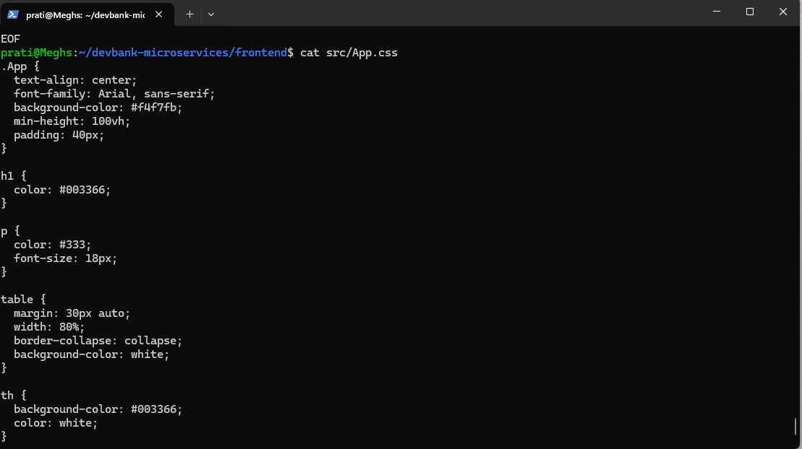

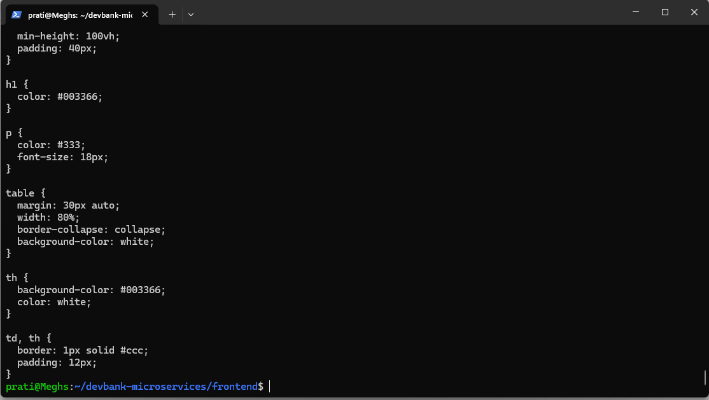

4.5 Run React Frontend Locally

Make sure backend is running first.

In one Ubuntu terminal:

```text
cd ~/devbank-microservices/backend
node server.js
```

In another Ubuntu terminal:

```text
cd ~/devbank-microservices/frontend
npm start
```

Expected output:

```text
Compiled successfully
Local: http://localhost:3000
```

Open browser:

http://localhost:3000

Screenshot 4.5

Take screenshot of browser showing:

```text
DevBank Digital Banking Platform
Customer Account Summary
```

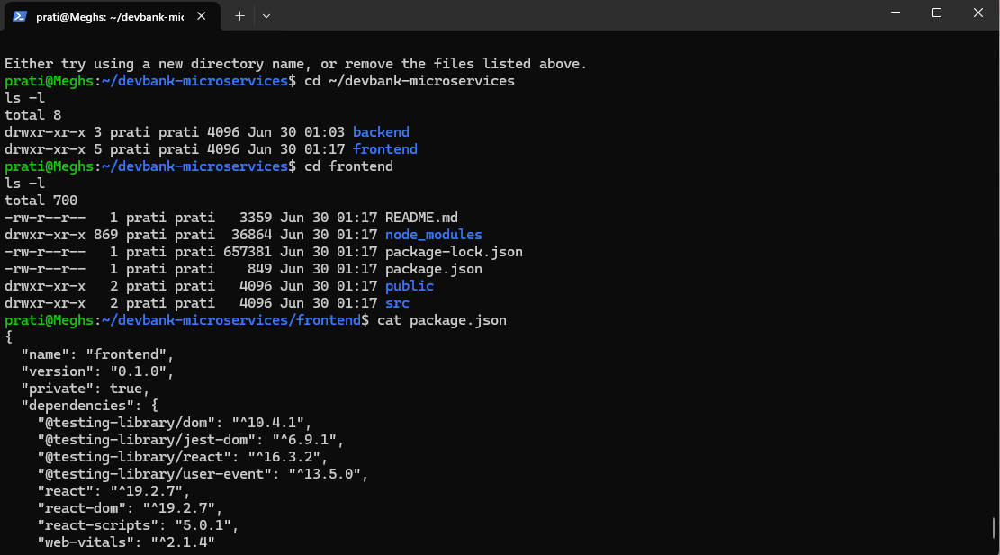

Step 4.4 – Replace React App Code

Run inside Ubuntu:

```text
cd ~/devbank-microservices/frontend

cat > src/App.js <<'EOF'
import React, { useEffect, useState } from "react";
import "./App.css";

function App() {
  const [accounts, setAccounts] = useState([]);

  useEffect(() => {
    fetch("http://localhost:5000/api/accounts")
      .then((response) => response.json())
      .then((data) => setAccounts(data))
      .catch((error) => console.log("Backend API error:", error));
  }, []);

  return (
    <div className="App">
      <h1>DevBank Digital Banking Platform</h1>
      <p>React Frontend Microservice connected with NodeJS Backend API</p>

      <h2>Customer Account Summary</h2>

      <table>
        <thead>
          <tr>
            <th>ID</th>
            <th>Customer Name</th>
            <th>Account Type</th>
            <th>Balance</th>
          </tr>
        </thead>

        <tbody>
          {accounts.map((account) => (
            <tr key={account.id}>
              <td>{account.id}</td>
              <td>{account.customer}</td>
              <td>{account.account}</td>
              <td>${account.balance}</td>
            </tr>
          ))}
        </tbody>
      </table>
    </div>
  );
}

export default App;
EOF

cat src/App.js
```

📸 Screenshot 4.4: App.js code.

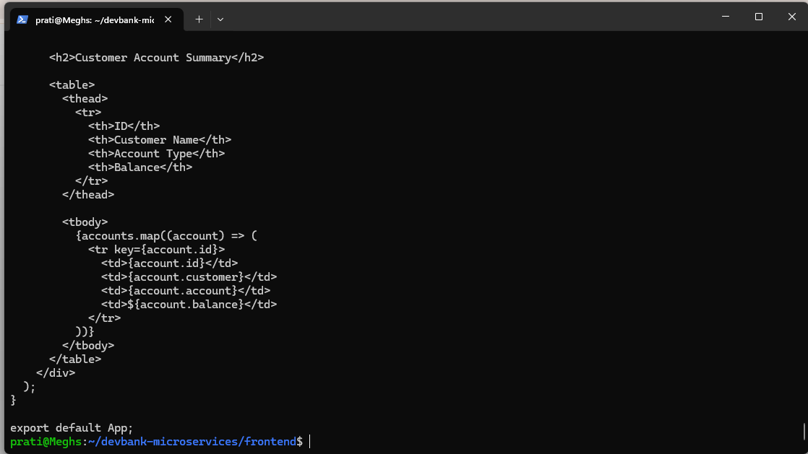

Step 4.5 – Add Styling

```text
cat > src/App.css <<'EOF'
.App {
  text-align: center;
  font-family: Arial, sans-serif;
  background-color: #f4f7fb;
  min-height: 100vh;
  padding: 40px;
}

h1 {
  color: #003366;
}

p {
  color: #333;
  font-size: 18px;
}

table {
  margin: 30px auto;
  width: 80%;
  border-collapse: collapse;
  background-color: white;
}

th {
  background-color: #003366;
  color: white;
}

td, th {
  border: 1px solid #ccc;
  padding: 12px;
}
EOF

cat src/App.css
```

📸 Screenshot 4.5: App.css code.

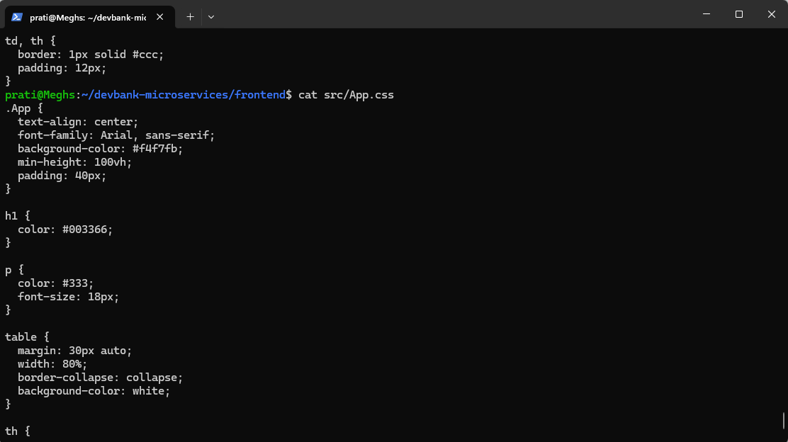

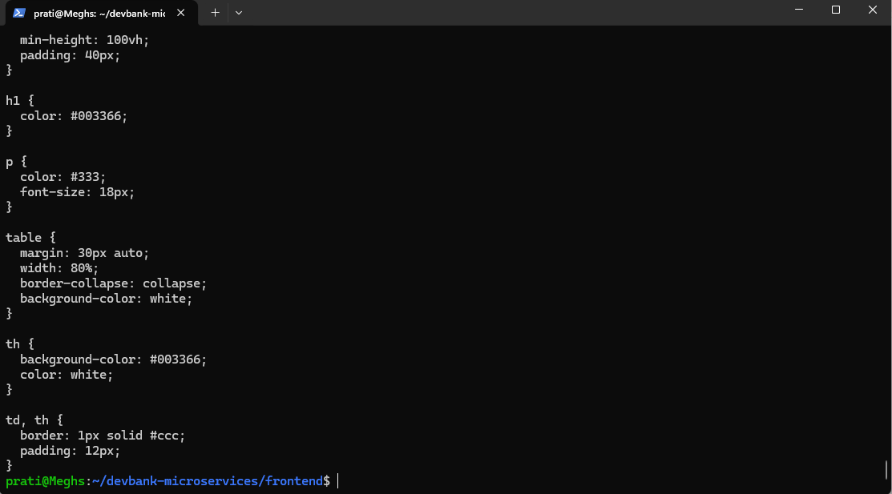

Step 4.6 – Run Frontend Locally

```text
Terminal to use: Ubuntu WSL
Browser to use: Chrome / Edge on Windows
```

Description

In this step, we will run both microservices locally:

Backend NodeJS API on:

http://localhost:5000

Frontend React app on:

http://localhost:3000

The React frontend will call the backend API and display DevBank customer account data.

Why this step is required

Before Docker and AWS deployment, we must prove that the frontend and backend work together locally. This confirms that:

React Frontend → calls → NodeJS Backend API → returns banking account data

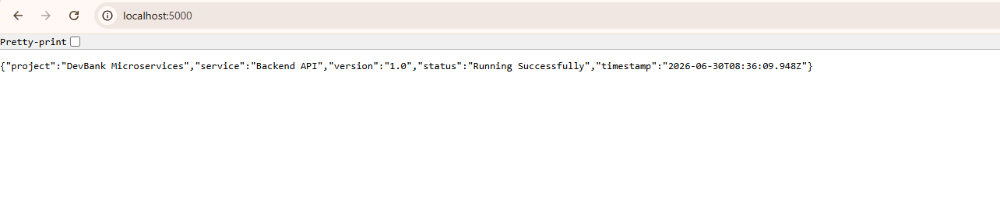

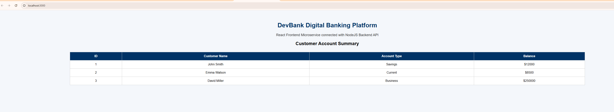

STEP 5 – Dockerize React Frontend Microservice

Terminal to Use

Ubuntu WSL

Description

In this step, we will package the React frontend into a Docker container. The React app will be built into static production files and served using Nginx. This is how frontend applications are commonly deployed in real production environments.

Why this step is required

Amazon ECS Fargate runs containers, so the frontend must be converted into a Docker image before deployment. This image will later be pushed to Amazon ECR and deployed as the frontend-service.

Step 5.1 – Stop the React Development Server

Terminal to Use

Ubuntu (where npm start is running)

Description

When you run:

```text
npm start
```

React starts a development server and keeps the terminal busy. Before we build a Docker image, we should stop this development server so that port 3000 is free.

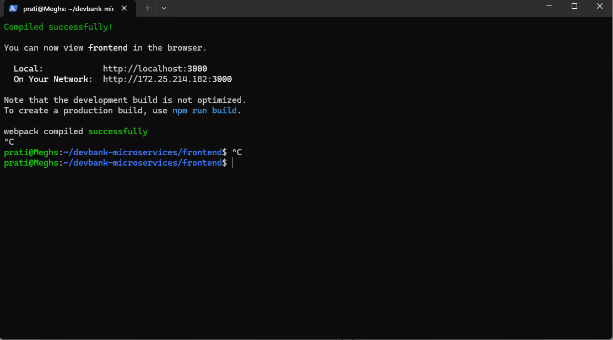

Step 5.1 – Go to Frontend Folder

Run:

```text
cd ~/devbank-microservices/frontend
pwd
```

Expected output:

/home/prati/devbank-microservices/frontend

📸 Screenshot 5.1: Frontend folder path.

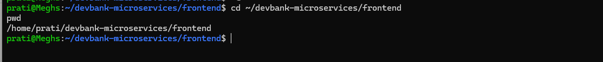

Step 5.2 – Create Frontend Dockerfile

Run this full block:

```text
cat > Dockerfile <<'EOF'
FROM node:20-alpine AS build

WORKDIR /app

COPY package*.json ./

RUN npm install

COPY . .

RUN npm run build

FROM nginx:alpine

COPY --from=build /app/build /usr/share/nginx/html

EXPOSE 80

CMD ["nginx", "-g", "daemon off;"]
EOF
```

Verify:

```text
cat Dockerfile
```

📸 Screenshot 5.2: Dockerfile content.

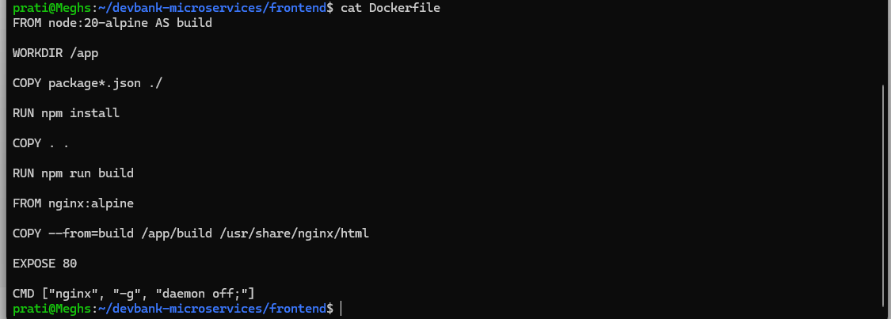

Step 5.3 – Build Frontend Docker Image

Run:

```text
docker build -t devbank-frontend .
```

Expected output:

Successfully tagged devbank-frontend:latest

📸 Screenshot 5.3: Docker build successful.

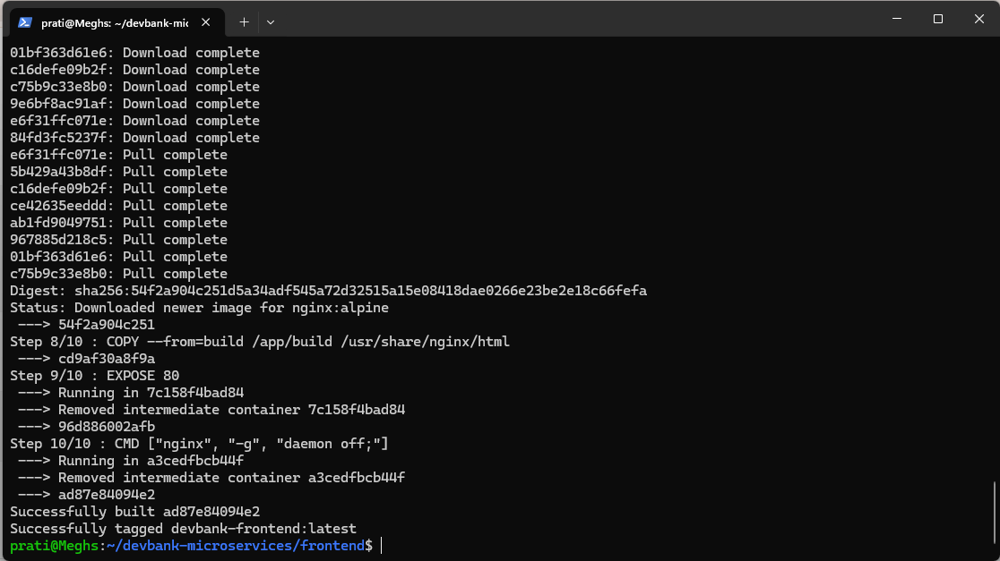

Step 5.4 – Verify Docker Image

Run:

```text
docker images
```

Expected output should show:

devbank-frontend   latest

📸 Screenshot 5.4: Docker image list.

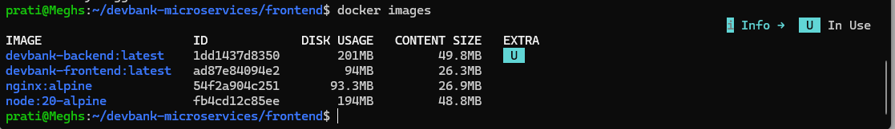

Step 5.5 – Run Frontend Container

Run:

```text
docker run -d -p 3000:80 --name devbank-frontend-container devbank-frontend
```

Verify:

```text
docker ps
```

Expected output:

devbank-frontend-container   0.0.0.0:3000->80/tcp

📸 Screenshot 5.5: Frontend container running.

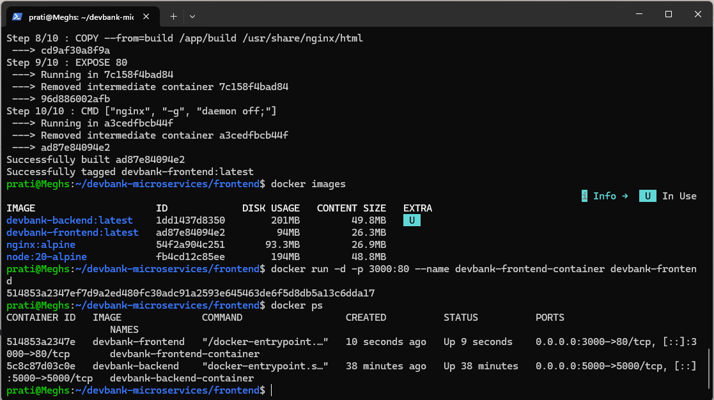

Step 5.6 – Test in Browser

Open Chrome or Edge:

http://localhost:3000

Expected output:

```text
DevBank Digital Banking Platform
Customer Account Summary
```

📸 Screenshot 5.6: React frontend running from Docker container

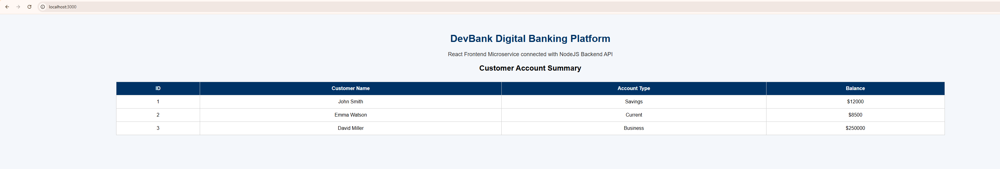

The React frontend microservice was successfully containerized using Docker. A multi-stage Dockerfile was created to build the React application and serve it using Nginx. The Docker image was built, executed as a container, and validated in the browser. This confirms that the frontend is ready for GitHub, Amazon ECR, and ECS Fargate deployment.

STEP 6 – Push Backend and Frontend Code to GitHub

Terminal to Use

Ubuntu WSL

Description

In this step, we will push both microservices to GitHub. GitHub will act as the source code repository for AWS CodePipeline.

Why this step is required

```text
AWS CodePipeline needs a source location. In this project:
```

GitHub → CodePipeline → CodeBuild → ECR → ECS Fargate

Whenever you push code to GitHub, CodePipeline will automatically start the build and deployment proces

6.1 Create GitHub Repositories

Go to GitHub in browser and create two public or private repositories:

```text
devbank-backend
devbank-frontend
```

Do not add README, .gitignore, or license while creating.

📸 Screenshot 6.1: GitHub showing two empty repositories.

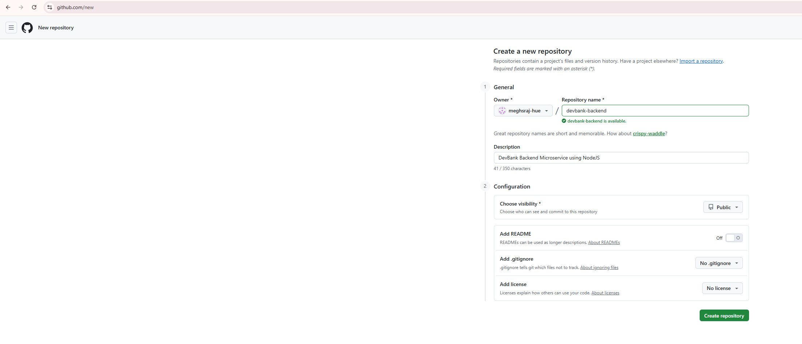

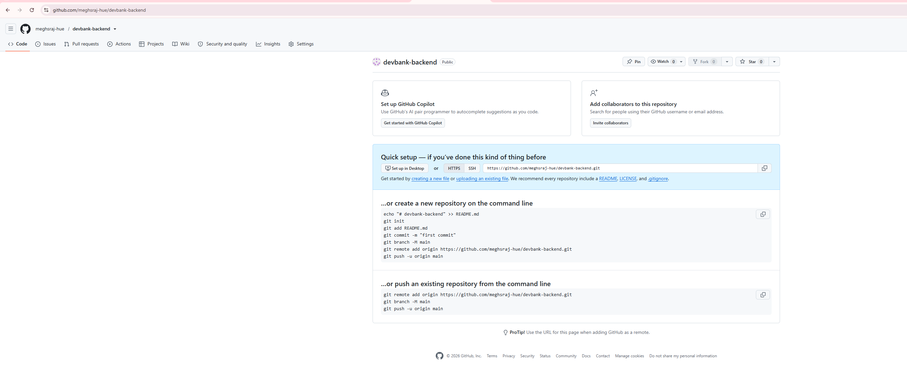

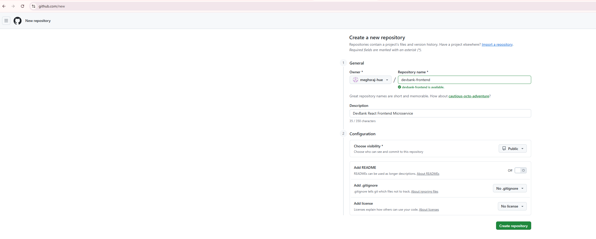

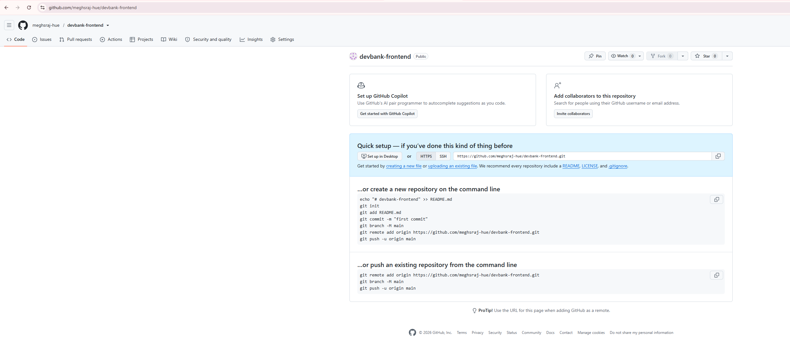

STEP 6.2 – Push Backend Code to GitHub

```text
Terminal to use: Ubuntu WSL
GitHub repo needed: devbank-backend
```

Description

Now we will upload your local backend microservice code to GitHub. This repository will become the source stage for AWS CodePipeline later.

Why this step is required

```text
AWS CodePipeline needs source code from GitHub. When code is pushed to GitHub, CodePipeline will automatically pull it, build a Docker image, push it to ECR, and deploy it to ECS.
```

1. Go to backend folder

```text
cd ~/devbank-microservices/backend
pwd
ls
```

Expected files:

```text
Dockerfile
package.json
package-lock.json
server.js
```

📸 Screenshot 6.5: Backend folder files.

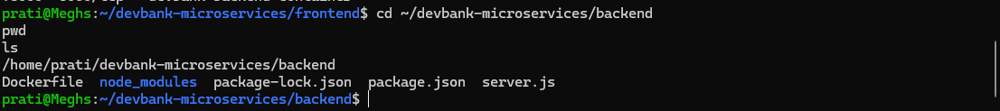

2. Configure Git user

Replace with your real GitHub email.

```text
git config --global user.name "Prati"
git config --global user.email "YOUR_EMAIL@example.com"
git config --global --list
```

📸 Screenshot 6.6: Git username and email configured.

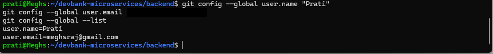

Initialize Git and commit backend code

```text
git init
git add .
git commit -m "Initial backend microservice"
```

📸 Screenshot 6.7: Backend commit successful.

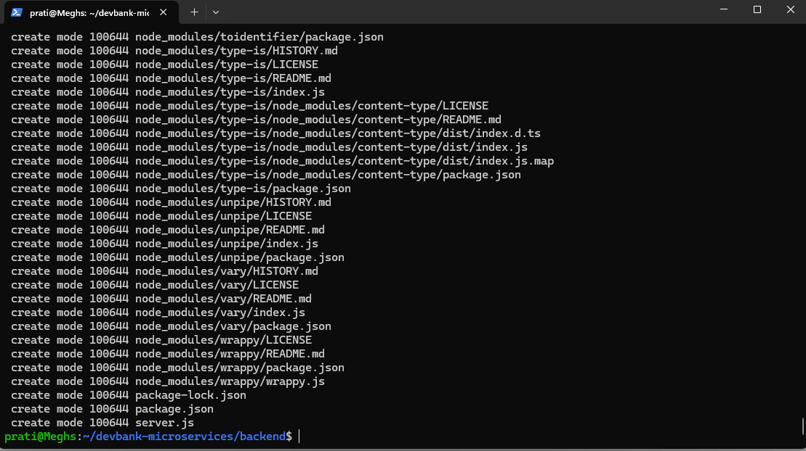

Step 6.2.5 – Rename the Git Branch to main

Terminal to Use

Ubuntu WSL

Description

```text
Git repositories used by GitHub typically use main as the default branch. AWS CodePipeline will also be configured to monitor the main branch.
```

Command

Run:

```text
git branch -M main
```

Verify:

```text
git branch
```

Expected Output

* main

📸 Screenshot 6.12: Terminal showing the current branch is main.

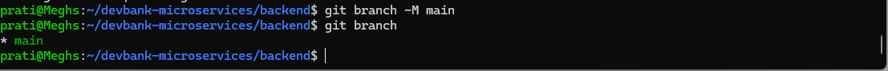

Step 6.2.6 – Connect Backend Repository to GitHub

Description

Now we will link your local backend project with the GitHub repository you created (devbank-backend).

First, tell me your GitHub username

From your screenshot, I can see an existing repository, but I can't clearly read your GitHub username.

It will look like:

https://github.com/<your-username>

or

<your-username>/devbank-backend

Once you tell me the username, I'll give you the exact commands:

```text
git remote add origin https://github.com/YOUR_USERNAME/devbank-backend.git
git remote -v
git push -u origin main
```

This avoids mistakes with the repository URL.

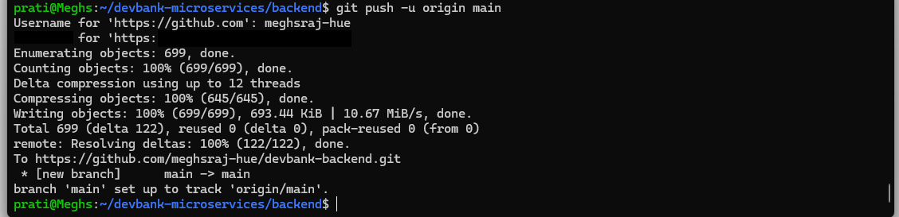

STEP 6.2A – Fix GitHub Authentication and Push Backend

Terminal to Use

Ubuntu WSL + GitHub Browser

Description

GitHub does not allow normal password authentication for Git push. You must use a Personal Access Token as the password.

Why this step is required

```text
AWS CodePipeline will later pull source code from GitHub. If code is not pushed to GitHub, CodePipeline cannot start.
```

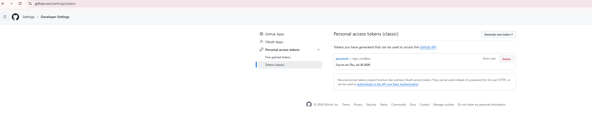

Verify Backend Repo

Open:

https://github.com/meghsraj-hue/devbank-backend

You should see:

```text
Dockerfile
server.js
package.json
package-lock.json
.gitignore
```

📸 Screenshot 6.15: Backend files visible in GitHub.

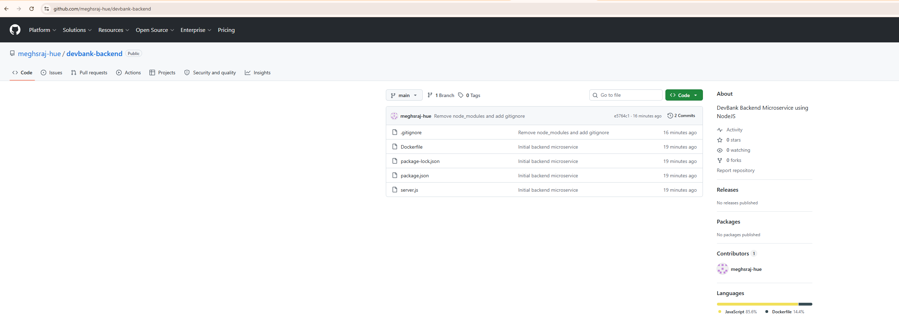

1. Create GitHub Token

In browser:

GitHub → Profile Picture → Settings → Developer settings → Personal access tokens → Tokens classic → Generate new token classic

Select:

```text
repo
workflow
```

Click:

Generate token

Copy the token immediately.

```text
📸 Screenshot 6.14A: Token permission page before generating token.
Do not screenshot or share the actual token.
```

Step 1: Prepare Ubuntu Terminal

```text
sudo apt update -y
sudo apt install -y git unzip curl jq docker.io
sudo systemctl enable docker
sudo systemctl start docker
sudo usermod -aG docker $USER
```

Log out and log in again, then verify:

```text
docker --version
git --version
```

Install AWS CLI:

```text
curl "https://awscli.amazonaws.com/awscli-exe-linux-x86_64.zip" -o awscliv2.zip
unzip awscliv2.zip
sudo ./aws/install
aws --version
```

Configure AWS:

```text
aws configure
```

Use your AWS Access Key, Secret Key, region, and output format:

```text
Region: us-east-1
Output: json
```

Step 2: Create Project Folder

```text
mkdir devbank-microservices
cd devbank-microservices
mkdir backend frontend
```

Step 3: Backend NodeJS Application

```text
cd backend
npm init -y
npm install express cors
```

Create backend file:

```text
cat > server.js <<'EOF'
const express = require("express");
const cors = require("cors");

const app = express();
app.use(cors());
app.use(express.json());

const PORT = process.env.PORT || 5000;

app.get("/", (req, res) => {
  res.json({
    service: "DevBank Backend API",
    status: "running",
    message: "Backend microservice deployed successfully on ECS Fargate",
    timestamp: new Date().toISOString()
  });
});

app.get("/api/accounts", (req, res) => {
  res.json([
    { id: 1, customer: "Aarav Shah", accountType: "Savings", balance: 12500 },
    { id: 2, customer: "Meera Patel", accountType: "Checking", balance: 8400 },
    { id: 3, customer: "DevBank Corporate", accountType: "Business", balance: 95000 }
  ]);
});

app.get("/health", (req, res) => {
  res.status(200).json({ status: "healthy" });
});

app.listen(PORT, () => {
  console.log(`Backend running on port ${PORT}`);
});
EOF
```

Create backend Dockerfile:

```text
cat > Dockerfile <<'EOF'
FROM node:20-alpine
WORKDIR /app
COPY package*.json ./
RUN npm install --only=production
COPY server.js .
EXPOSE 5000
CMD ["node", "server.js"]
EOF
```

Create backend buildspec:

```text
cat > buildspec.yml <<'EOF'
version: 0.2

phases:
  pre_build:
    commands:
      - echo Logging in to Amazon ECR
      - aws ecr get-login-password --region $AWS_DEFAULT_REGION | docker login --username AWS --password-stdin $ACCOUNT_ID.dkr.ecr.$AWS_DEFAULT_REGION.amazonaws.com
      - IMAGE_TAG=$(echo $CODEBUILD_RESOLVED_SOURCE_VERSION | cut -c 1-7)
      - REPOSITORY_URI=$ACCOUNT_ID.dkr.ecr.$AWS_DEFAULT_REGION.amazonaws.com/devbank-backend
  build:
    commands:
      - echo Building backend Docker image
      - docker build -t devbank-backend:$IMAGE_TAG .
      - docker tag devbank-backend:$IMAGE_TAG $REPOSITORY_URI:$IMAGE_TAG
      - docker tag devbank-backend:$IMAGE_TAG $REPOSITORY_URI:latest
  post_build:
    commands:
      - echo Pushing backend image to ECR
      - docker push $REPOSITORY_URI:$IMAGE_TAG
      - docker push $REPOSITORY_URI:latest
      - printf '[{"name":"backend-container","imageUri":"%s"}]' $REPOSITORY_URI:$IMAGE_TAG > imagedefinitions.json

artifacts:
  files:
    - imagedefinitions.json
EOF
```

Test locally:

```text
docker build -t devbank-backend .
docker run -p 5000:5000 devbank-backend
```

Open another terminal:

```text
curl http://localhost:5000
curl http://localhost:5000/api/accounts
```

Screenshot: backend API response.

Step 4: Frontend React Application

```text
cd ../frontend
npx create-react-app .
```

Replace src/App.js:

```text
cat > src/App.js <<'EOF'
import React, { useEffect, useState } from "react";
import "./App.css";

function App() {
  const [accounts, setAccounts] = useState([]);
  const backendUrl = process.env.REACT_APP_API_URL || "http://localhost:5000";

  useEffect(() => {
    fetch(`${backendUrl}/api/accounts`)
      .then((res) => res.json())
      .then((data) => setAccounts(data))
      .catch(() => setAccounts([]));
  }, [backendUrl]);

  return (
    <div className="App">
      <h1>DevBank Digital Banking Platform</h1>
      <p>Frontend React microservice deployed on AWS ECS Fargate</p>
      <h2>Customer Accounts</h2>
      <table>
        <thead>
          <tr>
            <th>ID</th>
            <th>Customer</th>
            <th>Account Type</th>
            <th>Balance</th>
          </tr>
        </thead>
        <tbody>
          {accounts.map((acc) => (
            <tr key={acc.id}>
              <td>{acc.id}</td>
              <td>{acc.customer}</td>
              <td>{acc.accountType}</td>
              <td>${acc.balance}</td>
            </tr>
          ))}
        </tbody>
      </table>
    </div>
  );
}

export default App;
EOF
```

Replace src/App.css:

```text
cat > src/App.css <<'EOF'
.App {
  text-align: center;
  font-family: Arial, sans-serif;
  padding: 40px;
  background: #f4f7fb;
  min-height: 100vh;
}

h1 {
  color: #003366;
}

table {
  margin: 30px auto;
  border-collapse: collapse;
  width: 80%;
  background: white;
}

th {
  background: #003366;
  color: white;
}

td, th {
  border: 1px solid #ccc;
  padding: 12px;
}
EOF
```

Create frontend Dockerfile:

```text
cat > Dockerfile <<'EOF'
FROM node:20-alpine AS build
WORKDIR /app
COPY package*.json ./
RUN npm install
COPY . .
ARG REACT_APP_API_URL
ENV REACT_APP_API_URL=$REACT_APP_API_URL
RUN npm run build

FROM nginx:alpine
COPY --from=build /app/build /usr/share/nginx/html
EXPOSE 80
CMD ["nginx", "-g", "daemon off;"]
EOF
```

Create frontend buildspec:

```text
cat > buildspec.yml <<'EOF'
version: 0.2

phases:
  pre_build:
    commands:
      - echo Logging in to Amazon ECR
      - aws ecr get-login-password --region $AWS_DEFAULT_REGION | docker login --username AWS --password-stdin $ACCOUNT_ID.dkr.ecr.$AWS_DEFAULT_REGION.amazonaws.com
      - IMAGE_TAG=$(echo $CODEBUILD_RESOLVED_SOURCE_VERSION | cut -c 1-7)
      - REPOSITORY_URI=$ACCOUNT_ID.dkr.ecr.$AWS_DEFAULT_REGION.amazonaws.com/devbank-frontend
  build:
    commands:
      - echo Building frontend Docker image
      - docker build --build-arg REACT_APP_API_URL=$BACKEND_URL -t devbank-frontend:$IMAGE_TAG .
      - docker tag devbank-frontend:$IMAGE_TAG $REPOSITORY_URI:$IMAGE_TAG
      - docker tag devbank-frontend:$IMAGE_TAG $REPOSITORY_URI:latest
  post_build:
    commands:
      - echo Pushing frontend image to ECR
      - docker push $REPOSITORY_URI:$IMAGE_TAG
      - docker push $REPOSITORY_URI:latest
      - printf '[{"name":"frontend-container","imageUri":"%s"}]' $REPOSITORY_URI:$IMAGE_TAG > imagedefinitions.json

artifacts:
  files:
    - imagedefinitions.json
EOF
```

Step 5: Push Code to GitHub

Create two GitHub repositories:

```text
devbank-backend
devbank-frontend
```

Push backend:

```text
cd ../backend
git init
git add .
git commit -m "Initial backend microservice"
git branch -M main
git remote add origin https://github.com/YOUR_USERNAME/devbank-backend.git
git push -u origin main
```

Push frontend:

```text
cd ../frontend
git init
git add .
git commit -m "Initial frontend microservice"
git branch -M main
git remote add origin https://github.com/YOUR_USERNAME/devbank-frontend.git
git push -u origin main
```

Screenshot: GitHub repositories with Dockerfile and buildspec.

Step 6: Create ECR Repositories

```text
aws ecr create-repository --repository-name devbank-backend --region us-east-1
aws ecr create-repository --repository-name devbank-frontend --region us-east-1
```

Screenshot: ECR repositories.

Step 7: Create ECS Cluster

```text
AWS Console:
```

Go to ECS → Clusters → Create cluster

Use:

```text
Cluster name: devbank-cluster
Infrastructure: AWS Fargate
```

Click Create.

Screenshot: ECS cluster created.

Step 8: Create Task Execution Role

Go to IAM → Roles → Create role

```text
Trusted entity: AWS service
Use case: Elastic Container Service Task
Policy: AmazonECSTaskExecutionRolePolicy
Role name: ecsTaskExecutionRole
```

Step 9: Create Backend Task Definition

Go to ECS → Task definitions → Create new task definition

Use:

```text
Task family: devbank-backend-task
Launch type: AWS Fargate
CPU: 0.25 vCPU
Memory: 0.5 GB
Execution role: ecsTaskExecutionRole
Container name: backend-container
Image URI: <backend ECR latest image URI>
Port: 5000
```

Step 10: Create Frontend Task Definition

```text
Task family: devbank-frontend-task
Launch type: AWS Fargate
CPU: 0.25 vCPU
Memory: 0.5 GB
Execution role: ecsTaskExecutionRole
Container name: frontend-container
Image URI: <frontend ECR latest image URI>
Port: 80
```

Step 11: Create Security Group

Go to EC2 → Security Groups → Create security group

```text
Name: devbank-sg
Inbound rules:
HTTP 80 from 0.0.0.0/0
Custom TCP 5000 from 0.0.0.0/0
```

Step 12: Create ECS Services

Backend service:

```text
Cluster: devbank-cluster
Service name: backend-service
Launch type: Fargate
Task definition: devbank-backend-task
Desired tasks: 1
Networking: public subnet
Security group: devbank-sg
Public IP: Enabled
```

Frontend service:

```text
Cluster: devbank-cluster
Service name: frontend-service
Launch type: Fargate
Task definition: devbank-frontend-task
Desired tasks: 1
Networking: public subnet
Security group: devbank-sg
Public IP: Enabled
```

Screenshot: ECS services showing backend-service and frontend-service active, matching the expected output in your project PDF.

Step 13: Validate Backend and Frontend

Find public IP:

ECS → Cluster → Service → Tasks → Task → Networking → Public IP

Test backend:

```text
curl http://BACKEND_PUBLIC_IP:5000
curl http://BACKEND_PUBLIC_IP:5000/api/accounts
```

Open frontend:

http://FRONTEND_PUBLIC_IP

Screenshot: React application showing DevBank customer account table.

Step 14: Create CodeBuild Projects

Create backend CodeBuild project:

```text
Project name: devbank-backend-build
Source: GitHub
Repository: devbank-backend
Environment image: Managed image
OS: Ubuntu
Runtime: Standard
Image: latest standard image
Privileged mode: Enabled
Buildspec: buildspec.yml
Environment variables:
ACCOUNT_ID = your AWS account ID
AWS_DEFAULT_REGION = us-east-1
```

Create frontend CodeBuild project:

```text
Project name: devbank-frontend-build
Source: GitHub
Repository: devbank-frontend
Privileged mode: Enabled
Environment variables:
ACCOUNT_ID = your AWS account ID
AWS_DEFAULT_REGION = us-east-1
BACKEND_URL = http://BACKEND_PUBLIC_IP:5000
```

```text
AWS CodeBuild can build Docker images and push them to ECR, but privileged mode is required for Docker builds. AWS also provides official Docker-to-ECR CodeBuild examples.
```

Step 15: Create CodePipeline for Backend

Go to CodePipeline → Create pipeline

```text
Pipeline name: devbank-backend-pipeline
Source provider: GitHub
Repository: devbank-backend
Branch: main
Build provider: CodeBuild
Build project: devbank-backend-build
Deploy provider: Amazon ECS
Cluster: devbank-cluster
Service: backend-service
Image definitions file: imagedefinitions.json
```

Step 16: Create CodePipeline for Frontend

```text
Pipeline name: devbank-frontend-pipeline
Source provider: GitHub
Repository: devbank-frontend
Branch: main
Build provider: CodeBuild
Build project: devbank-frontend-build
Deploy provider: Amazon ECS
Cluster: devbank-cluster
Service: frontend-service
Image definitions file: imagedefinitions.json
```

Screenshot: CodePipeline source, build, and deploy stages succeeded.

Step 17: Real-Time Change Test

Change backend response:

```text
cd backend
sed -i 's/deployed successfully/deployed automatically through CodePipeline/g' server.js
git add .
git commit -m "Update backend message"
git push
```

Then go to CodePipeline and verify the pipeline starts automatically.

After deployment:

```text
curl http://BACKEND_PUBLIC_IP:5000
```

Screenshot: Updated backend message after automatic deployment.

Innovative Additions for Better Submission

Add these to make your project look more real-time and professional:

```text
1. Health check endpoint: /health
2. Banking sample account API: /api/accounts
3. React frontend calling backend API
4. CloudWatch logs for backend and frontend containers
5. Separate pipelines for backend and frontend
6. Independent scaling of services
7. Screenshot of automatic deployment after GitHub commit
```

Final Project Conclusion

This project successfully implemented a production-style microservices deployment for DevBank using AWS CodePipeline and Amazon ECS Fargate. The backend NodeJS API and frontend React application were containerized using Docker, stored in Amazon ECR, and deployed as independent ECS services. CodePipeline automated the full CI/CD process from GitHub commit to ECS deployment, reducing manual release effort and improving deployment consistency. The final output confirms that both backend and frontend services are running successfully on public endpoints, demonstrating a scalable, high-availability, cloud-native deployment model suitable for real financial technology applications.

## Tables and recorded configurations

### Source table 1
Microservice | Responsibility
Customer Service | Customer details
Account Service | Account information
Transaction Service | Money transfer
Loan Service | Loan processing
Notification Service | Email and SMS
